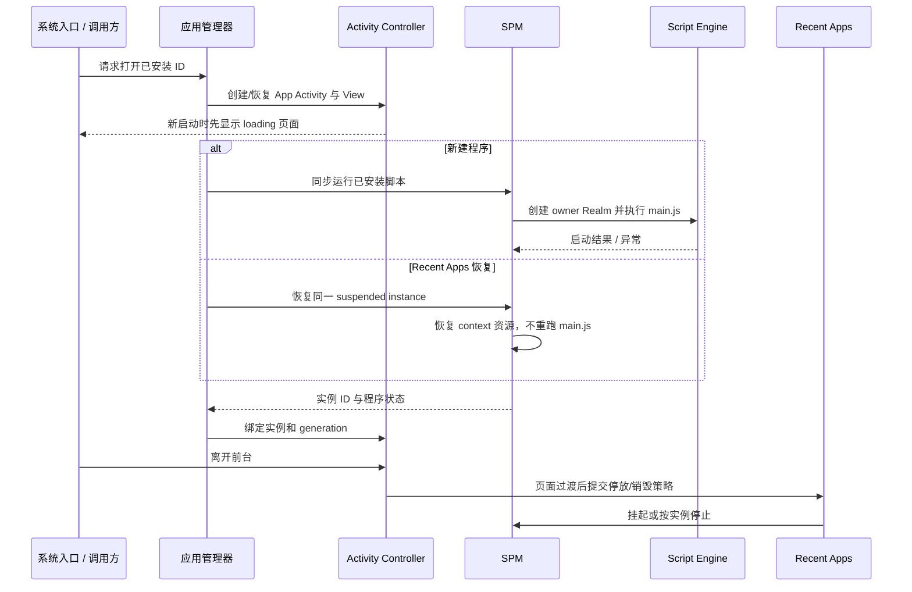

# Application 与 Framework 契约

本页定义应用和 Framework 开发者可以依赖的系统边界。系统内建 C 应用通过 Activity、服务和 UI 组件工作；脚本应用使用 EPKG 身份，并且只能经 SNI 暴露的 `eos`/`lv` 接口访问 Core。两者都不能持有 Vendor 驱动或设备操作表。SPM 只拥有脚本 Application/Watchface 的程序与 Realm 生命周期，不是所有内建 C 页面生命周期的统一入口。

## 启动身份与运行实例

安装包的 `manifest.json` ID 是应用/表盘身份。启动请求针对该 ID，而不是文件名或显示名称。应用管理器负责验证已安装身份并将请求交给 SPM；SPM 独占 Script Engine Core 和 Realm 生命周期。一个 ID 同时只能有一个未终止的脚本程序：前台切换通常恢复已有实例，不能另起第二个 Realm。

包安装从单一 EPKG 上下文开始：读元数据可用于预览；安装还必须完整校验所有条目，再按 `package_type` 解包并更新安装身份。预览成功、传输完成或包文件存在都不等于安装成功；调用方应使用安装结果和事件确定最终状态。

全新应用启动时，Activity 先建立加载页面，随后 `spm_app_run` 在调用线程同步执行脚本；脚本初始化期间主循环不能处理普通 UI 工作，加载遮罩只能提供绘制反馈，不能让 JS 并行运行。程序恢复则复用 Recent Apps 保存的同一实例和 Realm，不重新执行 `main.js`，也不重复创建并行副本。表盘使用根 Activity 替换流程，由表盘管理器经 SPM 完成程序切换。

页面过渡和程序生命周期是两件事。Activity 可以暂停或销毁页面而保留程序；Recent Apps 挂起时，程序及部分资源仍可能存在；驱逐、卸载、根表盘替换或致命引擎复位才进入完整停止。应用不得直接调用 `script_engine` 启动、恢复或清理脚本程序。

## 能力的消费模型

| 能力 | 应用侧交互 | 有效性与结束责任 |
|---|---|---|
| 传感器（Native Core） | Pull FIFO/latest，或 Push 订阅回调；有采样需求时由服务仲裁。 | latest 无样本返回无效/未找到；零值仍可有效。回调参数只在同步通知期间借用；Native 订阅应由注册 owner 在不再使用时取消。 |
| 传感器（JS） | 当前没有原始 Sensor 订阅接口；可读 `eos.sensor` 缓存，或使用 `eos.metric` 语义值。 | Metric 样本带 `valid`/`stale`；订阅绑定程序 SNI context，不保证每次回调触发一次硬件采样。`eos.sensor.setSamplePeriod` 走每类型单一的兼容需求，不是按脚本/应用隔离的 demand；多个调用方会共享并更新它。 |
| 电池 | Native Pull 当前快照，或订阅变化事件；Metric 提供语义电量值。 | 未收到有效报告前为无效；百分比/充电事件按阈值变化触发，不是每个硬件采样都广播。 |
| Metric | Pull 一次，或由 SNI timer 周期性通知。 | SNI 保存 owner program/generation；程序不活动时不会调用 JS，退订或 context 清理释放订阅。Activity 单独销毁不会自动代表程序销毁；不需要的数据需求应由应用主动取消。 |
| 系统事件（Native Framework） | C 模块可订阅安装、电源、页面等状态变化。 | `eos_event_post` 是同步广播，参数在回调期间借用；回调返回后要保留数据必须复制。取消订阅属于订阅模块责任。当前 JS 没有通用 Event Bus API，只能使用各个已注册的专用回调接口。 |
| 权限请求 | JS 请求由授权界面异步完成，结果通过脚本回调返回；Native 服务返回授权状态。 | 请求可能被拒绝、排队或因程序上下文失效而无法回调；发起请求本身不表示授权已完成。 |
| 音频 | 播放/录音请求同步返回是否成功启动；PCM 供数和硬件输出随后继续。 | 扬声器与麦克风 capability 独立；当前没有通用 JS 播放完成回调契约。播放资源由服务持有，应用通过服务停止或暂停。 |
| 时间 | Service 同步 Pull 平台日期时间。 | Core 没有时钟更新 Push 流或统一校时完成事件；时区/校时来源属于平台。 |
| 显示 / 电源 | Framework 请求亮度、休眠、AOD 或唤醒；电源状态变化由同步系统事件观察。 | 软件状态不等于物理硬件确认；部分操作是 void/fire-and-forget，具体平台 capability 可能缺失。 |
| 触觉 | Framework 请求 tick/buzz/long-vibration 等反馈意图。 | 设备操作无返回值，当前没有逐次振动完成/失败事件；应用不能确认物理反馈已发生。 |
| 文件与配置 | 文件/JSON 操作是同步路径操作；`eos.config` 使用当前脚本 ID 构造应用/表盘配置文件。 | 句柄关闭后失效，动态值按所属 API 释放。通用 Storage API 不因脚本身份自动隔离路径，路径前缀本身不构成沙箱。 |
| 状态 / 日志 | State 是同步读取和更新持久状态；Log 通过 listener 收到格式化消息。 | 日志 listener 同步执行且消息 buffer 只在 callback 内有效；系统状态不是应用配置；日志无后台队列保证。 |
| 通知 | 当前没有通用应用通知投递 API、notification broker 或持久化队列。 | `notification` 权限类别和消息列表 UI 不代表应用可以发布/读取系统通知。 |

Metric 当前有一个可见的有效性例外：`battery.charging` 会把 Battery Service 的无效/未初始化状态折成 `false`，并仍标记为有效。JS 若需要判断电池读数是否存在，应同时检查 `battery.percent.valid`；Native 可用 Battery State 的 validity 查询。该行为是当前实现限制，不是所有布尔 Metric 的一般规则。

Native Sensor 的 Push 回调在调用 `eos_sensor_notify` 的上下文同步执行；若 Vendor 从 ISR 进入通知，所有消费者也会在该上下文执行。因此平台应在能安全执行 Core 回调的 task/主循环上下文发布；中断只应采集/排队，除非整个下游路径明确可在 ISR 运行。JS metric 回调由 LVGL timer 在 Core 主循环派发，并进入所属 Realm。

## 页面、程序与回调的清理

- Activity 拥有页面 View；View 删除使其 LVGL 子对象、tree-node 句柄和页面回调失效。旧 View 指针不能跨越 destroy 或根替换保存使用。
- SPM 拥有脚本程序、Realm 和程序级 SNI context。停止/复位会使旧 generation 的 JS 句柄与回调全部失效；SNI 在回调进入时再次验证 owner、状态和 generation。
- Activity pause 与 SPM suspend 不等价。程序被 Recent Apps 保留期间，脚本可订阅对象仍可能存活；需要停止硬件/服务需求时，应在生命周期回调中明确取消或释放。
- Native callback 的 `user_data`、事件 `param` 和同步传入的数据指针由订阅者按契约管理；系统不会仅因 Activity 被销毁就自动发现任意 C 指针并注销它。
- 超时、无设备、未授权、无样本和脚本异常是不同结果。应用应使用结果/状态/有效性字段分支，不能以零、空对象或未发生回调推断成功。

## 应用开发不应绕过的边界

- 使用 Activity Controller 管理页面；不能直接改 Activity 栈、删除系统管理的 View 或重新挂接停放页面。
- 使用服务或已注册 SNI 接口访问传感器、音频、存储、电源与显示；不依赖设备查找顺序或 Vendor 实现细节。
- 新增 JS API 只能通过 SNI 描述和 owner-bound callback/resource 路径暴露；不暴露裸 native pointer。
- EPKG preview 只适用于展示元数据，不能代替完整校验和安装结果。

细节见[Activity](./framework/activity)、[应用管理](./framework/app)、[Recent Apps](./framework/app/recent_apps)、[脚本运行时与 SNI](./runtime)和对应服务页。
