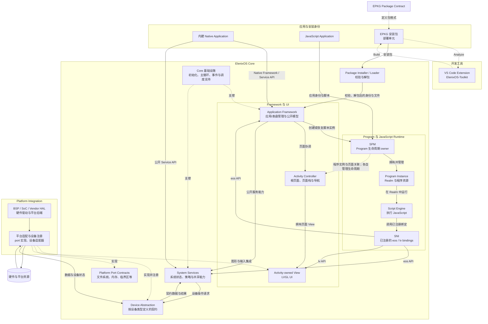

# 系统架构

ElenixOS 由可移植的 Core 和平台集成组成。Core 定义应用模型、程序与页面管理、系统服务、设备契约及基础运行接口；平台集成把这些接口连接到具体 SoC、BSP、Vendor HAL 和硬件。应用依赖 Core 提供的公开模型与能力，不依赖某个芯片或驱动。平台差异收敛在接口实现和设备能力中，由对应契约传达给 Core。

脚本 Application 和 Watch Face 以安装包作为部署单元。EPKG 格式契约定义安装身份、程序与资源文件的封装方式以及校验边界；Installer / Loader 按契约校验并解包，运行时消费安装后的应用身份和文件。EPKG 是开发工具与系统安装器共同使用的 Package Contract，不属于运行时或 Platform 的私有格式。格式定义见 [EPKG v1 安装包格式](./package_format)，应用运行模型见[应用管理模块](./framework/app)。

理解 ElenixOS 时，应把它看作多个相互协作、但由不同 owner 管理的架构域，而不是单一的“应用调用驱动”层链。下图给出主要关系：Program/Runtime、Activity/UI 和系统服务是 Core 中不同的部分；虚线表示平台实现 Core 定义的接口；数据与状态可以沿控制请求的反方向返回。

## 核心架构思想

- **Core 与平台实现分离。** Core 面向自身定义的 port 和设备契约；平台工程实现这些契约并接入 SoC/BSP。Core 和应用不以 Vendor 类型或寄存器接口作为依赖。
- **应用与硬件隔离。** 应用通过 Framework 和公开 Service API 使用系统能力。脚本应用只能经 SNI 访问已注册的 Native API。应用不直接调用设备操作表或驱动。
- **策略与机制分离。** Service 保有系统状态、共享策略和跨消费者协调；设备契约规定 Core 与平台实现之间的操作和数据语义；平台负责实际硬件操作与平台后端。
- **对象按 owner 管理。** Program、Activity/View、Service 状态和平台注册设备有各自的生命周期 owner。一个对象被另一层引用或关联，不意味着所有权转移。
- **能力按契约表达。** 平台能力并不假定处处相同。能力缺失、操作失败或数据无效的表达由相应设备类型和 Service 契约定义；上层按公开结果处理。
- **上层依赖稳定边界。** Application、Service 扩展和平台移植分别经 Framework/Service API、Core 扩展点、Device/port 契约进入系统，不把平台差异传播到应用模型。

## 架构域

| 架构域 | 解决的问题与主要对象 | 不负责什么 |
|---|---|---|
| Application 与安装身份 | 表示内建 Native 应用或已安装脚本应用的稳定身份、manifest 和文件。EPKG 是交付/安装单元；Installer 校验并解包后，Application Framework 管理已安装身份与资源。 | 不等同于一次运行实例、一个 Activity 或一棵 View。包内区域定义见[EPKG v1 安装包格式](./package_format)。 |
| Program 与 JavaScript Runtime | 对脚本应用创建和管理 Program Instance、Realm、SNI context，并执行 JavaScript。SPM 管程序生命周期，Script Engine 执行脚本，SNI 提供受控的 JS/Native 边界。 | 不管理全局 Activity 页面栈，也不代替 Service 的系统策略。内建 Native 应用通常没有 SPM Program。 |
| Activity 与 UI | 表示系统根页面、导航页面及其进入、暂停、恢复和销毁；Activity Controller 管理页面关系，Activity 拥有其 View，View 根植于 LVGL 对象树。 | 不拥有 JavaScript Realm；Activity 不是 Program 的别名。 |
| Application Framework | 提供面向应用的高层模型，并协调应用/表盘身份、启动入口、页面导航及公开系统能力。它把 Program 管理交给 SPM，把页面关系交给 Activity Controller。 | 不直接实现芯片驱动，也不接管 Service 或页面对象的生命周期。 |
| System Services | 为系统和应用提供共享能力，并在需要时持有状态、缓存、策略、需求仲裁或调度。Native Framework 可使用公开 Service API，脚本应用经 SNI 使用已注册的对应 API。 | 不提供某块板子的硬件实现；Service 的策略不应搬到 Vendor 驱动中。 |
| Device Abstraction 与 port 接口 | Device Contract 按设备类型定义 Core 与设备实现间的操作、状态和数据边界；port contract 提供文件系统、内存、临界区等平台基础接口。 | 不定义应用语义，也不意味着所有设备共用一种注册、热插拔或关闭流程。 |
| Platform Integration | 组合平台启动、port 实现、设备注册、设备适配器和 BSP/Vendor 后端，将 Core 契约接到目标硬件。 | 不决定应用权限、页面切换、Program 状态或 Service 策略。 |
| Core 基础设施 | 为 Core 子系统提供初始化、主循环、内存、事件和调度等通用支撑。 | 不替代应用/页面/设备 owner，也不构成所有异步行为都适用的统一队列。 |

图中的 Core 边界由 Framework/UI、Program Runtime、Services、Device Abstraction、port contracts 和基础设施共同构成。Device 与 port 接口属于 Core 的抽象面；接口的具体实现位于 Platform Integration。某项设备操作是否可选、缺失如何发现、状态如何回报，则看该类型自己的契约，不能从一张通用注册图推导。

## Application、Program、Activity 与 View

这几个概念描述不同阶段和不同对象：

| 概念 | 含义 | 主要 owner |
|---|---|---|
| Package | EPKG 安装容器，包含安装身份 metadata、入口脚本和随包文件。安装会校验并展开其内容。 | Package / Installer |
| Installed Application | 已安装并可由稳定 ID 发现、排序和启动的应用身份及文件。内建 Native Application 可以不以脚本包安装。 | Application Framework |
| Program Instance | 一次脚本应用或表盘的可执行实例，关联稳定应用 ID、实例 ID、Realm 和 SNI context。相同 ID 不并行建立第二个未终止脚本实例。 | SPM |
| Activity | 一个系统或应用页面及其在根页面/页面栈中的状态。一个 Activity 通常拥有一个页面 View。 | Activity Controller 与所属页面流程 |
| View | Activity 的 LVGL 页面根对象及其 UI 子树。父对象删除可使子对象及引用句柄失效。 | Activity / LVGL 对象树 |
| JS Realm | Program 执行 JavaScript 的隔离上下文。SNI 在此 Realm 中安装受支持的 Native bindings。 | Program / SPM 与 Script Engine 协作 |

脚本应用的 Program 可以关联应用 Activity 及其子页面；一个 Program 经历多个页面状态时，不因此变成多个 Program。反过来，系统页面或内建 Native Activity 也可以存在而没有脚本 Program。应用身份在多次启动间稳定，Program Instance 则代表其中一次尚未终止的执行生涯。

切换前台页面首先改变 Activity/UI 状态；Recent Apps 等上层流程再决定程序和页面是暂时停放以便恢复，还是被完整驱逐。恢复会重新附接原有实例和页面状态，而不是把 Activity 当成 Realm 重建。销毁时，Activity Controller 清理页面对象，SPM 清理 Program/Realm/SNI 资源，关联资源按各自 owner 的合同收尾。

## Runtime 与 Native System 边界

JavaScript Runtime 位于 Core 的脚本执行域中。应用代码在 Program 所属 Realm 中由 Script Engine 执行；SPM 创建、恢复、挂起和停止 Program，并协调该实例关联的运行时资源。SNI 是 Realm 与 Native System 之间的边界：它只向脚本安装已注册的 `eos`、`lv` 等 bindings，并将参数、返回值、句柄和回调按绑定合同带入 Native 实现。

因此，JS 应用不能因为某个 Native C 函数存在就直接调用它；只有明确注册并成为脚本 API 的能力才对 JS 可见。Native 资源仍由其 Native owner 管理，JS 引用本身不转移 Activity、View、Service 或设备对象的所有权。页面对象和脚本程序结束时，分别沿页面与 SNI/Program 的 owner 路径失效和清理。

## Framework、Service、Device 与 Platform

这四者分开存在，是因为它们回答不同问题：

| 部分 | 回答的问题 | 架构责任 |
|---|---|---|
| Framework | 应用以什么系统模型工作？ | 提供应用/表盘模型和高层协作入口；协调页面与程序 owner，不替它们持有所有权。 |
| Service | 哪个系统组件持有共享策略和状态？ | 实现设备无关的服务语义、缓存、请求协调和面向系统/应用的结果。不同 Service 实际持有的状态并不完全相同。 |
| Device Abstraction / Contract | Core 怎样描述某类设备能力？ | 为 Service 与平台实现定义类型化边界、设备状态和对应操作/数据语义。各类型可以采用不同模式。 |
| Platform / Vendor | 如何在目标芯片上实现这些操作？ | 实现 port/device 接口，接入 BSP、HAL、驱动和具体资源，并按设备契约返回数据或状态。 |

典型的能力控制由 Application 发起，经 Framework 或公开 Service API 进入 Service，再通过 Device Contract 到达 Platform 实现；数据与状态由平台取得后，经对应 Device/Service 返回上层。Framework 的高层模型不会取代 Service 策略，Service 不需要知道 Vendor 的芯片细节，Vendor 也不拥有应用级策略。

## 三类彼此独立的生命周期

ElenixOS 不把程序、页面和设备合成一个“应用对象”。独立意味着状态和生命周期 owner 不同，并不表示任何状态组合都合法；Framework、Recent Apps 和各 owner 在跨域操作时负责协调。

| 生命周期 | owner 与管理对象 | 与其他生命周期的关系 |
|---|---|---|
| Program lifecycle | SPM 管脚本 Program、Realm、SNI context，并执行启动、恢复、挂起和停止。 | 页面切换可发生在 Program 仍保留期间；挂起 Program 不等于销毁 Activity/View。 |
| Activity / UI lifecycle | Activity Controller 管根 Activity、页面栈、页面过渡；Activity/View 按页面规则暂停、恢复、停放或销毁。 | Activity 可以属于脚本应用，也可以是无 Program 的 Native/系统页面；页面销毁也不必等同于 Realm 立即销毁。 |
| Device / Service lifecycle | Platform Integration 建立目标平台设备和 port 实现；Core Service 持有自己的状态、缓存和消费者需求。 | 这些系统级对象不随单个应用启动或退出；应用请求或订阅的清理另由相应 Service 合同管理。 |

这种分离允许系统保存可恢复的脚本执行状态、独立处理页面过渡，并在应用切换期间继续提供共享设备能力。涉及多类对象的停放、驱逐和错误恢复必须由相应 owner 协作，不能由调用方任选一套析构顺序。

## 依赖、控制、数据与所有权

一次函数调用只能说明局部控制关系，不能单独说明系统依赖、数据返回或资源归属：

| 关系 | 大致方向 | 说明 |
|---|---|---|
| 架构依赖 | Application 通过 Framework / 公开 Service API 调用 Service；Service 使用 Core 契约访问设备。 | Platform Integration 实现 Core 定义的接口；上层不依赖具体 Vendor。JS 应用经 SNI 使用公开 binding。 |
| 控制请求 | Application 发起请求，Framework / Service 执行策略并调用 Device，Platform 实现设备操作。 | Service 依据自己的策略决定如何使用设备；请求方向不改变接口的 owner。 |
| 数据与状态 | 平台实现提供数据，经 Device / Service 处理后交给 Framework / Application。 | 数据依具体契约校验、规范化、缓存或仲裁；Push、Pull、回调等模型由相应子系统规定。 |
| 生命周期与所有权 | 各对象的 owner 分别管理 | SPM 管脚本程序，Activity Controller 管页面，Service 管自身状态，平台集成管平台实现和注册。相互引用不意味着转移所有权。 |
| 错误传播 | 从发生错误的边界向消费者 | 同步结果、状态、无效数据或异步通知因设备/Service 而异；ElenixOS 没有假定所有硬件都使用同一种成功确认机制。 |

## 系统级稳定边界

- Application 依赖公开 Framework/Service 能力，不依赖 SoC、Vendor HAL、驱动或设备操作表。
- JavaScript 只能通过 SNI 已注册的 bindings 进入 Native System；Native 函数不会自动成为 JS API。
- Program、Activity/View、Service 状态和平台注册设备由不同 owner 管理；跨域协调不能合并或绕过这些 owner。
- Service 保有系统级策略与状态；Platform/Vendor 实现设备机制并遵守类型契约，不接管应用语义。
- 平台能力及其缺失方式由对应 Device/Service 契约表达；移植不能把某块开发板存在的能力默认为所有平台共有。
- 扩展必须选择与能力归属一致的边界：应用入口进入 Application Framework，系统策略进入 Service，硬件能力进入 Device Contract 与平台实现，脚本 API 进入公开 SNI binding。

## 按开发角色继续阅读

- 安装包格式、区域语义、校验与签名预留见[EPKG v1 安装包格式](./package_format)；项目创建、包构建与分析见 [ElenixOS-Toolkit](../development/toolkit)。
- 应用身份、安装、启动及应用可依赖的能力见[Application 与 Framework 契约](./application_contract)。
- 程序状态和跨 Runtime 的生命周期协调见[运行时](./runtime)；JS 与 Native 资源边界见[SNI 架构](./script_engine/sni)。
- 根 Activity、页面栈、View 和页面过渡见[Activity 页面](./framework/activity)。
- 设备类型边界和通用约束见[Device 架构](./device_architecture_design)，具体能力进入[Sensor](./services/sensor)、[Audio](./services/audio)、[存储](./services/storage)等子系统文档。
- 平台注册和移植责任见[Platform / Vendor 契约](./platform_contract)；新增 Service、设备类型或 Native/JS 能力的扩展边界见[Core 开发契约](./core_development_contract)。
