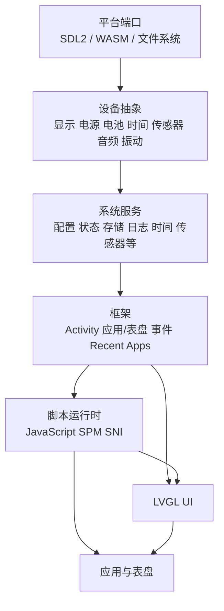

# 系统架构

当前模拟器中的 ElenixOS 可以按“平台端口—设备—服务—框架—应用”理解。脚本应用和表盘通过框架 API 使用服务和 UI；它们不直接依赖平台设备接口。

## 平台与设备

平台端口为显示、输入、时间、文件系统、内存和临界区等能力提供当前平台实现。设备抽象把显示器、电源、电池、时间、传感器、扬声器、麦克风和振动器的操作与状态暴露给服务。模拟器的 Native 平台使用 SDL2；WASM 平台使用浏览器虚拟文件系统和 Emscripten。

设备接口不是应用接口。移植或平台实现负责注册设备操作并报告状态，应用应通过相应服务访问能力。传感器是可注册多个实例的设备类型，其余当前设备接口主要以单例设备提供。

## 服务

服务把设备能力整理为面向系统和应用的操作：

| 服务 | 主要能力 |
|---|---|
| 显示/电源/触觉 | 亮度、屏幕电源、休眠/AOD、振动 |
| 电池/传感器/时间 | 电量、传感器读取与订阅、日期时间 |
| 音频 | 播放、录音、音量和静音 |
| 存储/配置/状态 | 文件、JSON、系统配置和运行状态 |
| 日志/权限 | 日志派发和脚本权限授权 |

事件总线负责系统事件广播；它不是 Activity 栈，也不替代 LVGL 控件事件。详见[事件总线](./kernel/event/events)。

## 框架与脚本

Activity 管理根页面和普通页面栈；应用管理器和表盘管理器负责包、启动和切换；Recent Apps 在应用离开前台时保留可恢复的挂起程序。脚本程序管理器区分 `ACTIVE`、`SUSPENDED`、`STOPPING` 和 `TERMINATED`，脚本引擎负责 JavaScript 执行，SNI 只公开已注册的 `eos` 与 `lv` API。

脚本句柄、Activity/View 和 LVGL 对象的有效期由所属上下文及对象生命周期共同决定。程序被完整停止或原生对象被删除后，旧句柄不能继续使用。

## 输入与数据流

触摸、表冠和侧边按钮进入平台输入层后，由 Chrome、Activity 或控件选择前景行为。传感器数据由设备提交给传感器服务，应用通过读取或订阅取得；系统事件通过事件总线同步派发。UI 修改最终由 LVGL 渲染到当前显示设备。
