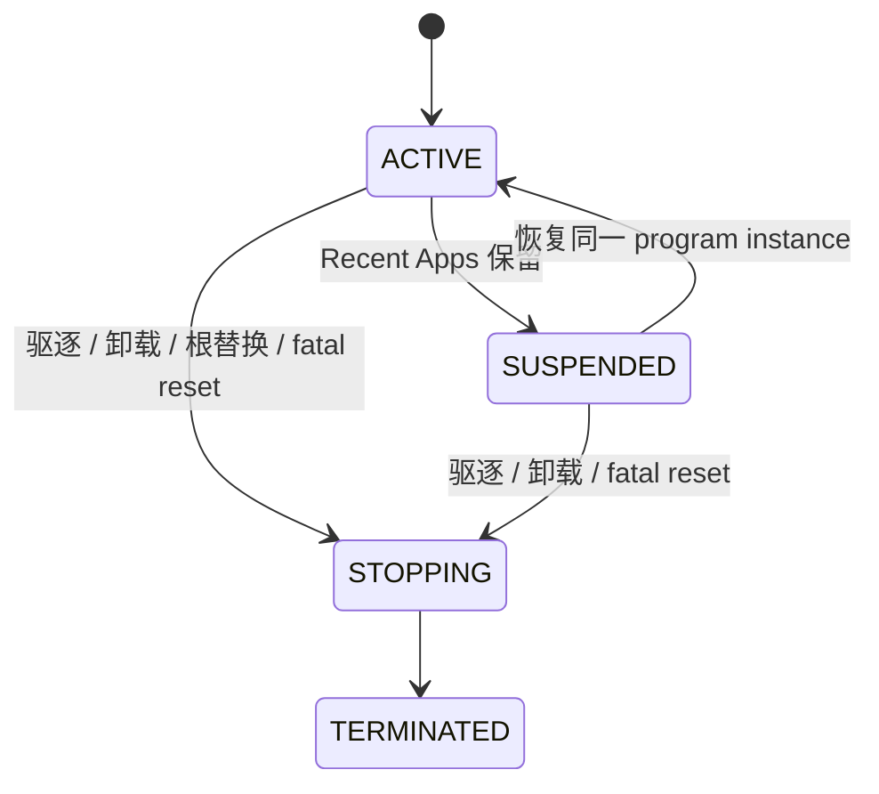

# Core 开发契约

Core 变更首先要识别自己改变的是哪种对外行为：应用能力、Vendor 操作、生命周期、数据语义、线程上下文、所有权，还是失败结果。只要上层或移植层可观察到变化，它就是架构契约变化，应同时更新对应的 Application 或 Platform 契约与子系统文档。

## 选择扩展边界

| 需要增加的能力 | 应扩展的边界 | Core 不应被迫承担的职责 |
|---|---|---|
| 新 SoC、芯片、触摸/旋钮/屏幕实现 | Platform port 实现既有 Device/port contract，并在依赖服务启动前注册 | 不把芯片寄存器、Vendor SDK 类型或板级条件散布到 Service、Framework、Application |
| 新逻辑数据服务 | Service 拥有语义、状态、需求仲裁、缓存和错误映射；需要硬件时经 Device contract | 不让 Vendor 维护应用权限、缓存和应用状态 |
| 新 Sensor 类型/数据语义 | 更新公共单位/类型/有效性约定、Sensor Service 的缓存和需求模型，并接入目标设备实现 | 不只在单块板子或 JS wrapper 中新增私有字段 |
| 新音频编码格式 | 实现 Decoder，加入 Audio Service 初始化注册；遵守 Player 输出契约 | 不在播放调度层或扬声器驱动中加入 Codec 专属解析分支 |
| 新表盘语义值 | 扩展当前静态 Metric 名称/来源映射，再决定是否通过 SNI/控件暴露 | 不把 raw sensor 类型直接变成所有应用都能理解的稳定语义 |
| 新 LVGL 组件或 JS API | 组件自己拥有内部对象；SNI 描述句柄、字符串、buffer、callback 的 owner 和失效点 | 不暴露裸 pointer，不绕过 Activity/View/SNI 生命周期 |
| 跨线程延后操作 | 使用 Dispatcher 或该 Service 已定义的任务队列，并为用户数据定义存活期 | 不把同步 Event Bus 当队列，也不从 ISR 直接进入 JS/LVGL |
| 通知投递与持久化 | 先定义服务、身份、权限、队列/持久化和后端交付合同，再接 UI | 不把消息列表 overlay 或 notification 权限枚举误当作通知系统 |

Sensor、设备类型和 Metric 当前均未定义通用的动态 Provider 选择或优先级合同。Audio Decoder 提供注册扩展边界，但尚无安全热插拔管理。各模块应依据其实际扩展合同管理生命周期，不共享一套未经定义的 Provider 生命周期。

## 依赖与所有权

- Framework/应用依赖 Service 的语义接口；Service 依赖 Device 类型接口；Platform 实现 Device/port contract。依赖不能反向穿越：Vendor 不依赖 Activity、LVGL、SNI 或应用对象。
- Sensor Service 拥有按类型的 FIFO/latest cache、需求和 Native subscriber 节点；每个订阅者只释放自己的需求。
- Battery、Metric、Config 等服务拥有各自状态快照；调用方获得的是值/借用数据或约定的句柄，不因读取自动取得服务内部对象的所有权。
- SPM 拥有脚本程序/Realm/context；Activity Controller 拥有页面栈和 View；LVGL 父对象拥有其子树。View destroy、program stop 和 engine generation 变化是不同失效点。
- EPKG 上下文拥有包文件句柄和解析表；预览值、manifest 临时结果和解包目标由各自约定的 consumer 释放。包上下文关闭后，其借用指针随之失效，安装流程不会在关闭后继续引用这些指针。

异步 callback 至少需要 owner、取消/销毁路径和可判定的 generation 或对象存活检查。若 callback 可能在 owner 暂停/销毁、Realm 复位或目标对象删除后到达，必须在进入上层前丢弃，不能靠悬空 pointer 检查补救。

## 同步广播与延后工作不是一回事

| 机制 | 调用者得到什么保证 | 适用边界 |
|---|---|---|
| Service 函数/Device op | 当前调用栈内的返回值或即时状态；可能同步触发较低层操作 | 参数和值按函数合同处理；同步调用返回仅表示该调用完成，后台工作完成语义由具体服务定义 |
| Event Bus | 发布时同步遍历订阅者；`param` 借用发布者存储 | 状态变化广播；回调短小，订阅者复制需要跨回调保留的数据 |
| Dispatcher | 入队成功后由 Core 主循环按序执行 | 从 ISR/平台线程转交 GUI/脚本安全上下文；提交不代表可靠持久化，队列扩展失败可能丢任务；callback user data 必须存活到执行 |
| SNI callback | 在 owner program 的 Realm 中，经运行时检查后调用 JS | 必须受 program state、context pause、engine generation 和绑定资源生命周期约束 |
| Sensor data subscriber | `eos_sensor_notify` 更新缓存后同步调用 | 执行上下文继承发布方；从 ISR 发布仅适用于已确认整条下游路径均可在中断上下文运行的场景 |

延后执行时，生产者复制或排队最少必要数据，再由目标上下文读取或消费；异步 callback 使用的数据在执行期间保持有效。允许 callback 重入同一服务的接口会定义取消、嵌套广播和删除语义；未定义重入语义的接口不支持重入。

## 状态和失败传播

设备能力、设备状态、服务状态和样本有效性分别表达不同语义，不合并为单一 Boolean：

- 未注册/不支持表示某条设备能力不存在。
- READY/BUSY/ERROR 是设备层状态，不直接等于服务上层的授权或业务状态。
- `valid`/样本时间戳表达数据是否取得；数值零可为有效读数。
- 同步操作失败通过该边界结果返回；异步 source 通过可读取状态、无效样本或明确定义的事件向上报告。

Device ops 表是类型专属合同；不同注册器的必需字段检查也不同。Capability 合同定义能力缺失时的发现方式、调用结果、服务降级行为、状态变化和重试语义。空 callback 或无动作成功不表示能力受支持。

当前 Power/Display 路径未提供统一硬件确认：PM 先更新软件状态再调用平台 power op，部分显示 op 为 void。Core 页面状态或事件只能代表软件状态变化，不能提升为物理设备成功证明。新增需要可靠确认的流程时，应显式引入可返回/上报完成状态的合同，而不是沿用现有 fire-and-forget 假设。

## 生命周期边界不能合并

上图只描述 Script Program。Activity/View 还有独立的 enter/pause/resume/destroy 与过渡退出策略；设备注册目前是平台启动期静态建立，服务级别没有全系统统一 deinit/unregister。修改其中一条生命周期时，必须检查其他 owner 的引用、回调、快照和 buffer 是否仍存活。

## Core 变更自检

- 谁发起请求、谁调用实现？响应或样本沿哪条路返回？
- Pull、Push、Subscribe、Event 或 Stream 中哪些模型实际存在？
- 哪一层保存状态；消费者看见的是缓存、借用值还是所有权转移？
- callback 是同步、Dispatcher 延后还是 timer 派发？运行上下文安全吗？
- Service/Activity/Program/Device 各自的停止和销毁是否明确？
- capability 缺失、初始化失败、设备离线、样本无效和取消分别如何表现？
- 新能力应由现有扩展点接入，还是需要改变公共契约？哪些平台和应用文档随之更新？

相关角色边界见[Application 契约](./application_contract)与[Platform/Vendor 契约](./platform_contract)。
