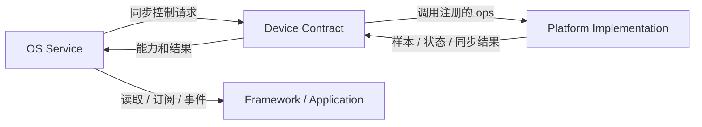

# 设备契约

Device Layer 是 Service/Core 与平台实现之间的类型化边界。它提供可注册的实现入口、状态和该设备类型专有的操作；它不拥有应用语义、采样/功耗策略、页面生命周期或 JS 回调。

## 两个方向

控制与数据流向不同方向。Service 请求操作，Device 通过注册的操作表调用平台；对于数据型设备，平台按各自协议 Push 数据或提供 Pull 值；Service 再负责缓存、仲裁、规范化、有效性和面向消费者的通知。设备层不会自动把硬件回调转成主循环任务，也不会自动重试。

## 注册和可用性

目标平台在依赖 Service 初始化前注册该类型的实现。注册成功只表示操作入口已登记，不代表设备当前可用、每个可选能力都存在或未来操作都成功。设备状态用于表示该类型契约定义的 ready/busy/error；操作返回码则描述一次请求结果，两者不能互相代替。

设备类型自行定义操作表、必需项、可选项和返回语义。显示、电源、音频、振动、时间、电池和传感器没有统一的 `init/read/notify/deinit` 接口。缺失能力只能在该类型明确允许可选时用 NULL 表示；Service/调用者需要检查不支持或设备缺失结果。

当前 Sensor Device 支持按名称注册多个实例，但 Sensor Service 初始化时为每种 Sensor Type 绑定一个默认设备；注册顺序决定默认实例，Service 没有动态选择、优先级和故障切换。大多数其他 Device 是 singleton。该模型不是通用多 Provider 框架，平台不能假定设备可以在线替换或注销。

## 数据、内存和生命周期

- Device Operation 表由平台实现提供，Core 保存其引用；实现和操作表必须在注册有效期间持续存活。
- Sensor 数据由平台上报到 Service；Service 复制样本并自行管理 FIFO/latest。订阅回调指针借用到本次同步回调结束。
- Battery 原始测量由平台报告，Service 复制到服务状态；变更 Event 同步派发，`param` 仅作为借用状态传递。
- Microphone 的共享 DMA buffer 由 Audio Service 分配并传给设备；Core 在设备停止后才可回收。Speaker 的 borrow/enqueue buffer 所有权目前未被公共操作表完整规定，应视作未闭合合同。
- Core 当前没有统一的 device hotplug、注册撤销或所有设备的 shutdown/deinit 流程。各 Service 所有的 request、subscriber 和缓存必须由其所属 Service 生命周期管理。

## 扩展规则

新增硬件接入既有 Device Type 时，在消费它的 Service 初始化前注册，并遵循单位、上下文、状态和缓冲合同。若需要新的应用语义或状态策略，应扩展/新增 Service，而不是把业务规则塞进 Device 操作表。若新增的是全新 Sensor Type，还必须同时定义公共数据类型、单位、坐标/时间语义、缓存和采样需求行为。

具体的 Vendor 启动顺序、数据上报与 ISR 边界见[Platform/Vendor 契约](./platform_contract)；应用如何消费 Service 见[Application 契约](./application_contract)。
