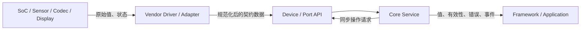

# Platform Port 与 Driver

Platform Port 是消费 ElenixOS Core 的集成层；它实现 Core 声明的 port/device contract，并把 BSP、Vendor SDK、中断、DMA、时钟、文件系统和 GUI/HAL 接到 OS。Core 仓库中的 port 头文件描述接口；芯片相关实现属于实际平台工程。

## 平台向 Core 提供什么

集成工程先准备 OS 必需的执行环境（时钟、临界区/调度、内存、文件系统和 LVGL display/input），再注册该目标实际拥有的设备操作，并在相关服务启用前初始化服务。Core 不会替平台猜测哪个 Vendor 驱动存在，也没有覆盖所有设备的统一发现、热插拔或 shutdown 调度器。

操作方向有两类：

- Core/Service 同步调用 Device ops 请求 enable、采样率、显示/电源设置、音频打开/提交等动作。平台操作应有界并快速返回；若工作较慢则排到平台 task，再通过该设备合同回报结果。
- 平台向 Core Push 样本/状态，或在 Core 调用时 Pull 实时值。Vendor 需要在上报前把硬件单位和板级坐标转换成 OS 公共数据语义，并按规定传播无效/错误状态。

## 驱动不得拥有的职责

- 不替 Service 决定跨消费者采样率、音量/电源业务策略或应用权限。
- 不直接执行应用/JS callback，不创建或销毁 Activity/View，不触碰 LVGL/JerryScript。
- 不假定另一个平台实现具备本板同样的能力；可选操作缺失必须可识别，调用失败必须按设备合同返回/报告。
- 不保存越过所有者生命周期的借用 buffer；异步 DMA/task 要在 Core 回收内存或关闭设备前停止并确认不再访问。

## 中断、任务与回调

Vendor 回调不会自动切换到统一线程。Device op 通常在发起服务的同步调用上下文执行；Event Bus callback 在发布者上下文同步执行；Dispatcher 将短任务排到 Core 主循环。传感器上报会在 `eos_sensor_notify` 的调用栈同步进入 Native consumers；电池报告变化时也会同步发布事件。因此，ISR 可负责采集或排队；若下游链未整体确认为 ISR-safe，平台需先 defer，再调用会派发消费者的入口。

各类操作具有不同的执行上下文：Time 的 pull、Platform 控制操作、Battery 采集和 Sensor 样本发布分别遵循各自约定。函数名称中的 `callback` 不表示操作必然异步或线程安全；平台移植按对应文档处理上下文和 buffer 要求。

## 数据/错误传播

同步操作错误沿调用结果返回；异步设备在报告路径里更新状态或提交数据。样本零值不是故障标志；需要区分尚无样本、过期样本、设备错误和合法零值。某个功能在软件模拟器可用也不代表目标硬件实现了它。

Sensor 的坐标/时间/采样要求、Audio 缓冲、Display/Power 状态以及设备注册顺序由[平台移植契约](./platform_contract)定义；Device 操作表和能力生命周期见[设备契约](./device_architecture_design)。
