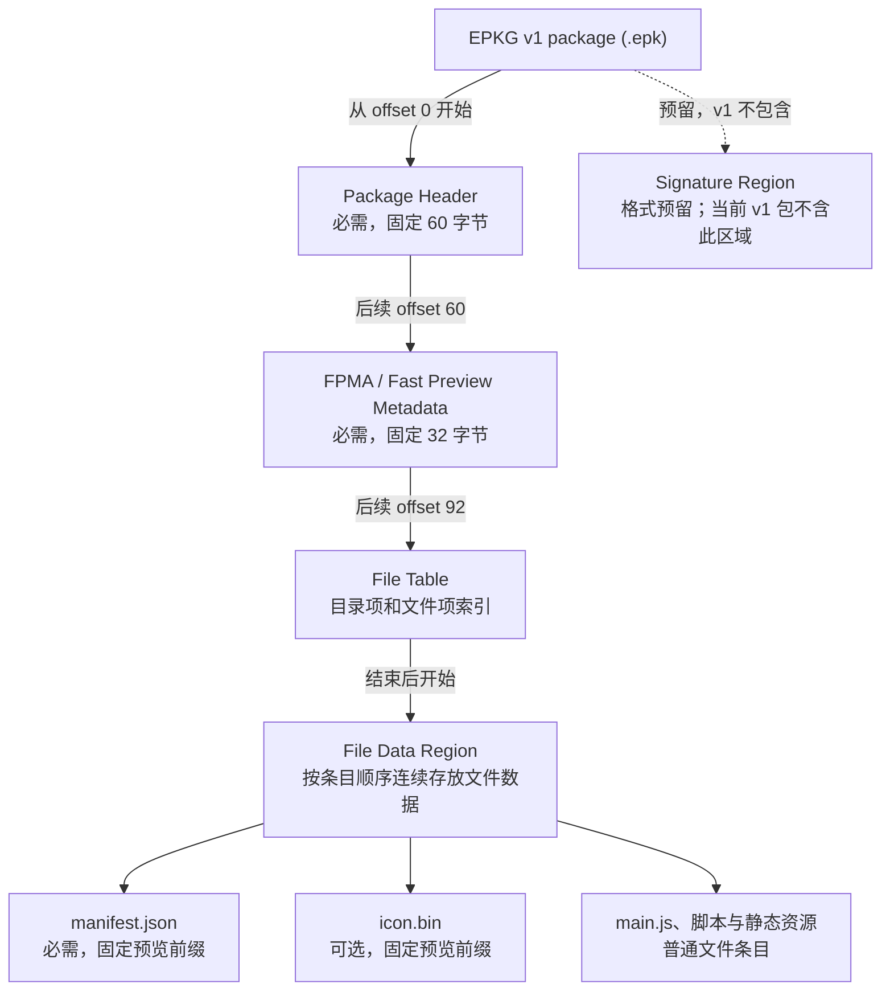
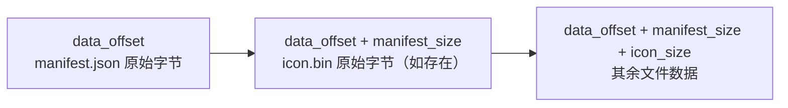

# EPKG v1 安装包格式

本页定义 ElenixOS 安装包的 **Package Contract**：安装包是什么、内部有哪些逻辑区域，以及系统如何解释它们。当前应用和表盘使用同一种 EPKG v1 `.epk` 容器。包格式属于 ElenixOS 系统契约；OS 的 Package Manager / Installer / Loader 和开发工具都按这份契约读取或生成包。官方 VS Code 工具 ElenixOS-Toolkit 在开发侧实现项目初始化、包构建和分析工作流，格式契约独立于插件。具体工作流见 [ElenixOS-Toolkit](../development/toolkit)。

此处的“区域”指 **Package Region / Logical Region**，即安装包文件内部的逻辑区域，不表示 Flash、FAT、文件系统或存储设备分区。安装器把包内文件解出到系统安装目录，是后续安装存储行为，与包内区域划分不同。

## 逻辑结构

EPKG v1 的包头、FPMA、File Table 和 File Data 是实际格式结构。`manifest.json` 与 `icon.bin` 是 File Data Region 中具有固定位置语义的文件，不是独立的二进制容器层。当前格式没有单独的代码区、资源区、图片预览区或第二份资源索引：脚本和资源以普通文件项存放，由 File Table 编目；FPMA 为快速预览提供 manifest 和可选图标的位置、大小与校验值。

| 内容 | 当前要求 |
|---|---|
| Package Header、FPMA、File Table、File Data | EPKG v1 必须存在；manifest 是必需文件，因此文件表至少包含一个文件项。 |
| `manifest.json` | 根路径必需，位于预览前缀起始处，使用 `NONE`。 |
| `icon.bin` | 根路径可选；若存在，位于 manifest 后的固定预览位置并使用 `NONE`。 |
| 目录项与其他文件 | 可选；由 File Table 列举。应用实际运行仍需要运行时要求的文件，例如根路径 `main.js`。 |
| Signature Region | 格式为未来保留；当前 v1 包不含此区域，签名 offset / size 必须为零。 |

## 包头与版本

Package Header 以固定 magic `EPKG` 标识包格式，`format_version` 独立表示格式版本，当前为 `1`。v1 包头从文件 offset `0` 开始，固定为 60 字节；FPMA 固定从 offset `60` 开始、长度为 32 字节，File Table 固定从 offset `92` 开始，包头的 `data_offset` 指向 File Data 起点，也就是 File Table 末尾。包头还描述包类型、条目数量、压缩前后数据总量及 `header_crc32`。这些固定 offset 和动态长度让 Loader 无需扫描文件内容即可定位后续区域；读取方按显式 little-endian 字段解析，不依赖 C 结构体布局。

所有整数均为无符号 little-endian。下表 offset 相对于包文件起点，字段必须逐项序列化，不能直接写入带编译器填充的 C 结构体：

| Offset | 字段 | 长度 | v1 含义 |
|---:|---|---:|---|
| 0 | `magic` | 4 | ASCII `EPKG`。 |
| 4 | `format_version` | 4 | 固定为 `1`。 |
| 8 | `header_size` | 4 | 固定为 `60`。 |
| 12 | `package_type` | 4 | `1` Application，`2` Watch Face。 |
| 16 | `flags` | 4 | 固定为 `0`；未知位拒绝。 |
| 20 | `file_count` | 4 | File Table 记录数，包含目录项。 |
| 24 | `fpm_offset` | 4 | 必须等于 `header_size`，即 `60`。 |
| 28 | `fpm_size` | 4 | 固定为 `32`。 |
| 32 | `table_offset` | 4 | 必须等于 `fpm_offset + fpm_size`，即 `92`。 |
| 36 | `data_offset` | 4 | File Data 起始位置，也就是 File Table 结束位置。 |
| 40 | `signature_offset` | 4 | 当前无签名 v1 固定为 `0`。 |
| 44 | `signature_size` | 4 | 当前无签名 v1 固定为 `0`。 |
| 48 | `total_stored_size` | 4 | 所有文件项 `stored_size` 之和。 |
| 52 | `total_original_size` | 4 | 所有文件项 `original_size` 之和。 |
| 56 | `header_crc32` | 4 | 包头 CRC-32；计算时先将本字段置零。 |

`package_type` 是安装路由信息：`1` 表示 Application，`2` 表示 Watch Face。它不是应用 metadata，也不重复写入 manifest。Header 的普通 `flags` 在 v1 必须为零。安装器据此调用应用或表盘安装路径；稳定身份和显示信息来自包内 `manifest.json`。未知格式版本、类型、标志位、区域位置或头部校验不符合 v1 契约时，当前解析器会拒绝该包。

包头还记录 `signature_offset` 与 `signature_size`。当前无签名 v1 包的这两个值必须为 `0`。它们是未来追加独立签名区域的格式扩展点，不代表当前包已经签名。

## FPMA 快速预览区域

紧接包头的是固定 32 字节的 `FPMA`（Fast Preview Metadata Area）。其 `fpm_version` 独立于 EPKG `format_version`，当前为 `1`。FPMA 描述必需 manifest 和可选 `icon.bin` 的原始长度与 CRC-32；flag bit 0 表示图标存在，其余 flag 位在 v1 必须为零。当前解析器将 manifest 和 icon 各自限制在 1 MiB 以内。

FPMA 字段 offset 相对于 FPMA 起点，整数同样为无符号 little-endian：

| Offset | 字段 | 长度 | v1 含义 |
|---:|---|---:|---|
| 0 | `magic` | 4 | ASCII `FPMA`。 |
| 4 | `fpm_version` | 4 | 固定为 `1`，独立于 EPKG 格式版本。 |
| 8 | `area_size` | 4 | 固定为 `32`。 |
| 12 | `flags` | 4 | bit 0 表示存在 `icon.bin`；其他位必须为零。 |
| 16 | `manifest_size` | 4 | 根路径 `manifest.json` 的原始字节数。 |
| 20 | `icon_size` | 4 | `icon.bin` 的原始字节数；不存在时为 `0`。 |
| 24 | `manifest_crc32` | 4 | 原始 manifest 字节的 CRC-32。 |
| 28 | `icon_crc32` | 4 | 原始图标字节的 CRC-32；不存在时为 `0`。 |

File Data 起点处的固定预览前缀如下：

FPMA 不保存也不复制应用 ID、名称、版本、权限或 API 信息；这些内容只从 manifest 读取。预览读取路径可据此快速获得身份信息和图标，不必先解码普通 payload。

## Manifest、身份与类型

`manifest.json` 是必需的根路径 UTF-8 JSON 对象。EPKG v1 要求非空字符串 `id`、`name`、`version`、`author`、`description`，并要求 `minApiLevel`、`targetApiLevel` 为 16 位无符号整数。`id` 是应用或表盘在安装和运行时使用的稳定身份键，必须匹配 `[A-Za-z0-9][A-Za-z0-9._-]*`；API level 字段提供兼容性范围，由对应应用或表盘安装路径检查。`permissions` 等其他 manifest 字段由现有 manifest / 权限层按其定义读取，不复制进包头。

包类型只由 Header 的 `package_type` 决定，manifest 不需要另设类型字段。图标只有一个固定来源：根路径可选文件 `icon.bin`。manifest 不得用 `icon` 字段指向替代图标。Application 与 Watch Face 共用同一容器；包类型不同不改变内部区域布局。

## File Table 与文件数据

File Table 位于 FPMA 之后、File Data 之前，按 `file_count` 提供的数量包含目录和文件记录。每条记录从固定 28 字节前缀开始，说明相对路径、条目类型、逐文件 codec、数据 offset、存储长度、原始长度及原始文件 CRC-32；记录自身携带路径字节，长度至少容纳固定记录前缀和路径，再按四字节边界对齐，以零字节补齐。条目类型表示普通文件或目录；`NONE` 的 codec 值为 `0`，`LZ4_BLOCK` 为 `1`。v1 的 entry flags 必须为零。File Table 本身没有独立的整体 CRC 字段。

记录内 offset 相对于该记录起点；记录中的 `data_offset` 则是相对于包文件起点的绝对 offset。字段布局如下：

| 记录内 Offset | 字段 | 长度 | 含义 |
|---:|---|---:|---|
| 0 | `record_size` | 4 | 本记录总长度，至少为 `28 + path_len`，并按 4 字节对齐。 |
| 4 | `path_len` | 4 | 后续 UTF-8 路径的字节数，不含 NUL 终止符。 |
| 8 | `entry_type` | 1 | `0` 普通文件，`1` 目录。 |
| 9 | `codec` | 1 | `0` `NONE`，`1` `LZ4_BLOCK`。 |
| 10 | `flags` | 2 | v1 固定为 `0`。 |
| 12 | `data_offset` | 4 | 文件数据在包中的绝对 offset；目录项为 `0`。 |
| 16 | `stored_size` | 4 | 包内存储字节数；目录项为 `0`。 |
| 20 | `original_size` | 4 | 解码后的原始字节数；目录项为 `0`。 |
| 24 | `crc32` | 4 | 原始文件字节的 CRC-32；目录项为 `0`。 |
| 28 | `path` | `path_len` | UTF-8 相对路径字节，无 NUL 终止符。 |
| 后续 | 零填充 | 按需 | 补至 `record_size`；填充值必须为零。 |

路径必须是安全的相对路径，使用 `/` 分隔，并满足以下条件：

- 不以 `/` 开头或结尾；不能包含反斜杠 `\`、NUL 或控制字节。
- 不能有空路径组件，也不能有 `.` 或 `..` 组件；File Table 中不得出现重复路径。
- 路径按 UTF-8 编码，字节长度必须小于 `EOS_FS_PATH_MAX`，以便在目标缓冲区中保留 NUL 终止符。

目录记录的 `data_offset`、`stored_size`、`original_size` 和 `crc32` 必须全部为零；目录记录可有可无。`NONE` 文件必须满足 `stored_size == original_size`。文件数据按 File Table 顺序连续排列：第一个文件从包头的 `data_offset` 开始，每个后续文件紧接前一个文件结束位置；空文件可以在当前游标处占用零长度范围。所有文件范围必须处于文件数据区域内，最终游标必须等于文件数据末尾；各文件大小之和还必须与包头的总量字段一致。

参考构建器按以下顺序写入记录：`manifest.json`、（如存在）`icon.bin`、目录项和其他文件；后两类按规范化路径的字典序排列。读取方按记录中的 offset 和路径处理，不应通过包文件名推断内容。

EPKG v1 的当前读写实现还施加以下容量上限。越界包会被 Builder 拒绝，或在 OS/Toolkit 校验时返回格式错误；不会通过截断路径或忽略多余条目的方式接收。目标文件系统还必须容纳安装目录前缀与包内相对路径；格式允许的路径长度不代表每个目标都能组合或存储它，Core 路径缓冲限制见[存储服务路径](./services/storage)。

| 项目 | 上限 | 说明 |
|---|---:|---|
| File Table 条目数 | 1024 | 文件和目录都计入 `file_count`。 |
| 路径 | 少于 256 字节 | 按 UTF-8 编码后的相对路径字节数计算。 |
| `manifest.json` | 1 MiB | FPMA 快速预览也需要读取完整 manifest。 |
| `icon.bin` | 1 MiB | 图标是可选文件；超限时包预览/构建不接受。 |
| 单个 LZ4 原始数据块 | 16 KiB | 大文件切分成多个 raw LZ4 block；这不是整文件大小上限。 |

包中各个长度、offset 与累计大小字段为 32 位无符号值，因此 EPKG v1 的存储范围受 32 位偏移/长度字段限制；目标文件系统、RAM、可用 Flash 以及安装时的解压缓冲还可能施加更小的实际限制。

`manifest.json` 必须是 File Data 的第一个文件条目并使用 `NONE`；可选 `icon.bin` 紧随其后，也使用 `NONE`。其他文件可逐文件使用 `NONE` 或有界的 `LZ4_BLOCK`，每个 LZ4 原始数据块上限为 16 KiB。`LZ4_BLOCK` 文件由连续的块记录组成，每块格式如下：

| 块内 Offset | 字段 | 长度 | 含义 |
|---:|---|---:|---|
| 0 | `raw_block_size` | 4 | 解码后原始块长度，最大 16 KiB。 |
| 4 | `compressed_block_size` | 4 | 后续 raw LZ4 block 的字节数。 |
| 8 | raw LZ4 block | `compressed_block_size` | LZ4 block 数据；不使用 LZ4 frame。 |

每块使用安全的 LZ4 block 解码器，且解码结果必须恰好等于该块声明的 `raw_block_size`。所有块的原始长度之和必须等于条目的 `original_size`；所有块头与压缩字节之和必须等于 `stored_size`。参考构建器的 `auto` 策略仅在压缩结果连同块头小于原文件时选择 `LZ4_BLOCK`，否则写为 `NONE`。解码使用有界的压缩与原始缓冲区，不会为解压而分配整个文件。

`NONE` 文件的存储长度等于原始长度。`LZ4_BLOCK` 是存储编码，不是运行时压缩文件系统：完整校验和安装时逐文件解码，安装结果是普通文件。无签名 v1 包的数据必须连续到文件末尾，末尾不包含额外区域或填充。

EPKG v1 没有独立的 Program / Payload 区，也没有额外的 Resource Index。根路径 `main.js` 是当前 Application / Watch Face Runtime 使用的脚本入口；它和应用的其他脚本、静态资源一样，是由 File Table 索引的普通文件。格式解析成功或 manifest 可预览，并不单独保证包中存在可运行入口或脚本可执行。

## 校验与系统解释流程

所有校验字段使用 CRC-32/ISO-HDLC，也就是 `zlib.crc32(data) & 0xffffffff`：初始值 `0xffffffff`、反射多项式 `0xedb88320`、最终异或 `0xffffffff`，序列化为 little-endian `uint32_t`。Header CRC 对完整 60 字节包头计算，但计算前将 offset 56–59 的 `header_crc32` 字段清零；FPMA 的 manifest/icon CRC 对各自原始字节计算；File Table 的文件 CRC 对解压后的原始文件字节计算。当前格式没有覆盖整个包的总 CRC 或可替代签名的校验。CRC 用于检测对应数据是否与记录值一致，不证明包的来源或发布者身份。

OS Package Manager 打开包时检查 EPKG magic / 版本、Header CRC、固定区域位置、FPMA、File Table 结构、路径安全性、数据边界与总长度关系。预览路径读取 manifest 和可选图标，只能说明这些预览内容可读。Application / Watch Face 的正式安装路径还会解析 manifest、检查类型和 API 兼容性、完整校验文件 payload 与 CRC，再按 `package_type` 选择对应安装目录并解包。因而预览成功、传输完成或文件存在都不能代替完整安装校验。

安装包定义的是部署数据和安装身份，不定义应用的 Realm、页面生命周期、权限授予结果或运行时 API 行为；这些边界由 [Application 与 Framework 契约](./application_contract)、[应用管理](./framework/app)和[表盘系统](./framework/watchface)说明。

## 当前契约与签名状态

| 状态 | EPKG v1 能力 |
|---|---|
| 当前已实现 | EPKG v1 Header 与 FPMA；Application / Watch Face 类型；manifest 身份与 API metadata；File Table 和安全路径；可选 `icon.bin`；逐文件 `NONE` / `LZ4_BLOCK`；Header、manifest、icon 和文件 CRC；预览、完整校验及安装时解包。OS 与 Toolkit 均按同一格式解释包。 |
| 格式已预留但尚未实现 | 包头中的 `signature_offset` / `signature_size`，以及可追加在文件数据之后、使用 `SIGN` magic 和独立 `signature_version` 的签名区域。当前 Toolkit 不生成有效签名；OS Loader / Installer 与 Toolkit 解析器均不执行完整签名验证，并拒绝非零签名 offset / size。 |

因此，签名区域是格式级扩展保留，不是当前可依赖的安全机制。当前版本没有完整的签名生成、签名验证、信任来源判断链路；EPKG v1 包应被视为未签名包。此处不定义 v1 尚未规定的密钥、算法、证书或信任策略。

官方应用和表盘项目通常由 [ElenixOS-Toolkit](../development/toolkit) 构建为符合本契约的安装包。Toolkit 提供构建与分析入口；包的稳定区域、字段语义和 Loader 约束由本页定义。
