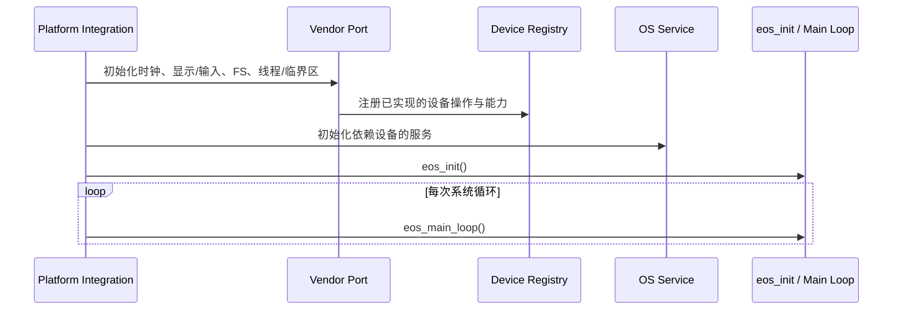
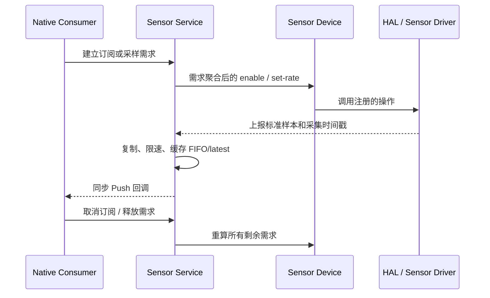

# Platform / Vendor 移植契约

平台移植者实现 Core 声明的 port/device 操作，并在消费者服务启动前注册可用设备。Core 已提供设备状态、服务策略、数据缓存、单位语义、应用 API 和生命周期管理；Vendor 提供芯片访问、板级转换、中断/DMA/RTOS glue 以及不可移植的 HAL。板级实现不应复制服务策略，也不应把原始驱动接口暴露给应用。

## 启动与注册协议

Core 没有一个覆盖所有 Vendor 的统一 `port_init`、通用设备 `init/deinit` 或运行时热插拔协议。平台集成负责准备基础设施和设备，再初始化依赖这些设备的服务，最后进入 Core 初始化和主循环。

设备注册必须早于绑定设备实例的服务初始化。Sensor Service 尤其需要显式初始化：当前 `eos_init()` 不调用它，平台集成必须在传感器注册后、Sensor API 使用前初始化该服务。Sensor Service 初始化时把每种类型当前默认设备绑定到服务实例；之后才注册的设备不会自动被该实例接管。当前也没有统一的注销、替换、故障转移或设备热插拔路径。

设备初始化失败不一定阻止系统启动：当前 `eos_init()` 会调用 Battery Service 初始化但不检查其失败结果，Sensor Service 则由集成工程单独初始化。缺少电池时 Core 仍可运行，但电池状态无效；缺少传感器时，相应需求或读取失败，或没有样本。因此，`eos_init()` 返回只表示该初始化流程完成，不表示所有设备服务均已可用；平台按目标产品需要检查初始化结果和 capability。

不同设备类型的操作表不是统一模板。注册成功表示 Core 保存了实现入口，不表示设备已实际启动、可用或后续操作一定成功。Vendor 应保持操作表和其引用状态的有效期至少覆盖整个注册期；当前设备注册没有与之配对的通用注销协议。

## 控制方向、数据方向与实现责任

| 能力 | Core 发起的控制请求 | Vendor 返回的数据 / 状态 | 平台责任和可选能力 |
|---|---|---|---|
| Sensor | Sensor Service 按聚合需求调用 enable/disable 和 set-rate；需求归零或电源策略变化才改变有效操作。 | Vendor 把每个样本按公共类型、单位、坐标系和启动后单调时间戳交给服务；服务复制样本、更新 FIFO/latest 并同步广播。 | `init/deinit` 也在操作表中，但当前 Service 不调用它们；目标 port 在注册后负责硬件初始化/停机。多实例允许注册，但服务当前为每种类型固定一个初始化时选出的默认实例，没有运行时优先级或故障转移。 |
| Battery | Battery Service 初始化时和 LVGL timer 到期时调用 `request_update`；该调用发生在 Core 调用上下文，Vendor 应快速返回并将慢速读取移到自己的安全执行上下文。 | Vendor 取得百分比、电压、电流、充电状态后调用 Core 上报；Core 更新有效状态、历史和变化事件。变化事件同步在 `report_raw` 的调用上下文广播。 | 电量百分比必须来自平台可靠值；Core 不根据电压替 Vendor 推算。没有有效报告时应用读取到无效状态。若从 ISR 上报，所有事件订阅者也会在该上下文同步执行，不能假定它们位于 UI 主循环。 |
| Display / Power | Display 与 PM 服务调用注册的亮度、电源操作；调用在服务路径同步发起。 | 设备状态由平台按设备状态接口报告；PM 事件表示 Core 软件状态变化。 | LVGL 显示驱动、扫描输出和 pointer/encoder 输入由平台图形/HAL 集成提供。显示设备 op 不是帧缓冲输出 API。部分显示操作没有统一错误返回；PM 的软件状态不能当成硬件确认。 |
| Speaker | Audio Player 同步打开采样格式、借用输出缓冲、提交 PCM、暂停/恢复/停止。 | 扬声器实现消费已提交的 PCM；播放进度、drain 和 EOF 通知属于可选 op。 | 扬声器独立于麦克风，可单独缺失。支持哪些 PCM 采样率/声道/位深由设备报告成功与否；Core 不提供通用重采样。 |
| Microphone | Audio Service 打开格式、把共享 ring buffer 交给设备、启动/停止 DMA 并读取写入游标。 | Vendor 生产 PCM 至共享 buffer，Service 消费并写入目标文件。 | Buffer 由 Service 创建并在关闭设备、停止 DMA 后释放；Vendor 不得在停止后继续写入。可选初始化、增益等能力不能被假定存在。 |
| Time | Time Service 对设备执行同步读取。 | Vendor 返回当前日期时间值。 | Core 不规定 RTC 芯片、校时源或时区来源；目标平台须提供符合公共日期时间表示的数据。 |
| Haptic | Haptic Service 把反馈意图映射到设备强度和开/关。 | 当前只有单向控制，不存在应用可订阅的振动样本流。 | on/off 操作是 void；当前 Service 没有每次脉冲的成功/失败确认，也没有完整的缺失设备 capability API。应用不能确认物理反馈确已发生。 |
| Input | 平台启动时注册 LVGL display/indev；旋钮和按键适配器把物理动作报告给 Core 输入路径。 | Pointer 事件进入 LVGL indev；表冠/侧键通过各自输入入口进入 Crown/Chrome/PM。 | 这不是一个统一的输入 Provider 或 Event Bus 协议。触摸、表冠旋钮、表冠键、侧键有不同投递路径；只有当前目标具备的输入才需注册。 |
| Storage | Core/Service 对文件系统端口执行同步文件、目录和路径操作。 | 文件系统返回内容、句柄和错误码。 | 平台提供实际文件系统及可选虚拟 root；该 root 映射不是应用隔离策略。调用方路径限制在更高层 API 实现。 |

该表描述的是方向，并不定义所有设备共有的生命周期：Battery 由 Core 请求、Vendor 回报；Sensor 由 Core 下发采样需求、Vendor 推送样本；Time 由 Core Pull；音频同时包含 Core 控制和连续 PCM 生产/消费。移植实现遵循对应设备契约，各设备保留其 Push/Pull 模型。

## Sensor 数据协议

传感器要求以 Core 公共数据契约定义的单位和坐标上报；时间戳是平台启动后的单调毫秒数，不是 UTC。`eos_sensor_notify` 会复制入参，但随后在调用者上下文同步执行消费者回调，样本指针只在回调返回前有效。因此从 ISR 取得的样本必须先投递给可安全运行 Core/消费者回调的 task 或主循环，再调用通知入口。传感器设备头文件列出的硬件 FIFO 能力当前没有由 Sensor Service 接线消费；平台应自行读取硬件 FIFO 并逐样本上报，除非当前目标集成另行实现了完整路径。

上报按 Sensor Type 标识样本，不带注册设备名或实例 ID；Service 无法在通知时辨别同一类型的多个来源。因此当前多实例注册主要用于设备查找，不构成同类型多 Provider 聚合。一个 Sensor Type 应由 Service 绑定的默认实例作为活动来源。

有效周期是所有 Native 订阅、算法请求和兼容需求中的最短周期，再受电源模式的最小间隔策略限制；它不是硬件 ODR 保证。Sensor Service 向设备下发的频率由整数换算得到，并可能受设备自身离散频率限制。释放一个 demand ID 只移除该消费者，不得直接 disable 设备；只有剩余需求为零或策略禁止启用时 Core 才停用默认设备。

## 能力、状态与故障传播

- 必需/可选操作由每种设备类型分别定义；部分注册入口会校验必需操作，另一些只校验注册对象。`NULL` 仅在该类型明确标为 optional 时表示不支持；系统没有统一验证器。可选操作由 Service 按已定义的 fallback/错误路径处理，不以静默成功表示支持。
- 设备状态区分未注册、就绪、忙和错误，但各类型如何改变状态由其契约定义；系统没有全局设备状态机或自动重连机制。
- 同步设备操作可返回错误并由 Service 映射；异步数据源通过上报值、有效性或状态变化传播结果。Vendor 不应在错误时提交看似有效的零样本。
- Sensor 数据发布和 Battery 报告会同步进入 Core 消费者/事件回调。中断只完成采集和排队；若消费者可能访问 LVGL、文件系统或 JS，发布必须在合适的任务上下文执行。
- LVGL pointer、显示刷新、触摸、表冠和侧键初始化属于平台 GUI/HAL 路径；`eos_dev_display` 设备操作表不覆盖这些职责。

不同设备当前能够传播的错误强度不同，系统没有统一确认模型：

| 路径 | 当前可观察结果 | 当前限制 |
|---|---|---|
| Sensor | 需求获取可报告无设备、无效状态等；Vendor 可报告 Device 状态；样本无效体现在无样本/时间戳。 | enable/disable/set-rate 操作为 void；通知入口会忽略未初始化、无缓存或非法类型数据，没有逐样本错误回执。 |
| Battery | Service 保留 invalid 状态；收到合格报告后更新快照并按阈值发变化事件。 | `request_update` 为 void；没有统一请求 ID、失败回调或超时事件。 |
| Display / Vibrator | 注册状态和当前 Service 请求可观测。 | 主要物理动作操作为 void；没有每次操作的硬件完成/失败确认。 |
| Power | Device `set_power` 有返回值。 | PM Service 当前忽略该返回值且不回滚已更新的软件状态；失败不会成为应用可订阅的统一硬件错误。 |
| Speaker / Microphone | 操作可返回同步结果；Audio Service 把启动阶段失败映射到服务结果。 | 播放/录音启动后的异步设备故障没有统一完成错误事件。 |
| File system | 各文件操作返回端口/服务结果或无效句柄。 | 结果表示该文件操作，不表示更高层应用事务已原子提交。 |

Vendor 应准确实现已定义的报告路径，不能在没有确认通道时伪造“硬件成功”信号。若某能力要求可靠异步确认，应先为该 Device/Service 建立带请求归属、完成/失败和取消语义的合同。

## 当前接口尚未定义的合同

平台移植需要验证 buffer 生命周期和错误语义。当前扬声器的 `borrow`/`enqueue` 操作公开了取缓冲和提交步骤，但设备头文件没有完整定义提交后缓冲的所有权转移或复用时机；该语义尚未形成跨平台保证。目标 port 及其测试可明确验证当前实现行为，在形成稳定公共保证前，此项仍属未定义行为。

类似地，Display 的多数硬件操作没有返回值，PM 服务先更新 Core 软件状态，再请求电源设备；应用观察到的软件状态或事件不证明物理电源切换成功。设备状态和目标平台诊断用于观测实际故障，Core 不提供硬件成功确认。
