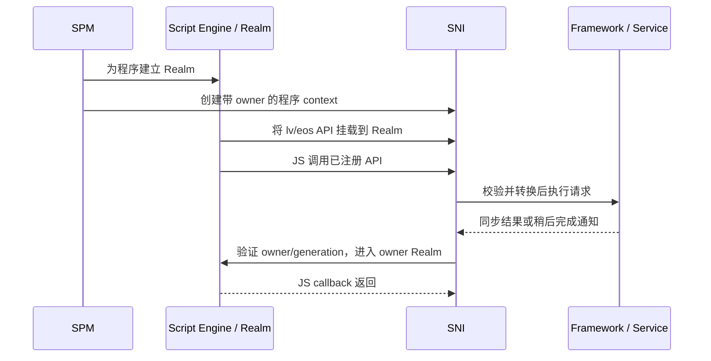

# SNI 与资源生命周期

SNI（Script Native Interface）位于每个脚本程序的 JavaScript Realm 与 ElenixOS Native System 之间。它把有限的一组 `lv`、`eos` API 安装到 Realm，将 JS 参数转换为受校验的 Native 值或句柄，并把 Native 结果及回调带回创建它们的程序上下文。SNI 是边界和生命周期协调层；它不拥有 Activity 栈、设备服务策略或脚本程序本身。

```mermaid
flowchart LR
    App[Application / Watchface JS]
    Realm[SPM-owned Program Realm]
    SNI[SNI API Export + Type Bridge + Callback Gate]
    Framework[Activity / UI / Native Services]
    Platform[Device Contract / Platform Port]

    App -->|registered lv / eos calls| Realm
    Realm --> SNI
    SNI -->|validated Native request| Framework
    Framework --> Platform
    Platform --> Framework
    Framework -->|value / handle / completion| SNI
    SNI -->|owner Realm callback| Realm
```

SPM 为程序创建 Realm 和对应的 SNI context，并独占脚本程序生命周期；Script Engine Core 执行 JS；SNI 将已注册 API 挂载到 Realm，并把回调归还给正确的 Realm。Application/Watchface 不能直接启动或停止 Script Engine，也不能因获得某个句柄就取得其背后 Activity、View 或服务的所有权。

## 向 JS 暴露什么

每个 Realm 只能看到显式注册的类、方法、属性和常量。当前 `lv` 承载 LVGL 绑定，`eos` 承载 ElenixOS Framework 与服务 API。存在一个 C 函数、类型或驱动操作，不会自动使它成为 JS API；当前注册表是 Native 构建时形成的 API 面，不是运行时动态加载任意 C 插件的机制。

SNI 在进入绑定实现前转换参数并检查值类型和句柄类别。不能转换的参数、已失效的句柄或绑定报告的 Native 错误会在相应 JS API 边界表现为异常或明确状态；具体错误值由该 API 定义。JS 代码只能依赖公开 JS API 的类型、返回语义和生命周期，不能依赖 SNI 内部编号、指针映射或注册表布局。

## JS 值、句柄与 Native 所有权

JS 对象是访问 Native 对象的代理，并不因此拥有或延长 Native 对象本身。资源是否需要显式释放、由谁执行最终析构，取决于 Native 对象的真实 owner：

| SNI 对象类别 | Native owner 与有效期 | 删除或失效规则 |
|---|---|---|
| 基本值与值对象 | 不拥有独立 Native 资源；字段在桥接边界转换为 JS 值。 | 不进入程序级资源清理；需要在 JS 中保留时就是普通 JS 值。 |
| LVGL 对象树节点 | 由 LVGL 父对象树及其所属 View/Activity 管理。SNI 为一个仍有效的 Native 节点复用对应 JS wrapper。 | JS 的显式删除 API 可提前删除；父对象、View 或 Activity 删除也会级联失效。删除通知使 SNI 句柄失效，之后不能再传给绑定使用。 |
| 树依赖句柄 | Native 子资源由父 LVGL 节点持有，例如 Chart 的 series/cursor；SNI 管理其 JS wrapper 和父子关联。 | 父节点删除时 Native 子资源随之删除，SNI 同时使子句柄失效；SNI 清理 wrapper bookkeeping 时不能再次析构 Native 子资源。 |
| SNI 托管资源 | 独立于对象树，由所属 SNI context 登记并按类型析构，例如 timer、animation 或 style。 | 提供删除操作的资源可由 JS 提前释放；程序完整停止时 SNI 执行兜底清理。仅丢弃应用变量不等同于确定性 Native 释放。 |
| 混合生命周期句柄 | Activity/View 等由 Activity Controller 或所属页面控制 Native 生命周期，同时被 SNI context 跟踪。 | Activity/View owner 先行销毁时，SNI 必须同步使句柄失效；SNI teardown 不能对已由 owner 销毁的对象再次析构。 |

Tree node、树依赖、托管和混合句柄都受所属程序 Realm 与 engine generation 限制。一个仍存活的 LVGL 节点在该 Realm 中重复转换时复用同一 wrapper 身份；这不表示句柄能跨 View 销毁、程序停止或引擎复位继续使用。

Activity/View 是混合所有权的关键边界：View 始终随其 Activity 页面销毁；一个由 JS 创建但尚未进入 Activity 生命周期的 Activity 仍由 SNI teardown 负责兜底销毁。Activity 一旦进入 Controller 管理的页面生命周期，Controller/页面过渡就是 Native owner，SNI 只登记并使 JS wrapper 失效，不能再重复销毁它。

Native 对象的删除、JS wrapper 的垃圾回收和程序 teardown 是三件不同的事。当前 SNI context 会强持有已登记托管句柄，以便程序结束时统一清理；应用不应把 JS GC 当作 Native 资源释放协议。对可以显式删除的长生命周期对象，应用应在不再使用时主动释放；SNI 的程序级 sweep 是漏删时的兜底。

### 字符串、值对象与指针型绑定

基本字符串从 JS 转为 Native 时，桥接生成由调用方负责释放的 Native 副本；从 Native C 字符串生成 JS 字符串时，JS 值拥有转换后的内容。数组、结构体指针和输出缓冲区按绑定定义选择复制或借用，并明确借用期限及输出区的分配/释放方。绑定不会向 JS 暴露生命周期短于 JS 使用期的临时缓冲区或可被 Native 覆盖的内存地址。

当前低层 LVGL 绑定中仍有指针型参数或返回值经数值形式桥接的接口。它们不是 SNI 托管句柄，不提供类型安全、对象失效通知或所有权管理；只有遵循对应 API 所要求的缓冲区 owner 和有效期时才能使用。应用代码不应保存这类数值并把它当作跨平台 Native 指针或资源句柄。

## 回调、Realm 与异步操作

SNI 保存回调注册时的 owner program、SNI context 和 engine generation。派发时必须验证 owner/context 仍有效、程序为 `ACTIVE`、context 未暂停且 generation 匹配，然后进入 owner Realm 调用 JS。回调不能通过全局“当前程序”变量推测归属，因为程序可能已挂起，或引擎暂时正在执行其他程序的回调。

异步表示 Native 操作在原始 JS API 调用返回后才完成，不表示存在并行 JavaScript 线程。当前 timer、LVGL event、Metric 和心率/罗盘请求最终都在其调用方定义的同步派发上下文中调用 JS；例如 Metric 与传感器请求完成由 LVGL timer 驱动。`spm_call` 在派发期间同步进入 Realm、执行 JS，再返回 Native。平台或 Core 扩展从 ISR/其他线程取得结果后，会先将其投递到允许操作 JerryScript 和相关 UI/服务的上下文；Realm 不支持从这些上下文并发进入。

程序挂起时，SNI 设置 paused gate 并暂停登记的 timer/animation；所有相关回调入口还会因程序状态或 paused gate 而跳过 JS。挂起保留 Realm/context，不等于注销订阅。它本身也不保证取消所有 Native 请求或释放它们持有的服务需求；需要立即停止数据需求时必须走对应的 cancel/unsubscribe。程序完整 teardown 会取消 SNI 管理的异步传感器请求和 Metric 订阅。

回调能够重入 Native API，因此正在派发的 timer/animation 或订阅不能在仍位于自身调用栈时立即释放。当前实现会把自删除延后到回调返回后完成；从所属程序的活动 SNI 回调中请求终止该程序会返回 `BUSY`，避免在 JS/Native 双栈中途销毁 Realm。异步回调的异常由对应派发器处理；它不能被当成最初 API 调用的同步返回值。

## 创建、挂起与销毁顺序

注册、调用和回调的归属顺序如下：

暂停只关闭回调执行门并停放可暂停资源。完整停止则由 SPM 协调；SNI 必须遵守以下顺序不变量：

1. 先把程序切为 `STOPPING` 并阻止新 JS 回调进入；暂停其 timer/animation。
2. 在 JS heap 仍可用时断开 wrapper 到 Native bookkeeping 的关联、取消 context 拥有的异步请求，并释放保存的 JS callback/user data 引用。
3. 在 LVGL 对象树仍有效时移除 SNI 注册的事件 descriptor；随后由页面 owner 清理程序 View 中剩余子对象。
4. 再释放该程序 Realm；若是当前执行程序则由 SPM 请求 Core stop，非当前/已挂起程序则释放自己的 Realm。
5. 清理 Native 资源和 SNI context。树依赖资源只拆除 wrapper 关联；Activity/View 等混合资源服从其 Native owner；独立托管资源由 SNI 的类型析构逻辑回收。

顺序的架构要求是：不能在 JS heap 失效后释放 JerryScript 引用，不能在 LVGL 节点销毁后再移除其事件 descriptor，不能在父节点删除后访问树依赖资源，也不能让两个 owner 对同一 Native 对象重复析构。当前实现把树依赖 wrapper、混合资源、纯托管资源分阶段 sweep；这些阶段名称、链表布局和具体析构列表属于内部实现，可以随重构变化，但上述先后约束不可破坏。

Activity/View 的销毁与程序 teardown 并非同一动作。页面 owner 可在程序仍被保留时使 View 及其 tree-node 句柄失效；程序停止则使整个 Realm、SNI context、回调和句柄失效。应用开发者应分别响应页面生命周期和程序生命周期，不能因 View 被销毁就推断服务订阅已取消。

引擎发生 fatal reset 时，engine generation 改变，旧 heap、Realm、JS 值和全部旧程序都不可继续使用。回调从 `spm_call` 返回后若发现 generation 改变，必须立即退出，不再读取旧的 JerryScript value、context 或 program 指针。SPM 的 reset 路径负责中和旧原生回调资源并重新建立运行环境；应用必须按新的程序启动路径恢复，不能重用旧句柄。

## Native 扩展契约

- 公开给 JS 的能力通过 SNI API 描述或类型桥接注册；Native 函数、驱动和服务实现本身不自动暴露给 JS。
- 每个对象返回值都要先选定值对象、LVGL tree node、树依赖、SNI 托管或由其他 owner 管理的混合句柄，并定义显式删除和 context teardown 的最终释放者。
- 参数转换失败时，操作停止并报告 JS 可观察的错误；错误句柄或转换失败后的输出内存均不作为有效 Native 指针。
- 每个长生命周期回调保留创建它的 owner/context/generation，并具有取消或销毁路径；JerryScript 仅从允许的运行时上下文进入。
- 写清字符串、数组、指针、输出缓冲区是复制还是借用，以及借用结束点；代码生成、描述数据和实现必须一致。
- 销毁路径覆盖父对象级联删除、JS 显式删除、Activity Controller 删除、回调自删除和 engine reset；每条路径只释放其 owner 所有的 Native 资源。

## 稳定契约与实现细节

应用可依赖：只有注册的 `lv`/`eos` API 是公开脚本接口；类型化句柄受 Native owner 生命周期限制；程序停止/引擎复位使旧 Realm 句柄失效；回调只进入注册 owner 的活动 Realm；context teardown 有资源回收兜底。

应用和扩展不应依赖：JerryScript 作为永久引擎选择、control block/native pointer 的具体存放位置、资源链表或内部 handle 编号、SNI context 的内部字段、生成器产物布局，以及当前 teardown 阶段枚举。公开 JS API 及其所有权/有效期语义才是兼容边界。

JS 应用如何区分页面与程序生命周期、哪些能力需要主动取消，见[Application / Framework 契约](../../application_contract)；新增跨层 API 的责任划分见[Core 开发契约](../../core_development_contract)；平台能力及异步回调上下文见[Platform / Vendor 契约](../../platform_contract)。
