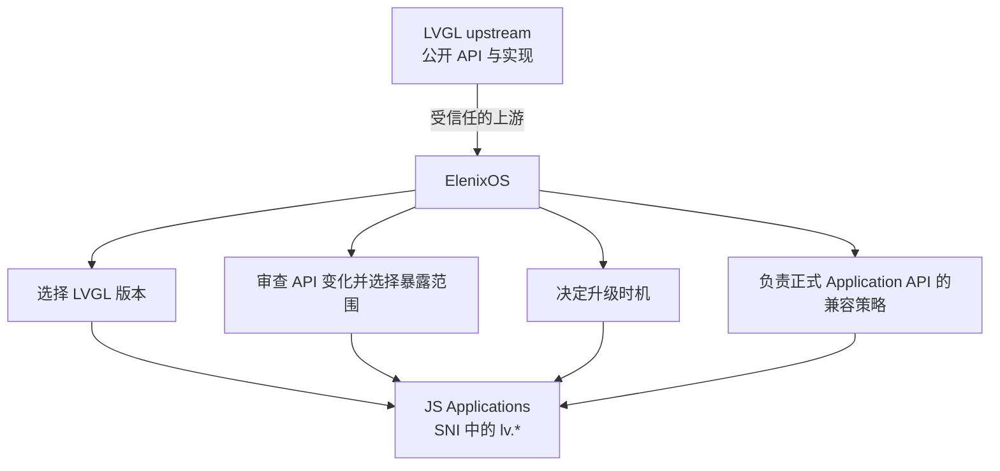
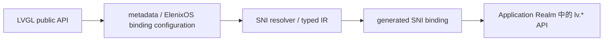

# SNI 架构与生命周期

## 定义与边界

SNI（Script Native Interface）是 ElenixOS 脚本 Realm 与 Native System 之间的调用和类型桥接边界。Realm 是一个脚本程序私有的 JavaScript 全局环境。SNI 把注册到 lv、eos 的 Native 能力挂载到该 Realm，在 JS 调用进入 C 时转换并校验参数，在 C 返回结果时把 Native 数据转换为 JS 值，并把 Native 事件和异步完成回调送回注册它们的程序 Realm。

SPM（Script Program Manager）拥有 Application、Watchface 等脚本程序的生命周期，并为每个程序配对一个 SNI context。SNI context 是该 Realm 对应的 Native 侧状态表；Script Engine Core 执行 JerryScript 并管理 Realm；Framework、服务和 LVGL 实现具体 Native 能力。SNI 负责跨边界的类型语义、Native 引用关联和回调归属，不拥有 Activity 栈、设备服务策略或脚本程序本身。

本文中的 Native owner 指实际决定某个 Native 实体何时销毁并执行其析构的 Native 组件。wrapper 只建立跨语言访问关系，不转移该所有权。程序 teardown 是 SPM 结束一个程序 Realm 并按依赖顺序关闭回调、解除 JS/Native 关联和清理资源的协调流程；context sweep 是其中遍历 SNI context 登记项并按类型执行清理的阶段。

调用路径是：Application/Watchface JavaScript → 程序 Realm → SNI 参数校验和转换 → Framework、服务或 LVGL → Native 结果再经 SNI 转换或派发回 owner Realm。来自平台或服务的异步结果先回到允许操作 JS/UI 的 Native 上下文，再由 SNI 同步进入所属 Realm；Realm 不从 ISR 或其他线程并发进入。

一个 C 函数或类型不会仅因存在于 Native 构建中就自动成为 JS API。API 描述和手写包装共同确定对 JS 可见的调用面；SNI 类型描述确定参数及结果如何跨界。调用入口、类型映射、Native 对象 owner 和回调 owner 是相关但不同的关系。

## LVGL 在 Application API 中的架构地位

在 ElenixOS 系统边界内，LVGL 是 GUI 子系统的组成部分。ElenixOS 选择并集成 LVGL 作为 GUI framework，LVGL 的公开 API 是 ElenixOS GUI API 的设计来源；LVGL upstream 是 ElenixOS 信任并管理的上游。Application 通过 SNI 使用 ElenixOS 选定版本所提供的接口，不能自行选择另一套 LVGL runtime version，也不能在 ElenixOS SNI/API surface 之外建立自己的 LVGL platform contract。

经 ElenixOS 选择并纳入发布 surface 的 `lv.*` 接口属于正式 Application API。API ownership 属于 ElenixOS 的平台策略，不取决于绑定代码由谁编写：ElenixOS 选择 LVGL 版本和应用可见 API，审查并安排升级，决定接口变化何时进入 Application API，并为已经纳入正式 API 的接口制定兼容策略。因而，Application API 不额外建立一套与 LVGL 基本一一对应的 `eos.ui.*` facade 来长期镜像 LVGL；SNI 直接承载受控的 `lv.*` 接口。若 ElenixOS 定义与 LVGL 语义不同的高层 UI abstraction，该 abstraction 属于另一套 ElenixOS API。



直接绑定 LVGL API 不等于跟随 upstream 自动升级。每个 ElenixOS 发布版本将选定的 LVGL 版本及其应用可见 API surface 纳入自己的平台 contract。采用新版本前，ElenixOS 审查 upstream 的 API 与行为变化并完成兼容性评估；新增 API 是否进入 `lv.*` 由 ElenixOS 决定。对已选择且与既有 contract 兼容的 upstream API，绑定采用直接映射；只有实际不兼容变化需要处理时，才引入对应的 alias、生成适配器、小型兼容 shim，或在 ElenixOS 自身的 major API/version 中迁移。LVGL upstream 发布 major version 本身不触发 ElenixOS 升级；ElenixOS 可以继续采用当前稳定版本，也可以安排平台级迁移。

LVGL binding generator 是该架构边界的一部分，负责把经 ElenixOS 选择的 API 转为 SNI 绑定机制：



生成器降低新增受支持 LVGL API 的绑定维护成本，但生成结果本身不决定平台稳定性。哪些绑定属于正式、稳定的 Application API，仍由 ElenixOS 的版本和发布策略确定。此定义针对 LVGL 作为 ElenixOS 所选完整 GUI framework 的架构角色；它不构成把所有第三方库直接暴露给 Application 的通用规则。硬件 vendor driver、RTOS 内部实现和文件系统实现不会因此自动成为 Application API。

## 类型系统：值、对象与句柄

SNI 类型系统将基本值与对象分开。对象模型只有两种对象：Value Object 和 Handle Object。Value Object 表示跨界复制的数据；Handle Object 表示具有 Native identity、并由一个明确生命周期模型保护的 Native entity。两者在 JavaScript 中都可能表现为普通 JS object，但语义、identity 与回收方式不同。

```text
SNI Object
├── Value Object
└── Handle Object
    ├── Object Tree Node
    └── Managed Resource
        ├── Pure Managed Resource
        ├── Tree-Dependent Resource
        └── Hybrid Resource
```

这个模型描述的是可持久暴露给 JS 的 Native identity。C 中出现 `T *` 不足以成为 Handle Object；只有 SNI 能建立身份复用、失效通知以及与真实 Native owner 协调的销毁/清理闭环时，该 Native entity 才适合作为持久 handle 暴露。短时 callback 参数、值结构和没有生命周期集成的外部指针不构成额外的正式 handle 类别。

| 类别 | C 侧表示 | JS 侧表示 | 身份、复制与生命周期 |
| --- | --- | --- | --- |
| 基本值（`SNI_T_*`） | 整数、浮点数、布尔值、字符串或显式声明的裸指针。 | Number、Boolean、String，或 `SNI_T_PTR` 使用的地址数值。 | 标量按值转换。字符串跨界复制内容。基本值不表示可查找的 Native 对象身份。 |
| 值对象（`SNI_V_*`） | 由类型描述指定字段的 C 结构体或值数据。 | 普通 JavaScript object，属性对应描述中的字段。 | C→JS 逐字段复制；JS→C 将属性复制到调用方提供的 C 目标中。JS 对象没有原生对象身份，也不关联独立 Native 资源。 |
| Handle Object（当前实现使用 `SNI_H_*` 类型号） | 满足一种正式生命周期模型的 Native entity。 | 普通 JS wrapper object，带有 SNI 的 Native 关联元数据。 | wrapper 在 Native entity 的有效期内关联其 identity；SNI 在 C→JS 时复用有效 wrapper，在 Native entity 失效时使关联失效。Handle 本身是否拥有 Native entity 由其正式子类定义。 |
| 裸指针（`SNI_T_PTR`） | 显式传递的地址。 | 当前桥接将地址表示为 Number。 | 只传递地址数值，不包含 SNI handle 的类型校验、身份复用、存活通知或自动释放语义。 |

### 基本值与 Value Object

基本值是按值解释的数据。整数、浮点数、布尔值和字符串不会因跨界而保留一个可供 JS 稍后查找的 Native 对象身份。字符串从 JS 转 C 时，桥接分配包含字符串内容的 Native 副本；从 C 转 JS 时，JS 字符串持有内容副本。转换产生的 C 字符串内存由执行该转换的绑定调用路径释放。

Value Object（值对象）是通过字段描述映射的结构化值。它适用于坐标、区域、颜色分量、动画参数等数据：JS 需要字段值，但不需要持有原始 C 结构的地址，也不需要管理该结构的资源生命周期。值对象的 C 结构可以在栈上、调用方结构中或其他 Native 存储中；只要 SNI 类型映射声明它是值对象，桥接就读取字段并构造 JS object。

从 C 到 JS 时，SNI 按字段描述读取 Native 结构，在普通 JS object 上设置属性；从 JS 到 C 时，SNI 读取这些属性并写入调用方提供的目标结构。属性转换不保留 C 结构地址，之后修改 JS object 也不会回写原 C 结构。JS object 可由 JS 引擎正常回收；源结构和目标结构仍由各自的 Native 调用方管理，不进入 SNI Native 资源登记表，也不参与 Native 资源清理。

`SNI_V_LV_COLOR` 是当前的特殊映射：C→JS 按颜色字段生成对象；JS→C 还接受 Number，并通过 `lv_color_hex` 构造 `lv_color_t`。这是该类型的 API 表示规则，不改变它作为值数据、没有独立 Native identity 的语义。

“Value”与“Value Object”不是两种互斥的所有权模型。文档中“值”是按值传递语义的总称；`SNI_T_*` 表示基本值，`SNI_V_*` 表示具有字段描述的结构化值。

### Object 与 Handle Object

Value Object 与 Handle Object 在 JavaScript 语言层面都可能表现为 object。Value Object 只承载复制后的数据字段；Handle Object 是 Native entity 的 JS 身份入口，关联该 Native entity 的 SNI 类型和生命周期记录。JS wrapper 不是 Native entity，也不会因创建 wrapper 而取得 Native 所有权。

Native object 是由 LVGL、Framework、服务或其他 Native 子系统创建和管理的实体。它具有由 Native owner 决定的 identity 和销毁时机。只有声明为对象型句柄的 SNI 类型才把这种 Native identity 暴露给 JS。一个 C 指针声明本身不能说明它指向 Native object、值结构、字符串、buffer，还是一次调用中的临时借用数据。

Handle Object（句柄对象）是访问一个具有 Native identity 的实体的 JS wrapper。它解决 JS 对象与 C Native identity 之间的稳定关联：C→JS 可按实体和类型复用 wrapper，JS→C 可校验 wrapper 的类型与有效状态后取得关联地址。句柄表示访问身份，不自动表示 Native 所有权；其所有权和失效规则来自 Object Tree Node 或三种 Managed Resource 定义。

正式模型中，Object Tree Node 由 LVGL object tree 拥有；Managed Resource 则分为 Pure Managed、Tree-Dependent 和 Hybrid。context 登记只是 SNI 的查找与失效机制，不能单独决定 Native owner，也不能把一个指针归类为 Managed Resource。当前仍以 `SNI_H_*` 编号包装的值型、栈期或未集成外部引用，是实现偏差，不构成第四种 Handle Object。

### Pointer 与类型映射

C 的 `T*` 只说明表达式是地址，不说明它的跨界语义。相同的指针形状可分别表示：

- `SNI_H_*`：当前实现使用的 Handle Object 类型号；类型号只有在对应 Native entity 满足正式生命周期模型时才代表合法的持久 Handle Object；
- `SNI_V_*`：只在转换时读取或填充的结构化值；
- `SNI_T_STRING`：按字符串内容复制的字符序列；
- `SNI_T_PTR`：由绑定显式声明的裸地址数值；
- API 定义的 buffer、输出参数或短时借用引用。

因此，C 指针类型不编码 JS 表示、对象 owner、调用者所有权、有效时段或销毁操作。特别是，`T *` 是 C 调用形式，不是 SNI ownership 类型；类型描述也不能替代生命周期集成。`SNI_T_PTR` 只传递地址数值，不执行 Handle Object 的类型、身份或有效性检查。若某 Native entity 的外部 owner 无法与 SNI 协调销毁/失效，该指针不具备通用持久 handle 的准入条件；调用方可改为返回值或 Value Object，或提供有明确 owner 集成的专用 wrapper。

类型转换发生在 SNI 边界。JS→C 时，绑定先依据声明的类型转换参数并检查类型/句柄状态，再调用 Native 实现；C→JS 时，绑定按返回类型复制值或建立/复用句柄 wrapper。转换失败时，绑定停止该次 Native 调用，并以该 API 定义的异常或状态返回给 JS。

自动生成代码与 SNI 类型模型的关系是按语义选择转换：Value Object 根据字段描述复制数据；Object Tree Node 根据已知的 LVGL object 类型语义建立可观察删除的 control block；Pure Managed 只对应 SNI create path 建立的资源闭环；Tree-Dependent 的创建包装同时建立 parent association，相关提前删除路径同步失效 handle；Hybrid 依赖明确的 SNI/Native owner 集成。生成器从 `T *` 声明本身无法推导这些关系；不满足生命周期准入条件的指针不作为通用持久 Handle 自动映射。

## Native identity、wrapper 与查找关系

### LVGL 对象树节点

Object Tree Node（对象树节点）是由 LVGL object tree 管理生命周期的 `lv_obj_t` 实例，例如 `lv.obj` 及其子类。Native identity 是该 `lv_obj_t` 对象；Native owner 是 LVGL object tree，树根 View 的上层 owner 决定整棵 View tree 何时被删除。SNI 关联 JS wrapper，但不接管节点销毁权。

节点不必由 SNI 创建。Native API 返回一个仍有效的 parent、child 或 current object 时，只要 SNI 能在该节点上建立 control block 并接收 LVGL delete notification，它就可以成为 Object Tree Node Handle。此模型的安全基础是“LVGL tree owns lifetime，SNI observes deletion”，而不是“SNI owns creation”。同一个 Native tree node 通过多条 API 暴露时，SNI 复用该节点的有效 wrapper identity。

当前实现以 control block（控制块）连接一个 SNI LVGL handle、一个 LVGL 对象和一个 JS wrapper：

JS wrapper
  ↕ JerryScript 原生元数据
SNI control block（`ptr`、类型、alive、`js_obj`、owner context、engine generation）
  ↕
LVGL object
  ↕ `eos_wdata`[`EOS_WDATA_SNI_CB`]
SNI control block

控制块是 SNI 的关联与有效性记录，不是 LVGL 节点，也不拥有该节点。它记录 Native 地址、SNI 类型、存活状态、所属 context、创建时的 engine generation、JS wrapper 引用，以及依附于该节点的子资源记录。JS wrapper 的 JerryScript 原生元数据指向控制块；LVGL 对象通过 `eos_wdata` 的 `EOS_WDATA_SNI_CB` 类型化键反向找到控制块。这里使用的是 ElenixOS 的对象数据注册表，不是把 SNI 控制块独占写入 LVGL 的 `user_data`。

### 登记资源与双向查找

不是 Object Tree Node 的 Managed Resource 使用 `sni_context` 中按 SNI 类型分组的登记节点，而不是树节点 control block。登记节点可记录 Native 地址、JS wrapper、类型、存活状态，以及 Tree-Dependent Resource 的父 control block 关系。登记回答“SNI 如何找到 wrapper / 使关联失效”；它不回答“谁拥有 Native entity”。

程序 Realm
  → SNI context
      → 按类型分组的资源链表
          → 登记节点（`ptr`、type、`js_obj`、alive）
              ↔ JS wrapper 的 JerryScript 原生元数据
              → 可选 `parent_cb` 关系
                  → 父 LVGL 节点 control block
                      → `eos_wdata`[`EOS_WDATA_SNI_CB`]

两种句柄使用不同查找方向：

| 查找方向 | LVGL 树节点 | context 登记资源 |
| --- | --- | --- |
| JS→C | 从 JS wrapper 的 JerryScript 原生元数据取得 control block，再校验 SNI 类型和 `is_alive`，取得 Native 地址。 | 从 JS wrapper 的原生元数据取得登记节点，再检查登记节点、类型和 `is_alive` 标志，随后读取其中的地址；这不是对 Native owner 的通用存活查询。 |
| C→JS | 从 LVGL 节点的 `eos_wdata`[`EOS_WDATA_SNI_CB`] 找到 control block，并复用其 wrapper。 | 在当前程序 context 对应类型的资源链表中按 Native 地址查找，并复用该节点的 wrapper。 |
| 查找成本 | JS→C 与树节点→JS 通过已有的关联记录直接访问；树节点不在 context 资源链表中。 | JS→C 直接从 wrapper 取登记节点；C→JS 在线性扫描当前类型链表后找到记录。资源查找不是全局 O(1) 索引。 |

同一活跃关联被多次 C→JS 转换时，SNI 返回记录中已有的 JS wrapper，而不是为每次转换创建一个新 object。这样在该关联范围内，JS 的严格相等比较、Map/Set 键和事件目标保持同一身份。复用边界由 Native 地址、SNI 类型和关联所在的运行时上下文决定；它不是“任意相同地址、任意类型、任意 Realm 都共用一个 JS 对象”的承诺。例如 Activity 的 `eos.view` wrapper 与同一 View 的 `lv.obj` wrapper 属于不同 SNI 类型，不能从它们引用同一 Native 地址推导出 JS 严格相等。

LVGL 发出节点删除事件时，SNI 将控制块标为失效、清除 Native 地址并释放 SNI 持有的 JS 引用。父节点关联的子资源也被标记失效，清除 Native 关联并释放其 JS 引用。程序仍持有的旧 JS wrapper 可以继续作为一个 JS 值存在，但之后不能再通过 SNI 转换成有效 Native 地址。删除事件由 Native owner 触发；wrapper 被 JS 变量丢弃不会删除 LVGL 节点。

### Control block 与 generation

control block 提供树节点 wrapper 的 Native 侧关联状态：地址回答“访问哪个节点”，类型用于句柄转换校验，存活位阻止已删除节点继续被使用，`js_obj` 用于 C→JS 找回 wrapper，`owner_ctx` 标明注册该节点的程序 context，`engine_gen` 区分 JerryScript 引擎复位前后的运行代次，`sub_resource_head` 连接依附该节点的登记资源。

Native 删除通知负责节点的即时失效；generation 解决引擎复位后旧 control block 或回调记录仍留在 Native 存储中的隔离问题。当前 generation 字段存在于树节点 control block 和异步 callback context；普通 managed-resource 登记节点本身没有 generation 字段。程序 context 与其 Realm 的绑定及旧 Realm 销毁共同约束这类资源句柄的有效期，因此 generation 不是每一种 handle 都重复保存的通用字段。

引擎正常代次内，对象树 Native owner 先删除节点时，SNI 删除事件会使 wrapper 失效。Fatal reset 令旧 JerryScript heap 不再可访问；SPM 的恢复路径清理可安全清理的 Native 关联，并让新引擎使用新 generation 和新 Realm。旧 JS 值、旧 Realm 和旧回调不会迁移到新一代运行环境。

## 资源模型与所有权

Native ownership、SNI registration 与 SNI resource category 是三个不同概念：

| 概念 | 含义 |
| --- | --- |
| Native owner | 真正决定 Native entity 何时销毁、并执行其析构的组件。 |
| SNI registration | context 保存的地址、类型、wrapper 和可选父关系，用于按 Native identity 找回 wrapper、同步失效及 teardown 清理桥接记录。 |
| SNI resource category | 正式对象模型中描述生命周期关系的分类；registration 本身不会把一个 entity 变成 Pure Managed、Tree-Dependent 或 Hybrid。 |

正式资源模型仅包含以下三类 Managed Resource：

| 类别 | 创建与 Native owner | JS GC | Native owner 提前销毁 | context teardown |
| --- | --- | --- | --- | --- |
| Pure Managed Resource | 资源经 SNI constructor/create path 创建；SNI 是其生命周期权威，资源不依赖 LVGL object tree。 | 丢弃 wrapper 不代替显式 destroy；资源仍由 SNI 跟踪。 | 正常显式删除走 SNI 控制的销毁并同步注销 handle。 | 未显式删除的资源由 SNI 执行最终 Native 清理，再释放登记。 |
| Tree-Dependent Resource | LVGL 在一个 Object Tree Node 内创建并拥有的 Native 子资源；SNI 只持有独立 JS identity 和 parent association。 | GC 不删除 Native child，也不改变 parent ownership。 | parent node 删除或子资源显式 remove 时，SNI 同步使对应 handle 失效；Native owner 执行 child 析构。 | 清理关联与 wrapper 记录；不重复析构 Native child。 |
| Hybrid Resource | 由另一个 ElenixOS subsystem/owner 管理，并与 SNI 建立明确的双向生命周期协议；双方分别管理 Native entity 与 JS identity。 | GC 不代替 Native owner 的销毁协议。 | Native owner 的删除/注销路径通知或同步调用 SNI，使 wrapper 关联失效。 | SNI 按协议清除关联；只有协议明确授权的阶段才由 SNI 触发 Native destruction，避免重复析构。 |

### Pure Managed Resource

Pure Managed Resource（纯托管资源）是生命周期独立于 LVGL object tree、并由 SNI 建立完整创建—跟踪—销毁闭环的 Native resource。该资源经 SNI 暴露的 constructor/create path 创建，创建后登记到对应 context；若提供运行期 destroy/delete API，该路径由 SNI 控制并同时注销 handle；脚本未主动删除时，Realm/context teardown 由 SNI 执行最终清理。SNI 因此是该资源生命周期的 authority，能够避免 Native owner 先释放资源后 sweep 再析构旧地址。

“通过 SNI context 登记”是闭环中的跟踪步骤，但登记操作本身不会创建 Native resource，也不能证明该指针归 SNI 管理。一个 Native C type 可以同时对应 SNI 创建的资源实例和 LVGL/display/其他 subsystem 创建的实例；只有来自 SNI create path 且由同一生命周期闭环覆盖的实例属于 Pure Managed Resource。`lv_timer_t *` 是 C 表示：经 `new lv.timer()` 创建、登记并可经 SNI timer delete 或 context sweep 清理的 timer 实例符合 Pure Managed 模型；display refresh timer 或其他 subsystem 创建的 `lv_timer_t` 不会因 C 类型相同而自动符合该模型。

### Tree-Dependent Resource

Tree-Dependent Resource（树依赖资源）是 LVGL 在某个 Object Tree Node 内部创建并由该父节点拥有、但 JS 仍需独立 wrapper/handle 的 Native 子资源。其典型关系是 `parent lv_obj_t → owned child resource`：Native owner 是 parent tree node；SNI 建立子资源的 JS identity、context 登记和 parent control block association；父节点销毁时 LVGL 析构 Native child，SNI 使依赖 handle 失效。Chart series 与 cursor 是该模型的实例。该分类解决的是“Native 子对象属于树节点，但 JS 需要独立身份访问它”的问题。

父节点 control block 的 `sub_resource_head` 使节点删除回调能够定位依附于该节点的 handle；context 的类型链表负责按 Native 地址找回 wrapper。父节点删除时，SNI 先使关联失效，LVGL owner 负责 Native child 析构；teardown 释放父关系及 wrapper 元数据而不第二次析构 Native child。

父节点仍存活时的显式 child remove 是同一生命周期模型的另一个 Native destruction entry point。删除完成时对应 SNI association 同步失效。当前 `sni_api_lv_chart_remove_series` 与 `sni_api_lv_chart_remove_cursor` 调用 LVGL remove API 后没有解除 parent association 或移除 context 登记；handle 后续仍可能通过 `is_alive` 检查并把旧地址交给 Native API。`lv.obj.removeEventDsc` 及按 callback/user data 移除事件的路径也会移除 Native descriptor/释放 callback context，但未同步移除对应 `SNI_H_LV_EVENT_DSC` context resource node。以上都是 Tree-Dependent invalidation 实现缺陷和 stale-handle/use-after-free 风险，不是该正式分类的缺口。

### Hybrid Resource

Hybrid Resource（混合生命周期资源）是由另一个 ElenixOS subsystem/Native owner 管理、同时需要 SNI 长期维持 JS identity，并且 SNI 与该 owner 之间存在明确生命周期协作协议的 Native entity。混合之处是两侧管理不同责任：外部 Native owner 决定 entity 的业务生命周期并执行其常规析构；SNI 管理 JS wrapper identity、context association 与 Realm teardown 期间的协调。owner 销毁 entity 时，协议同步让 SNI association 失效；teardown 按协议选择是请求 owner 销毁，还是仅清除 SNI 关联。Hybrid 不是任意外部指针，也不是 borrowed pointer 的同义词。

当前 `eos.activity` 和 `eos.view` 位于 Hybrid 类型范围，但 Native 关系不同：

- Activity 实体由 Activity Framework 管理。尚未进入 Activity 生命周期的 JS 创建 Activity 会留在程序 context 中；正常 teardown 对仍存活且尚未启动的 Activity 执行兜底销毁。进入页面生命周期后的 Activity 由 Activity Controller/页面路径管理；context sweep 不重复销毁已进入控制器生命周期的 Activity。
- View 是 Activity 持有的 LVGL 根节点。Activity 删除路径删除其 View；SNI 对 `eos.view` 保留的只是按类型登记的 wrapper 关联。context sweep 清除该关联，不额外删除 View。
- JS 显式调用 Activity destroy 或替换 View 时，SNI 包装路径先移除相应资源登记，再进入 Native 删除路径。之后不再由该 context sweep 对已删除对象做第二次析构。

当前源码的 Hybrid 生命周期集成没有覆盖所有外部销毁路径：`sni_context_invalidate_resource` 可以将登记地址置空，但仓库内没有其调用点。context sweep 只对 Activity 地址使用 live registry 检查，普通 JS→C 转换则只检查登记节点、类型和 `is_alive`，不在每次访问时查询 Activity/View owner。因此，如果 Activity 或 View 在 Realm 仍运行时被外部 Controller/Native 路径销毁，而 SNI 登记未先移除，wrapper 仍可能把旧地址交给 Native 调用。当前实现没有建立即时失效保证，也没有排除 use-after-free 风险。显式 SNI `activity.destroy` / `setView` 路径会先注销关联；外部 owner 的其他销毁路径仍是实现缺陷。该缺口不改变 Hybrid 的正式定义。

### 临时或未集成引用：当前实现偏差

临时 Native 数据不是 Handle Object 的一种生命周期类别。若 Native 数据只在一次同步调用或 callback 执行期间有效，边界使用 Value Object/基本值复制所需数据，或由专用 callback wrapper 限定访问范围；若 Native pointer 由外部 owner 管理且 SNI 无法观察其销毁，该 entity 不具备通用持久 Handle 的准入条件。这里描述的是边界处理，不增加 Borrowed Resource、External Resource 或 Scoped Resource 等正式类型。

当前实现有若干 `SNI_H_*` 类型仍被用于这类情况。类型号和 context 登记不能赋予其长期 Native identity，也不能给出借用范围。特别是 `lv_event_t` 来自事件派发中的短时对象；绘制 descriptor、display/layer 引用及其他栈期结构也必须按各自 API owner 和有效期判断。当前通用 bridge 对登记节点的检查不是 Native owner 的存活检查。若这类包装允许 JS 保存 wrapper 并在原调用/owner 生命周期之外继续访问，现有实现存在 stale pointer 风险，应视为尚未收敛到正式类型模型的实现债务。

### 当前 Handle 映射与正式模型的差异

`sni_context` 中出现登记节点，只证明实现保存了 wrapper association；resource sweep 中出现一个析构分支，也只证明实现按该类型号执行清理。两者都不能代替“对应实例由谁创建、谁拥有、如何通知提前销毁”的生命周期闭环。当前源码按 `SNI_H_*` 类型号登记指针，因此同一个 C type 的不同来源可能被合并到相同清理分支。下表区分正式分类和已核对的实现状态：

| 当前 Native type / 引用 | 正式模型中的判定 | 当前实现状态 |
| --- | --- | --- |
| `lv_obj_t` | Object Tree Node；包括 SNI 创建和 Native getter 返回的已有有效节点。 | control block 通过 `eos_wdata` 关联节点，LVGL delete notification 使关联失效；其安全性来自 tree owner 与删除观察。 |
| `lv_timer_t` | 仅由 `new lv.timer()` 创建并纳入 SNI 闭环的实例属于 Pure Managed Resource。 | SNI constructor 创建 timer、加入 context 并绑定 wrapper；显式 delete 与普通 sweep 清理 timer 和 callback state。其他 subsystem 创建的同类型 timer 不因类型号而自动属于 Pure Managed。 |
| SNI Animation wrapper | 只有 SNI 创建并完整控制的动画 abstraction 才可作为 Pure Managed Resource。 | constructor 创建并登记 `sni_anim_callback_ctx_t`，而非通用 `lv_anim_t *`。当前 sweep 会解除活动动画的 callback/user-data association 并释放 SNI context，但没有在该分支显式删除 `active_anim`；因此仅凭该路径不能证明 Realm teardown 会停止/销毁活动 Native animation。该类型不能推广为任意 LVGL animation handle。 |
| Chart series / cursor | Tree-Dependent Resource。 | `addSeries` / `addCursor` 建立 parent association；parent 删除路径使 child handle 失效。当前 `removeSeries` / `removeCursor` 在 Native child 删除后没有同步注销 SNI association，是需要修复的提前失效 bug。 |
| AnalogDial hand handle | Tree-Dependent Resource。 | `eos_ww_analog_dial_get_hand()` 返回与 AnalogDial object 关联的 hand handle；SNI 将它链接到该 parent control block，parent 删除时依赖 handle 一并失效。 |
| `lv_event_dsc_t` | 由 SNI 为特定 Object Tree Node 注册的 callback descriptor 属于 Tree-Dependent Resource。 | Native callback context 记录 owner object，owner deletion/普通 teardown 会清理 descriptor 与 callback state；但通用 `SNI_H_LV_EVENT_DSC` resource node 未建立 parent control block link，显式 remove 也没有注销该 handle association。因此 owner 路径能清理 Native callback state，不代表 JS descriptor wrapper 已即时失效。 |
| `lv_draw_buf_t` | 按实例来源判定；只有满足 SNI 创建、SNI 跟踪、SNI 控制销毁闭环的实例才可为 Pure Managed。 | 同一 `SNI_H_LV_DRAW_BUF` 包装 `canvas.getDrawBuf()` 返回的已有 buffer，也包装 SNI canvas 特殊路径创建并交给 canvas 的 buffer。前者可能由调用方/Canvas owner 管理；后者由 canvas context 保存并在 `freeBuffer` / object delete 路径销毁。两条特殊销毁路径没有同步移除对应 context resource node；随后通用按类型 sweep 仍调用 `lv_draw_buf_destroy`，而 `getDrawBuf()` 也没有证明返回对象归 SNI 所有。该类型目前存在 stale handle、重复析构或错误释放风险，不构成已验证的 Pure Managed 闭环。 |
| `lv_style_t` | 只有 SNI create path 创建并由 SNI 完整销毁的 style 实例才属于 Pure Managed。 | 当前绑定树中找到的是作为参数的 `SNI_H_LV_STYLE` 转换，没有对应 SNI constructor/C→JS 创建闭环；sweep 的 reset/free 分支不证明 pointer 来源。该类型当前未确认为 Pure Managed。 |
| `lv_font_t` | 只有 SNI 创建且析构权覆盖其具体字体种类的实例才属于 Pure Managed。 | 当前绑定树中找到的是 font 参数转换，没有对应 SNI 字体创建路径；sweep 调用 `lv_binfont_destroy`，源码注释同时指出系统/内建字体是静态对象。若这类指针进入同一登记分支，按 C type 清理不能区分动态 binfont 与 static font。当前未确认为 Pure Managed。 |
| `lv_group_t` | 只有 SNI constructor/create path 建立完整闭环的 group 实例才属于 Pure Managed。 | 当前 type enum 和 sweep 中有该类型编号/`lv_group_delete` 分支，但在 SNI binding tree 未找到对应创建和 wrapper 导出路径；析构分支本身不构成闭环证明。 |
| `lv_observer_t` | observer 若归属于 subject 或其他外部 owner，只有该 owner 与 SNI 有明确定义的失效协议时才可作为正式 Handle；类型编号不能把它变成 Pure Managed。 | 当前 type enum/sweep 包含该编号和 `lv_observer_remove` 清理分支，但在 SNI binding tree 未找到相应 create/export path 或 owner invalidation integration。当前归属与有效期未由实现闭环说明。 |
| `lv_subject_t` | caller-owned 或其他 subsystem 初始化的 subject 不属于 Pure Managed；仅由 SNI 创建并由其负责 deinit/free 的实例才可能符合该类。 | 当前 binding tree 使用 subject handle 作为参数，但没有找到对应 SNI create/export path；sweep 的 `lv_subject_deinit` / `eos_free` 假定了注销清理方式，却不能证明每个传入地址由 SNI 分配。 |
| `lv_layer_t` / display 引用 | display owner 管理的 Native 引用没有显式 SNI 生命周期协议时，不属于 Pure Managed，也不自动成为 Hybrid。 | `SNI_H_LV_LAYER` 位于现有纯托管枚举范围，但 sweep 不执行独立析构，源码称其由 display 清理；layer 的来源和 display 删除与 SNI wrapper 的同步失效未由通用 handle 关系表达。这是现有分类错位。`lv_display_t` 也位于残余 handle 编号范围，不能据此视为正式 Handle。 |
| `SNI_H_LV_EVENT_CB` | 只有有稳定 Native identity 且满足正式生命周期模型的 callback record 才可作为 Handle Object。 | 当前源码中该编号出现在 type enum/name table，但没有发现对应的创建、bridge 或 JS API 路径；enum 所在的 Tree-Dependent 区间本身不能作为生命周期定义。 |
| `lv_color_filter_dsc_t`、`lv_event_t`、绘制 descriptor 等值型/短期数据 | Value Object、基本值或有边界的专用 callback 参数；没有稳定 Native identity 时不属于 Handle Object。 | 部分仍位于 `SNI_H_*` 范围。事件派发把栈上的 `lv_event_t *` 转成 context resource handle，但 callback 返回后没有移除登记或使 handle 失效，登记节点仍保存该地址；JS 保留的 wrapper 可能在事件栈结束后继续解引用。Color Filter sweep 注释称其常为栈数据，但按类型清理会 `eos_free` 登记地址。类型范围、来源和清理语义未统一，属于技术债而非正式资源类别。 |
| `eos.activity` / `eos.view` | 需要外部 owner 与 SNI 双向生命周期协议的 Hybrid Resource。 | 当前有 SNI 显式 destroy/setView 注销及 teardown 协调路径，但外部 Controller 销毁时的即时 invalidation 尚不完整，存在前述 stale pointer 风险。 |

因此，当前源代码的“Pure Managed range”不是逐实例 ownership 证明。Timer constructor 是已确认的 Pure Managed 闭环示例；其余类型需要逐项确认创建路径、显式销毁、外部 owner 通知和 teardown 责任。Layer、Canvas draw buffer、栈期 event/descriptor 等当前行为不得用来放宽 Pure Managed 或 Handle Object 定义。


## SNI Context、Realm 与 API 注册

SNI context 是与一个脚本程序 Realm 配对的 Native 侧生命周期上下文。SPM 为每个程序创建一个 context 并设置其 owner program；Core 为该程序准备 JerryScript Realm 并在其中挂载 SNI API。活动调用或 callback dispatch 时，当前程序提供关联的 context。Realm 保存该程序的 JS 全局对象与脚本环境；context 保存需要由 Native 侧按程序隔离的桥接状态。当前普通程序及 Console program 都各自有 context。

context 记录：

- 按 handle 类型分组的资源登记链表及计数；
- LVGL event callback context；
- Sensor request callback context；
- Metric subscription callback context；
- 所属 program、paused gate 和 teardown 阶段。

全局 SNI 初始化时注册值对象字段表、LVGL/ElenixOS API 描述及桥接行为；这些类型和 API 描述不是每个 context 单独复制的资源清单。Core 创建或准备一个 Realm 时调用 SNI mount，把 lv 和 eos API 对象挂载到该 Realm。API 描述包含类、构造函数、实例/静态方法、属性和常量；LVGL 类型生成器输出 API/字段描述，运行时类型桥接按这些描述执行转换。手写包装也通过同一桥接边界处理类型。生成器不会从 C 的 `T*` 自动推导 identity、ownership 或有效期。

context 不拥有 JerryScript Realm，也不拥有全局 API/type descriptor 表；这些分别由 Core/SPM 和 SNI 初始化层管理。Native 服务对象、Activity 页面栈和 LVGL display 也不因其 wrapper 登记在 context 中而转移到 context 所有。

context 资源链表是一种 SNI association/tracking 结构。节点存在不等于底层 Native entity 由 context 或 SNI 拥有；Native owner 和允许的销毁动作仍由 Object Tree Node、Pure Managed、Tree-Dependent、Hybrid 的正式语义决定。当前实现中，链表也保存了尚未归入正式 Handle Object 模型的历史 `SNI_H_*` 项；这部分是实现遗留状态。

## Pause、Callback 与执行上下文

Callback context 是 Native 保存的一条延迟调用记录，包含 JS 函数及可能的 user data 引用，并关联注册时的 owner program、SNI context 和 engine generation。Native 事件、timer、animation、Metric 或 Sensor 完成通知都使用所属记录返回原 owner。回调的 owner 是注册它的程序，不是通知发生时恰好处于前台的程序。

派发前会检查 callback 是否仍有效、engine generation 是否匹配、context 是否暂停、owner program 是否为 `ACTIVE`。通过检查后，SPM 同步切换到 owner Realm 执行 JS callback，再恢复先前程序状态。JerryScript Realm 不会从 LVGL 其他线程或 ISR 并发进入；来自不适合操作 JS/UI 的上下文的结果由相应 Native 路径投递到允许派发的上下文。

暂停只关闭 callback gate，并暂停登记的 timer/animation；它保留 Realm、context、callback 和资源登记。传感器请求或 Metric 订阅不会因暂停自动取消。完整程序 teardown 才会取消 SNI context 拥有的请求/订阅并释放 callback 引用。程序状态从 `ACTIVE` 进入 `STOPPING` 后，新 callback 不再进入 JS。Timer 或 Animation callback 删除自身时，运行时会先标记待删除，等 callback 从 JS/Native 调用栈返回后再执行实际清理。当前程序在自己的活动 callback 中请求终止时，SPM 返回 `BUSY`，避免调用栈尚未返回就释放 Realm。

## Teardown 与生命周期顺序

Teardown 是 SPM 结束一个程序 Realm 时协调 Native 回调、SNI context、JS 引用、程序 View 和资源 owner 的过程。它不等于 JavaScript GC，也不等于一次资源链表 sweep。正常 teardown 有两个先后约束：引用和 LVGL event descriptor 要在 JerryScript heap 仍可操作时解除；Native 对象只由其真实 owner 销毁，SNI sweep 再按类型处理剩余记录和独立资源。

### 触发与非触发

正常 teardown 发生于 SPM 终止程序、脚本启动/执行失败后的清理，以及替换/重载等由 SPM 走终止路径的操作。单纯挂起/恢复不会 teardown；Realm 和 context 保留。运行期某个 callback 抛出 JS 异常也不单独等价于程序 Realm 销毁，后续错误处理由对应 dispatch/SPM 路径决定。Fatal engine reset 是另一条紧急恢复路径，不执行普通的完整 sweep。

### 普通 teardown 的阶段

SPM 当前按以下依赖顺序执行普通程序终止。阶段含义和 owner 边界是稳定解释；内部函数名及枚举编号属于实现细节。

1. **停止新派发。** 程序状态切到 `STOPPING`，SNI 暂停 timer/animation 并关闭 context callback gate。
2. **断开 managed wrapper 的 Native 元数据。** SNI 清除 context 登记资源 wrapper 上的 Native pointer，避免后续 JerryScript GC 通过 native free callback 修改仍在遍历的资源链表。
3. **释放 JS 引用并取消异步登记。** SNI 取消该 context 的 Sensor request 和 Metric subscription，释放 timer/animation callback 的 JS 函数及登记 wrapper 引用，并在 heap 有效时运行 GC。
4. **移除 LVGL event callback。** SNI 从仍有效的 LVGL 对象上移除 event descriptor，释放 callback/user data 引用和对应 Native callback 记录。
5. **清理程序 View。** SPM 调用程序的 View cleanup 路径。页面/Activity owner 删除其拥有的 View tree；LVGL 删除通知使仍关联的树节点 wrapper 失效。
6. **释放或停止 Realm。** 当前执行程序经 Core stop 路径释放；非当前程序释放自己的 Realm。程序停止后的旧 Realm 值不再是可继续调用的 JS 环境。
7. **SNI Native sweep。** context sweep 按正式资源关系处理仍有效的登记：Tree-Dependent 解除 parent association 并释放 SNI wrapper 记录；Hybrid 按外部 owner 协议协调失效/销毁；Pure Managed 执行 SNI 负责的最终 Native 清理。Object Tree Node 与 parent 已回收的 Tree-Dependent Native child 由其真实 Native owner 销毁。
8. **释放 context。** SPM 销毁已 sweep 的资源表和 callback/list bookkeeping，并丢弃程序记录。

当前实现还保留一个额外的 residual `SNI_H_*` sweep loop，用于释放不属于 tree-dependent、hybrid 或 pure-managed 枚举范围的历史登记节点。该 loop 的存在不使其中的值型、栈期或未集成外部指针成为正式 Handle Object，也不证明它们有安全的跨界生命周期。

前几步已清除 JS wrapper/native association，并释放 callback 引用；Native sweep 的目标是剩余 Native 资源和 SNI 记录。Value Object 不进入这些阶段。Tree node 由 LVGL 树 owner 删除；Tree-dependent Native 子对象由父节点级联删除；Hybrid Activity/View 遵循 Activity owner；Pure Managed 类型走各自清理分支。

### Teardown 的边界与 JS GC

JS GC 回收 JS heap 中不再可达的对象，不执行通用的 Native resource destructor。当前有效的 tree handle control block 和 context resource node 持有相应 wrapper 的 JerryScript 引用，因此丢弃 JS 变量本身不会注销 Native 记录，也不会成为资源释放时机。Native owner 删除对象或显式 SNI 删除路径解除关联后，SNI 才释放所持 wrapper 引用；此时如果程序仍保留 JS wrapper，它成为不能转换回有效 Native handle 的旧对象。

因此，Realm 结束仍需 SPM/SNI teardown：资源链表和 Native 分配不是 JS heap 对象，JS GC 不会按类型调用 LVGL/Framework 析构；event descriptor、timer、animation 和服务 callback 还各自持有 Native 状态；Native tree owner 与 SNI context 需要按依赖顺序拆开双向关联。Realm/context 停止后，旧 wrapper、旧 handle 和 callback 不会迁移到下一个 Realm 或 engine generation。

普通 teardown 不会：

- 由 SNI 删除不属于它的 LVGL display、Activity 栈或 Native service；
- 再次释放父 LVGL 节点已经回收的 Tree-dependent Native 子对象；
- 仅因 JS 对某个 wrapper 不再有变量引用就销毁对应 Native 对象；
- 因为 context 中存在登记节点，就把该 Native entity 解释成由 SNI 创建、拥有或有权析构的对象。

### Fatal engine reset

Fatal reset 时 JerryScript heap 仍可能结构完整，但其中部分 handle 已不可信。SPM 使用专用恢复路径移除 event descriptors、中和 Sensor 请求，并把 timer/animation callback 和 user data 置空，再清理程序 View；之后释放 context shell 并重建引擎代次。此路径不执行完整的 managed-resource sweep，也不遍历所有 Realm/JS handle 做常规引用释放，以免 use-after-free 或 double free。因而一部分 Native 资源、资源登记节点和 callback context 会故意留存；timer/animation 等未被安全删除的对象以无 callback 的中和状态留在恢复路径中。新引擎丢弃旧 JS heap 与旧 handle。Fatal reset 不是普通 teardown 的资源完整回收保证。Core 如何捕获 fatal、重建 JerryScript heap，以及哪些 Program 会由管理器恢复，见[脚本引擎概述](../../script_engine_overview)。

当前 fatal reset 还有一条 Metric 订阅清理缺口：`eos.metric.subscribe` 为每个订阅创建 LVGL timer，并把订阅记录保存在 SNI context 的 Metric 列表中。SPM 的 fatal reset 路径没有调用普通 teardown 使用的 Metric cleanup，也没有中和这些订阅 timer；随后它释放 context 外壳。timer 重新启用后，旧 dispatcher 可能仍访问该订阅记录的 `owner_ctx`；当前有效性检查在 generation 比较之前先解引用 `owner_ctx`。源码因此没有建立“fatal reset 后所有旧 Metric callback 均安全失效”的保证，并留下潜在 stale-context 访问及 Metric demand 未释放的路径。

## 可发现的规范定义

当前 SNI 核心定义位于本页：

- SNI 的跨层职责和调用边界：**定义与边界**；
- LVGL 的 Application API 归属、SNI binding generator 职责和兼容策略：**LVGL 在 Application API 中的架构地位**；
- value / Value Object / JS object / Native object / handle / pointer：**类型系统：值、对象与句柄**；
- control block、`eos_wdata`、身份复用和双向查找：**Native identity、wrapper 与查找关系**；
- Pure Managed、Tree-Dependent、Hybrid，以及当前未收敛的临时/外部引用：**资源模型与所有权**；
- Realm 配对、Context 内容、API/type registration：**SNI Context、Realm 与 API 注册**；
- owner、generation、pause、callback：**Pause、Callback 与执行上下文**；
- teardown 阶段、GC 边界和 fatal reset：**Teardown 与生命周期顺序**。

脚本调用、页面/程序生命周期与 Native owner 的更大边界见[Application / Framework 契约](../../application_contract)、[Script Engine 概览](../../script_engine_overview)，Core 与 Platform 的责任边界分别见[Core 开发契约](../../core_development_contract)和[Platform / Vendor 契约](../../platform_contract)。
