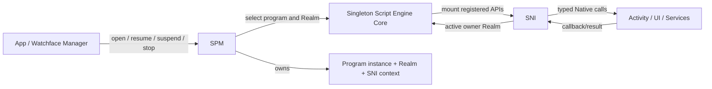

# 脚本引擎概述

脚本运行时让 Application 和 Watchface 共享一套 JavaScript 执行、Realm、模块加载和 Native API 边界。它由三种不同的 owner 协作：应用/表盘管理器选择要打开的安装身份和 Activity；SPM 管脚本程序实例及其生命周期；Script Engine Core 执行 JS；SNI 把已注册能力和 Native 资源安全地接到每个程序 Realm。应用/表盘管理器通过 SPM 请求程序启动和恢复，SPM 是程序生命周期与 Script Engine Core 之间的管理边界。

## Core 状态与 Program 生命周期

Script Engine Core 是一个全局 JavaScript 执行器，负责引擎初始化、Realm、模块解析、执行、垃圾回收和引擎级错误恢复。SPM 创建带独立 Realm 与 SNI context 的 Program，并保存安装身份、类型、权限及 `ACTIVE`、`SUSPENDED`、`STOPPING`、`TERMINATED` 生命周期状态。Core 的执行状态描述当前引擎调用窗口，不等于某个 Program 的生命周期：`main.js` 执行结束后 Core 可以回到 `IDLE`，而 Program 仍为 `ACTIVE`，其 Realm 仍可通过 timer/event 回调重新进入。

| 层 | 拥有的状态 | 不拥有的状态 |
|---|---|---|
| App / Watchface Manager | 已安装 ID、入口选择、对应 Activity 的启动/切换流程 | JerryScript Realm 与 SNI Native 资源 |
| SPM | Program 实例、Realm 关联、程序状态、程序级错误和回调 gate | Activity 页面栈策略、设备服务策略 |
| Script Engine Core | 全局引擎状态、JS 调用、Realm 执行、模块解析和引擎 generation | 应用导航、Recent Apps 卡片和硬件能力 |
| SNI | 每个 Program 的 JS/Native API 映射、句柄和 callback owner | Activity 栈、服务缓存与 Vendor 设备 |

当一个应用被 Recent Apps 保留时，SPM 可以让它的 Program/Realm 保持 `SUSPENDED`；恢复是恢复同一实例，不会重新执行 `main.js`。新应用入口通过 SPM 同步运行 `main.js`，该调用会占用发起启动的执行上下文，不会因为先显示 loading Activity 就并行运行 JS。不同程序不能并行执行 JavaScript；调度与暂停策略由 SPM/调用者决定。

## 包身份与模块加载

应用和表盘使用同一种 EPKG v1 `.epk` 容器；`package_type` 区分 Application 与 Watch Face，`manifest.json` 中的 `id` 是运行身份，API level 用于兼容性检查，权限声明用于启动前的授权流程。包格式、完整性校验与安装属于 Package/App 边界；Script Engine 接收已准备好的程序包，不负责传输、安装或卸载 UI。安装包结构见[EPKG v1 安装包格式](./package_format)，项目与构建工具见 [ElenixOS-Toolkit](../development/toolkit)。

`main.js` 是程序入口。模块解析以程序包路径为基础，规范化模块标识并缓存解析结果以维持同一程序中的模块实例语义；程序/引擎释放时清理对应模块状态。脚本可通过当前包的模块解析机制导入文件，但这不等于通用 Storage API 自动形成应用沙箱；文件访问边界由相应公开 API 定义，见[存储契约](./services/storage)。

## API 与 Native 扩展边界

每个 Realm 在创建时挂载注册过的 `lv` 与 `eos` API。SNI 描述/绑定决定脚本能够调用什么、Native 值如何转换、对象由谁持有，以及 callback 返回哪个 Realm。任意 C 函数或 Vendor driver 不会因链接进系统就自动成为脚本能力；新增脚本能力从稳定的 Framework/Service 接口中选择，并通过 SNI 显式注册。

句柄分配、失效、显式删除与程序 stop 的兜底清理属于 SNI 合同。公开 API 的类型、返回语义和生命周期构成脚本接口；内部 handle 编号、Realm 切换方法、资源链表、生成器产物和 Native 地址映射属于实现细节。具体所有权、暂停与异步 callback 规则见[SNI 架构与生命周期](./script_engine/sni)。

## 异常、引擎重建与程序恢复

语法/模块错误、可捕获的 JavaScript 异常和 JerryScript fatal error 是不同的失败路径。正常程序停止结束一个 Program/Realm；fatal reset 则在当前进程内重建 JerryScript heap 和 SNI 全局注册状态。它不会重启操作系统进程。

### 普通 stop 与 Core 清理

SPM 正常终止 Program 时先关闭该程序的 callback gate、清理 SNI 引用和页面资源，再调用 Core stop/release Realm。Core 释放当前 Realm、模块引用及执行状态并回到 `IDLE`；JerryScript 全局 heap 仍可供后续 Program 使用。完整的 Core clean-up 路径另行调用 `jerry_cleanup` 并进入 `UNINITIALIZED`，它与每个 Program 的正常停止不是同一层级。

### Fatal reset 的捕获与重建

JerryScript 的 fatal port 在 Core 建立的 fatal scope 内通过 `setjmp`/`longjmp` 返回恢复点。Program 首次运行期间由 `script_engine_run` 建立 scope；之后进入 JerryScript 的 callback 则由 callback 调用路径建立 scope。Core 保存崩溃 Program 的身份和错误信息，然后按以下顺序重建引擎：

1. 清理 Core 持有的模块队列、模块引用、Realm 切换状态和当前脚本包状态。
2. SPM 将所有 Program 标为 `STOPPING`，暂停 LVGL timer 派发，清理 event descriptor 与 Sensor 请求，令 timer/animation callback 失效，清理 Program View，并销毁所有 SPM Program 和 Recent Apps 记录。
3. Fatal heap 中仍可能有无法安全检查或释放的 JerryScript handle。恢复路径不会执行普通 SNI resource sweep；为避免使用损坏或仍在 C 调用栈上的记录，一部分 SNI/Native bookkeeping 和资源会留存。旧 SNI context 外壳与 Program 记录失效。
4. Core 调用 `jerry_init` 重新初始化 JerryScript heap，调用 `sni_init` 重建 SNI 类型和 API 注册状态，递增 engine generation，然后重新开放 LVGL timer 并把 Core 状态设为 `IDLE`。
5. 新 Program 通过常规 SPM 启动路径创建新的 Realm、SNI context 和 wrapper。旧 Realm、JS value、handle、callback 与 Program 不会恢复或迁移。

该恢复只在有效 fatal scope 内成立。JerryScript fatal 若发生在没有活动 scope 的位置，或在 fatal recovery 自身再次触发，当前 port 会 abort 进程，无法转入上述重建流程。

### 重建后如何处理应用

Core 自动重建 JerryScript，并不表示每种崩溃的 Program 都自动重启。Program 级恢复由触发路径和应用类型决定：

| 场景 | 引擎重建后的处理 |
| --- | --- |
| main.js 首次启动时 fatal | `script_engine_run` 完成 heap 重建后把执行错误返回启动方；启动方展示错误并处理失败，没有另外发布延迟 fatal 事件。 |
| Application 的运行期 callback fatal | Core 延迟发布 `EOS_EVENT_SCRIPT_FATAL`；App 管理器显示 Restart/Exit 错误面板。选择 Restart 后，新 Activity 和新 SPM Program 重新启动应用；默认路径不会自动重启该应用。 |
| JavaScript Watchface 的运行期 callback fatal | Watchface 管理器显示 Restart/Switch 面板；用户选择后通过常规表盘切换路径重建新的 Activity 和 Program。 |
| Console fatal | 延迟 fatal 事件由 App 管理器处理：清理旧 Activity 子栈，重新创建 Watchface；若崩溃前前台是脚本 Application，再以新 Activity 和新 Program 恢复该应用。Native/System Application 不会以脚本 Program 方式重启。 |

callback 运行期的 fatal 通知经 `Dispatcher` 延后发布，使 Core 完成 heap 重建和 timer 恢复后再进入 App/Watchface 处理路径。SNI 在全局 reset 中失去所有旧 context；句柄和资源清理的局部边界见[SNI 架构与生命周期](./script_engine/sni)。

普通的 `SUSPENDED`、引擎 `IDLE` 或可捕获脚本异常与 fatal reset 是不同状态；Realm、Activity 和服务需求是否保留取决于相应 owner 的生命周期合同。

## 执行时间与线程边界

Script Engine Core 不提供并行 JS 线程。`main.js`、普通同步 SNI API 和 `spm_call` 中的 callback 都在当前调用栈运行；timer、LVGL event 或 Native async request 只决定 JS 何时再次进入，不使 callback 变成后台线程。Native callback 由适合操作 JerryScript 的运行上下文送入注册 owner 的 Realm。

Core 默认以 3000 ms 限制一次同步 JS 执行。JerryScript 在 VM 执行期间定期调用停止回调，Core 根据启动后的单调 tick 检查耗时；超时会结束当前 JS 执行并以 `EOS_ERR_TIMEOUT` 返回调用路径。Native Core 可将阈值设为 `0` 关闭该检查。

停止回调只在 JerryScript 执行期间检查时间，不会抢占一个已经进入并阻塞的 Native C 函数。文件 I/O、解码、Native API 或同步 callback 若长时间占用当前调用栈，仍会延迟 UI/Core 主循环；是否有 Dispatcher 或设备专属队列取决于对应服务合同。因此执行超时只覆盖 VM 能够检查到的 JS 执行区间。

## 按生命周期问题继续阅读

- [Application / Framework 契约](./application_contract)：安装身份、启动、挂起、恢复和程序停止。
- [运行时](./runtime)：Activity、View、事件、线程上下文和平台初始化的系统级关系。
- [SNI 架构与生命周期](./script_engine/sni)：JS 句柄、callback、异步请求与 teardown 顺序。
- [Platform / Vendor 契约](./platform_contract)：脚本 API 下面的设备和服务边界。
