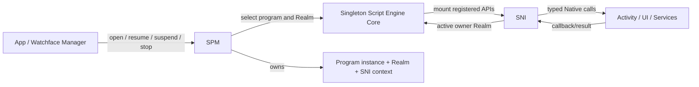

# 脚本引擎概述

脚本运行时让 Application 和 Watchface 共享一套 JavaScript 执行、Realm、模块加载和 Native API 边界。它由三种不同的 owner 协作：应用/表盘管理器选择要打开的安装身份和 Activity；SPM 管脚本程序实例及其生命周期；Script Engine Core 执行 JS；SNI 把已注册能力和 Native 资源安全地接到每个程序 Realm。上层不得跳过 SPM 直接调用 Script Engine 启动或恢复应用/表盘。

## Core 状态与 Program 生命周期

Script Engine Core 是一个全局 JavaScript 执行器，负责引擎初始化、Realm、模块解析、执行、垃圾回收和引擎级错误恢复。SPM 创建带独立 Realm 与 SNI context 的 Program，并保存安装身份、类型、权限及 `ACTIVE`、`SUSPENDED`、`STOPPING`、`TERMINATED` 生命周期状态。Core 的执行状态描述当前引擎调用窗口，不等于某个 Program 的生命周期：`main.js` 执行结束后 Core 可以回到 `IDLE`，而 Program 仍为 `ACTIVE`，其 Realm 仍可通过 timer/event 回调重新进入。

| 层 | 拥有的状态 | 不拥有的状态 |
|---|---|---|
| App / Watchface Manager | 已安装 ID、入口选择、对应 Activity 的启动/切换流程 | JerryScript Realm 与 SNI Native 资源 |
| SPM | Program 实例、Realm 关联、程序状态、程序级错误和回调 gate | Activity 页面栈策略、设备服务策略 |
| Script Engine Core | 全局引擎状态、JS 调用、Realm 执行、模块解析和引擎 generation | 应用导航、Recent Apps 卡片和硬件能力 |
| SNI | 每个 Program 的 JS/Native API 映射、句柄和 callback owner | Activity 栈、服务缓存与 Vendor 设备 |

当一个应用被 Recent Apps 保留时，SPM 可以让它的 Program/Realm 保持 `SUSPENDED`；恢复是恢复同一实例，不会重新执行 `main.js`。新应用入口通过 SPM 同步运行 `main.js`，该调用会占用发起启动的执行上下文，不会因为先显示 loading Activity 就并行运行 JS。不同程序不能并行执行 JavaScript；调度与暂停策略由 SPM/调用者决定。

## 包身份与模块加载

应用和表盘使用同一种 EPKG v1 `.epk` 容器；`package_type` 区分 Application 与 Watch Face，`manifest.json` 中的 `id` 是运行身份，API level 用于兼容性检查，权限声明用于启动前的授权流程。包格式、完整性校验与安装属于 Package/App 边界；Script Engine 接收已准备好的程序包，不负责传输、安装或卸载 UI。安装包结构见[EPKG v1 安装包格式](./package_format)，项目与构建工具见 [ElenixOS-Toolkit](../development/toolkit)。

`main.js` 是程序入口。模块解析以程序包路径为基础，规范化模块标识并缓存解析结果以维持同一程序中的模块实例语义；程序/引擎释放时清理对应模块状态。脚本可通过当前包的模块解析机制导入文件，但这不等于通用 Storage API 自动形成应用沙箱；文件访问边界必须由调用它的公开 API 单独定义，见[存储契约](./services/storage)。

## API 与 Native 扩展边界

每个 Realm 在创建时挂载注册过的 `lv` 与 `eos` API。SNI 描述/绑定决定脚本能够调用什么、Native 值如何转换、对象由谁持有，以及 callback 返回哪个 Realm。任意 C 函数或 Vendor driver 不会因链接进系统就自动成为脚本能力；新增能力应先确定稳定的 Framework/Service 接口，再显式通过 SNI 注册必要的部分。

句柄分配、失效、显式删除与程序 stop 的兜底清理属于 SNI 合同。脚本只依赖公开 API；内部 handle 编号、Realm 切换方法、资源链表、生成器产物和 Native 地址映射都不属于稳定脚本接口。具体所有权、暂停与异步 callback 规则见[SNI 与资源生命周期](./script_engine/sni)。

## 异常、fatal reset 与失效

语法/模块错误、脚本执行异常和 JerryScript fatal reset 是不同的失败边界。一般启动或调用错误由当前请求路径返回给 SPM，再由应用/表盘管理器决定展示或回退；异步 callback 的异常由对应 callback path 处理，不能作为原始 API 调用的同步结果。

Fatal reset 会重建 JerryScript heap 并增加 engine generation。旧 Realm、JS 值、SPM Program、SNI context 和旧 callback 参数全部失效；SPM 的 reset 路径销毁所有受影响程序及 Recent Apps 状态，再由管理器按正常入口重新启动。callback 在 JS 返回后若发现 generation 已改变，必须立即退出，不能访问旧 heap 中的任何临时 JS 值或 Program/context 指针。应用只能在新启动路径中重建 UI 和订阅。

普通的 `SUSPENDED`、引擎 `IDLE` 或可捕获脚本异常不应被解释为 fatal reset；它们是否保留 Realm、Activity 和服务需求取决于相应 owner 的生命周期合同。

## 执行时间与线程边界

Script Engine Core 不提供并行 JS 线程。`main.js`、普通同步 SNI API 和 `spm_call` 中的 callback 都在当前调用栈运行；timer、LVGL event 或 Native async request 只决定 JS 何时再次进入，不使 callback 变成后台线程。Native callback 必须回到适合操作 JerryScript 的运行上下文，并进入注册 owner 的 Realm。

执行超时用于限制同步 JS 调用长时间占用系统执行路径，不能替代拆分阻塞工作。文件 I/O、解码、Native API 或同步 callback 若在该调用栈中耗时，仍会延迟 UI/Core 主循环；是否有 Dispatcher 或设备专属队列取决于对应服务合同。

## 按生命周期问题继续阅读

- [Application / Framework 契约](./application_contract)：安装身份、启动、挂起、恢复和程序停止。
- [运行时](./runtime)：Activity、View、事件、线程上下文和平台初始化的系统级关系。
- [SNI 与资源生命周期](./script_engine/sni)：JS 句柄、callback、异步请求与 teardown 顺序。
- [Platform / Vendor 契约](./platform_contract)：脚本 API 下面的设备和服务边界。
