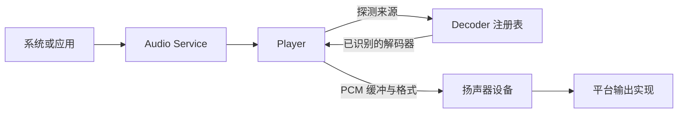
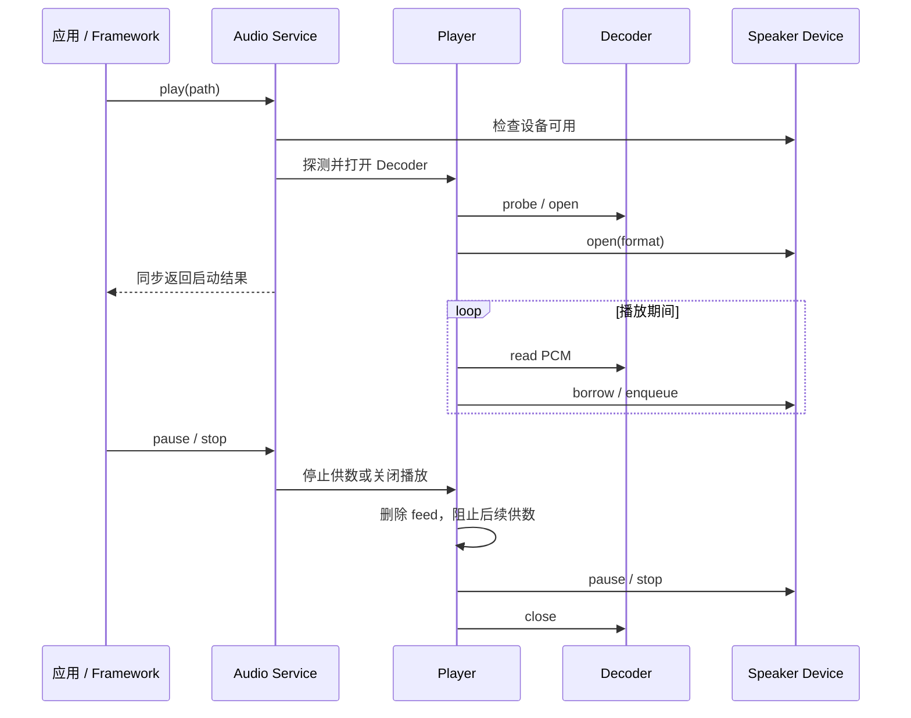

# 音频服务

Audio Service 协调播放控制、格式解码、扬声器输出和麦克风录音。应用通过服务表达播放或录音意图；服务管理播放器状态和设备访问，不让应用直接控制 Codec 或平台音频端口。

## 播放链与可替换解码器

Decoder 把输入来源解析为播放器可消费的 PCM 帧。注册项为播放器提供来源探测、打开、读取、关闭和可选定位能力；Player 管理通用播放状态，并将解码出的缓冲提交给扬声器设备。这样 Codec 的文件格式逻辑与暂停、恢复、定位和输出队列分离。

Decoder 是明确的扩展点：新格式可以实现相同的 Decoder 能力并接入注册表，Player 的调度逻辑不需为每种格式增加分支。当前 WAV Decoder 在 Audio Service 初始化路径注册。Player 依次调用 probe 并使用首个接受来源的 Decoder；这是当前遍历行为，重叠的 probe 会造成选择顺序依赖。Decoder 注册节点被打开的播放描述借用，必须活到对应 close 完成；Core 当前没有活动引用计数或安全热卸载协议。新增内建 Decoder 应进入初始化注册路径，不能运行中删除仍在使用的实现。

播放打开 Decoder 后，将其采样率、声道数和位深交给扬声器设备。Player 不承担 Codec 专属处理，核心也没有通用 PCM 转码层；设备必须接受该格式或报告失败，不能假定核心会自动转换。

## Feed 与平台输出

播放开始时不在调用方的启动路径中同步读完整音频；feed 时钟后续驱动缓冲填充。当前默认 feed 使用 LVGL timer，因此回调在 LVGL 主循环执行。平台可以替换 feed 实现来接入 RTOS/DMA 时钟；这是时钟实现的替换点，不改变 Decoder 与 Player 之间的数据契约。Player 的供数回调可能读取文件、解码并提交扬声器缓冲，因此移到 ISR 时必须提供安全的延后执行或证明下游操作可在 ISR 中执行。默认实现并不等同于后台工作线程。

扬声器设备通过类型化操作提供打开格式、借用/提交缓冲、暂停/恢复、停止和播放进度等能力。设备和端口可能缺失或不支持特定操作，Audio Service 将相应失败返回调用方。播放实例由服务统一持有，调用方不拥有播放器内部状态。

## 请求、持续执行与停止

`play` 的同步成功只表示 Decoder 和扬声器已接受启动；后续文件读取、解码和 PCM 消费仍在继续。默认 feed 在 LVGL timer 回调中供数，因此单次文件读取或 Decoder 阻塞会占用主循环。启动阶段找不到 Decoder、设备缺失、格式不接受或资源不足时返回失败；开始后的异步端口故障没有统一的播放错误事件合同。若扬声器提供 drain 查询，Player 会等待排队样本耗尽后自然结束；缺少该能力时 Core 不能证明最后一个样本已经物理输出。

暂停会暂停供数并保留 Decoder/播放器状态；停止会删除 feed、停止扬声器并关闭 Decoder。服务持有的播放源路径副本用于 seek/reopen，但 Decoder descriptor 暴露的 `src` 指针在公共接口中没有说明借用期。当前 WAV 实现打开文件时建立自己的文件句柄；新增 Decoder 若需在 `open` 返回后继续使用来源数据，应自行复制/持有它，不能依赖调用方临时字符串继续有效。

## 录音、音量与配置

麦克风录音由 Audio Service 管理：服务检查麦克风能力、轮询或读取设备数据并写入目标文件，停止时释放录音资源。播放器和录音输入是分开的设备能力，扬声器存在不代表麦克风也存在。

音量与静音由服务保存并应用到扬声器；静音不会覆盖已保存的音量值。具体的音量控制粒度和硬件行为取决于设备能力。

## 所有权与扩展约束

- Decoder 注册项在服务初始化时建立并由注册表持有；播放打开后的 Decoder 描述及其源资源由 Player 在结束路径关闭。
- 新 Codec 应扩展 Decoder 注册，不应把格式探测塞进 Audio Service 或平台扬声器驱动。
- 平台扬声器和麦克风只实现设备操作，不持有应用播放策略或页面生命周期。
- feed 实现可随平台替换；新增实现必须遵守 Player 回调使用的线程和缓冲所有权约定，不能未经同步就从 ISR 直接操作 LVGL 或脚本运行时。
- 应用应通过 Audio Service 控制播放和录音，不应把当前单个 Player 实例当作应用拥有的对象。
- Speaker `borrow`/`enqueue` 后缓冲所有权与复用时点尚未由公共设备头文件完整定义；平台实现须用目标 port 契约明确验证，不能互相假设复制或转移所有权。

上层启动/停止和异步完成语义见[Application 契约](../../application_contract)；设备注册及 Vendor PCM 责任见[Platform/Vendor 契约](../../platform_contract)。
