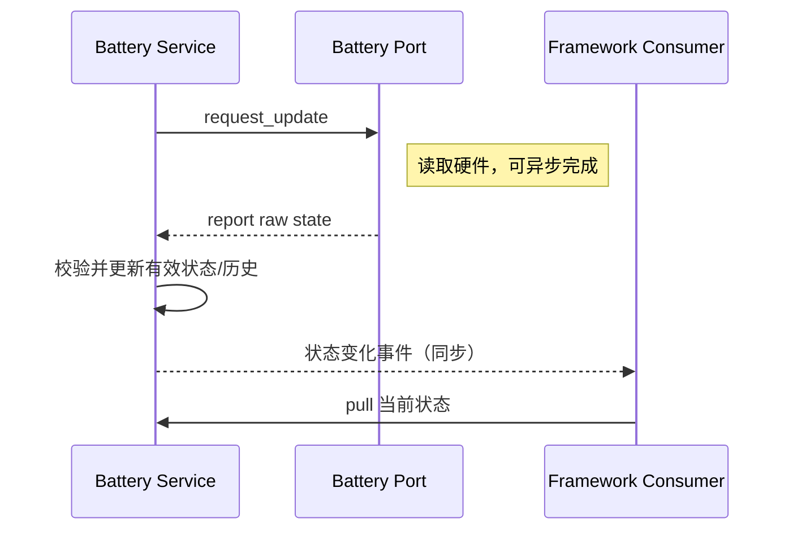

# 电池服务

电池服务是 Pull 请求与 Push 报告的组合：Service 按初始化/定时策略调用设备的 `request_update`，Vendor 取得数据后再报告；Service 校验百分比、更新状态快照/历史，并在有意义的变化时同步发布事件。平台设备报告的百分比是主要电量来源；Core 不在应用层或 Service 中根据电压替 Vendor 推导电量。

## 采样策略

服务自动按未充电时的电量以及充电状态选择正常、低电量和充电模式。默认策略如下：

| 模式 | 进入条件 | 请求周期 | 电量事件阈值 |
|---|---|---:|---:|
| 正常 | 未充电且电量高于 20% | 60 秒 | 1 个百分点 |
| 低电量 | 未充电且电量不高于 20% | 300 秒 | 2 个百分点 |
| 充电 | 正在充电 | 5 秒 | 1 个百分点 |

Service 初始化时立即请求一次更新，之后由 LVGL timer 按当前模式周期请求。设备的 `request_update` 没有同步读数返回值；状态只在设备报告后更新。事件按上表阈值或充电状态变化触发，不会按每次轮询都广播。模式周期和阈值当前在 Battery Service 实现中固定，不属于 Kconfig 选项。

## 状态与通知

消费者可以 Pull 当前快照，也可以订阅电量/充电变化。服务事件按变化阈值触发，而非每次采样均广播。尚无有效设备读数时，状态保持无效，默认数值不代表真实测量。设备请求入口不返回采样结果；初始化成功也不表示已收到首个有效值。

服务还聚合容量、循环计数和电量变化历史；变化历史最多保存 128 项，写满后覆盖最旧项，相同的连续电量/充电状态不会重复记入。历史计数与条目由服务 API 读取，消费者不应直接改写内部记录。

设备注册及 `request_update` 属于平台侧契约；更新报告完成后，事件在报告调用的上下文同步执行。平台从 ISR 报告时，所有电池事件订阅者也在该 ISR 上下文同步运行，因此该路径仅适用于整条下游回调链均已确认可在中断上下文执行的情况；其他情况由平台先延后到合适的 task/Core 上下文。通用职责见[Platform/Vendor 契约](../../platform_contract)与[Application 契约](../../application_contract)。
