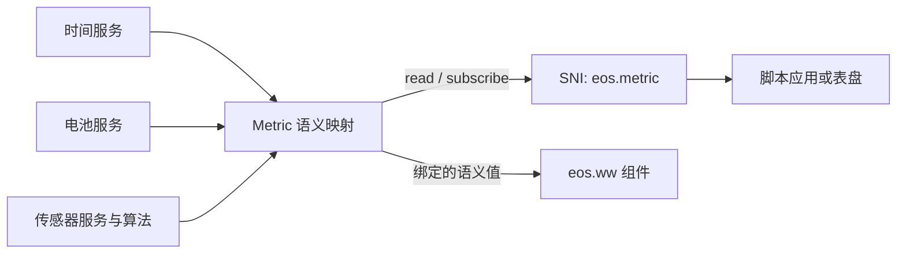

# Metric 服务

Metric 服务为表盘和脚本提供稳定的语义数据名，把时间、电池、传感器等不同来源映射为统一的数据样本。它隔开“数据是什么”与“数据来自哪种设备”，让表盘组件不必直接依赖传感器类型或板级接口。

## 数据路径

服务向消费者返回语义名称对应的值、单位、样本时间戳、有效性和过期状态。它通常读取现有服务的数据或由时间推导值，不复制底层传感器缓存，也不负责设备驱动、原始采样或历史数据库。

## 当前 Metric 名称与单位

| 名称 | 值与单位 | 首次读取时的有效性规则 |
|---|---|---|
| `time.now` | 当日经过的秒数，单位 `s`；不包含日期。 | 当前实现始终标记 `valid=true`。时间设备未注册时，时间服务返回零值，因此 Metric 会显示 `0 s` 且仍为有效样本。 |
| `battery.percent` | 电量百分比，单位 `%`，有效范围 0–100。 | 收到有效 Battery 报告后有效；否则 `valid=false`。 |
| `battery.charging` | 充电状态，单位 `bool`；`value` 为 0 或 1。 | 当前实现即使 Battery 尚无有效报告也返回 `valid=true` 和 `false`；需要判断电量数据可用性时同时检查 `battery.percent.valid`。 |
| `health.heart_rate` | 心率，单位 `bpm`。 | 需要非零时间戳和非零心率样本；超过 30 秒标记 `stale=true`。 |
| `health.spo2` | 血氧饱和度，单位 `%`，通常为 0–100。 | 需要非零时间戳和非零 SpO₂ 样本；超过 30 秒标记 stale。 |
| `activity.steps` | 单调累计步数，单位 `steps`。 | 需要传感器样本时间戳；超过 10 秒标记 stale。 |
| `environment.temperature` | 温度，单位 `degC`。 | 由原始 milli-°C 除以 1000；超过 10 秒标记 stale。 |
| `environment.pressure` | 绝对气压，单位 `Pa`。 | 直接使用 BARO 的 Pa 字段；超过 10 秒标记 stale。 |
| `orientation.heading` | 方位角，单位 `deg`，范围 `[0, 360)`，顺时针递增。 | 来自指南针算法；超过 10 秒标记 stale。订阅该 Metric 会取得指南针传感器需求。 |
| `moon.phase` | 月相周期比例，单位 `phase`，一个朔望月归一化到 `[0, 1)`。 | 根据平台当前日期计算；有效且不 stale。 |
| `moon.illumination` | 估算照明比例，单位 `%`，范围 0–100。 | 根据平台当前日期计算；有效且不 stale。 |

Metric 的 `timestamp` 对传感器来源是采集样本的启动后单调毫秒时间戳；对时间、电池和日期推导值，是读取时的启动后单调毫秒时间戳。它不是被 `unit` 字段描述的值本身的单位。

脚本可以同步读取一次 Metric，也可以建立周期订阅。订阅回调绑定到创建它的 SNI 程序上下文，并在该上下文可运行时执行；退订或上下文销毁会释放订阅。数据来自传感器时，订阅值仍表示 Sensor Service 的最新缓存，不代表每次回调都会触发一次硬件采样。采样新鲜度由传感器需求仲裁、设备能力和 Metric 的有效/过期标记共同决定。

表盘组件可直接绑定已知 Metric，也可由脚本读取 Metric 后自行控制组件。组件负责展示和自身 LVGL 资源，Metric 服务负责值的语义和来源映射；组件和 Metric 均不直接依赖设备操作表。

## 扩展边界

当前 Metric 名称和来源映射由服务内的静态集合定义，没有动态 Provider 注册表或优先级选择机制。增加新硬件来源时，先扩展对应设备/服务契约；只有需要跨应用稳定表达的值才加入 Metric 语义映射。随后才由脚本边界或表盘组件选择是否公开和呈现该值。

因此，新增消费者或表盘组件只要使用已有 Metric，就无需更改数据来源；新增 Metric 则需扩展服务映射及相应的 SNI 边界。底层传感器的存在本身不意味着脚本侧已有对应 Metric，也不意味着存在可注册的通用 Provider。

## 当前实现边界

- 常见来源通过时间、电池和 Sensor Service 读取；部分语义值由服务推导。
- 传感器 Metric 读取的是服务缓存，不替代原始传感器订阅和采样需求 API。
- 当前只有 `orientation.heading` 的订阅会取得对应的指南针算法请求；其他 Metric 的订阅周期本身不保证启动底层硬件采样。
- 当前 `battery.charging` 在没有有效 Battery Service 报告时仍返回 `false` 且 `valid=true`；判断电池数据是否可用时，JS 同时检查 `battery.percent.valid`。该行为是此 Metric 的特定语义，不适用于所有布尔 Metric。
- Metric 是面向显示和脚本的语义适配层，不是所有系统数据的通用数据仓库。

相关边界见[Application 契约](../../application_contract)、[传感器服务](../sensor)、[SNI 架构与生命周期](../../script_engine/sni)和[表盘系统](../../framework/watchface)。
