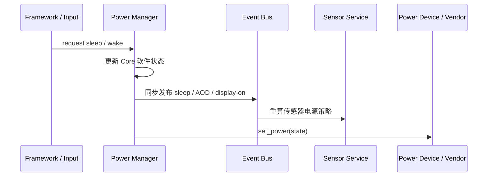

# 电源管理服务

Power Manager 维护 Core 看到的显示/休眠策略，并把需要的电源动作交给 power device。它是系统状态的 owner，不是物理电源控制器的反馈传感器；调用方观察的软件状态不一定证明硬件已经完成切换。

## 请求、状态与平台动作

系统状态为显示开启、AOD 和休眠。睡眠请求在 AOD 模式启用时转为 AOD，否则进入休眠；唤醒转为显示开启。状态事件由同步 Event Bus 发布，然后服务执行平台 `set_power` 操作。

当前 `set_power` 的返回值没有向调用方传播，状态也不会因平台错误回滚；power device 缺失时 Core 记录错误，但不存在通用的“硬件拒绝/完成”异步结果。事件说明 Core 状态已改变，不是硬件已确认。如果产品需要可靠确认，必须为 Power Device/Service 增加明确的确认和失败合同。

休眠会暂停 Power Manager 的 timer，并在启用 Deferred File Writer 时同步其写入；传感器服务观察同步状态事件，在低功耗/AOD 模式施加间隔下限，在休眠时关闭传感器但保留需求，唤醒后按剩余需求恢复。

## 上层与下层责任

- Framework、输入和系统策略请求休眠/唤醒、常亮模式或 timeout；应用不直接改写设备 power state。
- Power Manager 负责软件状态、超时策略、配置和状态事件；它不拥有板级电源轨、显示面板序列或芯片 sleep 流程。
- Vendor 注册 power device 的状态切换操作，并实现目标平台可支持的状态。设备注册成功不表示 AOD、sleep 等每种状态都有硬件实现。
- 平台无法提供某状态时，应由集成明确表达 capability；当前单一 `set_power(state)` 接口没有独立查询每个状态支持情况的通用 discovery 协议。

自动休眠只有在服务实际创建 timer 时才发生。超时设置只更新已存在 timer 的周期；如果当前构建/配置未创建 timer，显式请求仍可改变软件状态，但不会因 timeout 自动触发。

当前 Core 源码将 `DEBUG_DISABLE_TIMER` 固定为 `1`，因此当前构建不会创建自动休眠 timer。配置键 `sleep_timeout_sec` 缺失时的周期基线为 15 秒，但此值只有创建 timer 的目标构建才会生效；当前 Simulator/该 Core 版本中，等待 15 秒不会自动进入 AOD 或休眠。显式 sleep/wake 请求和输入唤醒状态转换仍按前述路径工作。

平台责任见[Platform/Vendor 契约](../../platform_contract)；输入唤醒路径见[UI 与输入架构](../../ui)。
