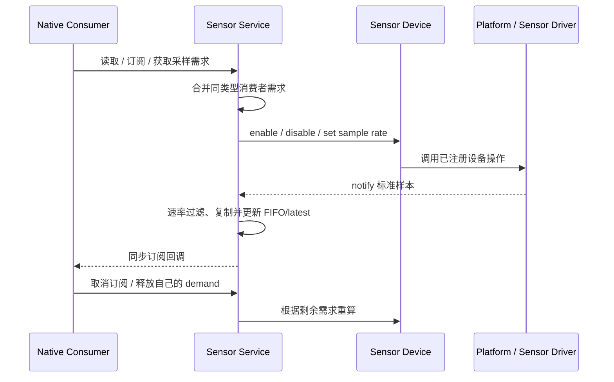

# 传感器服务

Sensor Service 是传感器设备与 Native 消费者之间的状态和采样协调者。设备提供采样控制及标准样本；服务持有每种类型的 FIFO/latest、Native 订阅和采样需求；应用通过读取、订阅或更高层 Metric 取得数据。JS 当前不直接订阅 raw Sensor 样本。

## 从请求到样本的协议

Vendor 的控制和数据方向相反：服务根据有效需求向设备下发 enable/rate；Vendor 在取得样本后把标准类型、数据和采集时间交回服务。`eos_sensor_notify` 复制入参，维护 FIFO 与 latest，并在临界区外同步遍历订阅者。回调收到的样本指针只在本次回调期间有效；要留存必须复制。

## 消费者如何读取或订阅

- Native Pull 可从 FIFO 取最早未消费样本，或读取不消费 FIFO 的 latest 快照。尚无样本时返回未找到/无效；零值可以是有效样本，时间戳和有效性才表示是否收到过数据。
- Native Push 订阅由服务持有。订阅的最小间隔大于零时，会同时创建一项独立采样需求；间隔为零时只注册回调，不负责启动传感器。取消订阅释放该订阅自己的需求，回调内自取消会延迟到广播安全点清理。
- 算法请求和显式需求也各自拥有 demand ID。兼容接口 `eos_sensor_set_sample_period` 不是按消费者隔离的句柄：当前实现对每种类型只有一个共享兼容需求，多个调用方会更新同一需求。新增 Native 消费者应使用独立 demand 生命周期。
- JS `eos.sensor.readLatest` 读取服务缓存但没有 raw subscribe。`eos.metric` 可周期通知语义数据；对于传感器来源，它读的是 Sensor Service 缓存，不保证一次回调对应一次硬件采样。

## 仲裁、状态与有效周期

服务按类型取所有有效需求中的最短时间间隔，再应用当前电源策略的最小间隔或禁用策略。采样周期是消费者所需的输出节奏，不是 Vendor 必须精确达到的硬件 ODR；设备能否接受通过操作能力和状态体现。释放一个消费者不能降低/关闭仍被其他消费者需要的传感器。

从显示开启切换到 AOD 时使用低功耗下限；休眠会关闭活动设备但保留需求，唤醒时根据仍有效的需求重算。服务缺少已绑定设备、设备状态为错误或当前策略禁止启用时，建立需求可能失败；Core 不应伪造有效样本。

### 样本字段、单位与容量

Native `eos_sensor_data_t` 和 JS `eos.sensor.readLatest()` 使用下列标准语义。只有 SNI 已导出的字段才能从 JS 读取；其中 `timestamp` 对所有 JS 结果都存在。

| 类型 | 字段 | 单位与换算 |
|---|---|---|
| `ACCE` | `x/y/z` | milli-m/s²；除以 1000 得 m/s²，约 9807 表示 1 g。 |
| `GYRO` | `x/y/z` | milli-deg/s；除以 1000 得 deg/s。 |
| `MAG` | `x/y/z` | nT；除以 1000 得 µT。 |
| `TEMP` | `temp` | milli-°C；除以 1000 得 °C。 |
| `BARO` | `pressure`, `temperature` | pressure 为绝对 Pa；temperature 为 milli-°C，除以 1000 得 °C。 |
| `HUMIDITY` | `humidity` | milli-%RH；例如 50000 表示 50.000 %RH。 |
| `LIGHT` | `lux` | lux，无缩放。 |
| `PROXIMITY` | `distance_mm` | mm，无缩放。 |
| `HR` | `heart_rate` | BPM，无缩放。 |
| `SPO2` | `spo2` | 百分比，通常为 0–100。 |
| `STEP` | `steps` | 单调累计步数，不是步频或增量。 |
| `ECG` / `CAP` | `ecg` / `cap` | 项目定义的 source counts；当前没有可依赖的电压或电容物理标定。 |
| `PPG` | `red` / `ir` | 光学前端 ADC counts；这是原始光学源值，不是心率结果。 |

样本时间戳是平台采集时刻的启动后单调毫秒数，不是墙上时钟或 Unix 时间。值为零可以是有效数据；尚无样本时 Native latest API 返回 `EOS_ERR_NOT_FOUND`，JS 的已初始化有效类型仍可返回全零字段，因此 JS 调用方应检查 `timestamp`，不能只检查对象是否为 `null`。

三轴数据使用 ElenixOS 右手设备坐标系。Core 契约固定坐标的右手性，物理安装方向由各板级平台规定；平台在上报前完成芯片轴向和安装变换，应用不再按板卡或芯片做轴交换/翻转。

每种 Sensor Type 的 FIFO 默认保存 64 个样本。写入空间不足时会丢弃最旧条目以接收最新样本；latest 快照独立更新，不受 FIFO 消费影响。采样周期是输出节奏请求，不保证硬件精确 ODR。

## 生命周期与上下文

Sensor device 必须先于 Sensor Service 注册；Service 在初始化时为各类型固定当前默认设备并创建缓存。注册晚于服务初始化不会自动换绑，当前没有 sensor hot-plug、默认设备优先级或故障切换机制。平台集成还必须单独初始化 Sensor Service；`eos_init()` 当前不负责这一步。

Native subscriber 节点和需求由消费者 owner 管理。Native Activity 或程序结束不会让任意 `user_data` 自动失效并替代取消订阅；owner 必须在停止/销毁路径显式取消。SNI 管理的 Metric 回调则归属脚本 context，由 SNI 按 program/generation 检查并在 context 清理时释放。

`eos_sensor_notify` 在发布者上下文同步执行 Native 消费者回调。因此 Vendor 若从 ISR 取得数据，必须先通过平台 task/Dispatcher 延后到允许执行 Core callback 的上下文；除非能证明整条下游 callback 链 ISR-safe。服务不持有关键区调用消费者，但也不自动把发布改送到 LVGL 主循环。

## 交接边界

- [Platform/Vendor 契约](../../platform_contract)：注册时机、样本转换、notify 上下文和多设备选择规则。
- [Application 契约](../../application_contract)：Pull、Native 订阅、Metric 和程序生命周期的消费规则。
- [Metric 服务](../metric)：面向表盘/脚本的语义数据边界。
