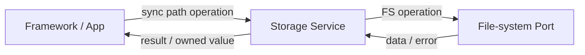

# 文件系统模块

存储服务在平台文件系统端口之上提供统一的 JSON、文件与目录操作，并管理延迟写入等可选机制。平台端口负责当前目标的文件系统实现；服务 API 接收路径和句柄，不隐含应用身份或脚本沙箱。

## JSON 与文件数据

JSON 数据支持按类型读取和更新。键缺失或类型不匹配时，读取使用调用方给定的回退值。动态字符串和解析后的 JSON 树由调用方按其分配来源释放。

JSON 与整文件数据写入在当前调用中完成；递归删除会影响整个目标目录树，调用前必须确认路径边界。

## 文件与目录资源

文件和目录通过显式句柄访问。打开失败会返回无效句柄；句柄关闭后立即失效，后续读写均不再有效。目录读取逐项写入调用方提供的缓冲区。空间查询和其他设备能力可能因平台而不受支持，调用方通过返回结果识别失败。

文件句柄与整文件便捷 API 均在当前调用路径访问文件系统；大文件 I/O 可能占用调用上下文。整文件 API 的写入返回当前写操作结果，但不表示更高层应用事务已原子提交。

## 路径与隔离

脚本接口根据当前程序身份构造包 `assets/` 和应用/表盘配置目录；这些路径规则属于 SNI 层。通用 Storage API 不根据当前脚本身份重写或限制路径，因此不提供自动隔离的应用沙箱。新增的 JS 文件能力在其接口边界定义路径约束，再调用通用存储操作。

系统使用以 `/` 开头的逻辑路径。`EOS_SYS_ROOT_DIR` 决定逻辑根到平台文件系统的映射：Simulator Native 将它设为仓库 `fs/` 目录，WASM 使用 `/` 虚拟根，MCU 平台通常使用已挂载文件系统的根目录 `/`。因而应用包和系统目录名在各平台一致，但它们在主机上的实际绝对路径不同。

| 逻辑路径 | 内容 |
|---|---|
| `/.sys/config/cfg.json` | 系统配置文件。 |
| `/.sys/app/apps/<app-id>/` | 已安装 Application，根目录含 `manifest.json` 与运行入口 `main.js`。 |
| `/.sys/app/app_data/<app-id>/` | Application 持久数据目录，例如 `eos.config` 使用的应用配置。 |
| `/.sys/wf/faces/<watchface-id>/` | 已安装 Watch Face，根目录含 `manifest.json` 与运行入口 `main.js`。 |
| `/.sys/wf/wf_data/<watchface-id>/` | Watch Face 持久数据目录。 |
| `/.sys/res/font/` | 系统字体资源；默认 TTF 相对文件名为 `font.ttf`。 |

Simulator Native 下，例如 `/.sys/app/apps/demo/main.js` 对应仓库中的 `fs/.sys/app/apps/demo/main.js`。Core 多处组合路径时使用 `EOS_FS_PATH_MAX` 字节的固定缓冲区；Simulator 项目默认 256 字节，缓冲区还要为结尾 NUL 留空间。它不是跨 API 统一的拒绝规则：超长路径的返回值或截断处理由具体 API 决定。可通过 Kconfig 的 File system 配置组调整缓冲区大小。平台映射和构建默认值见[内核配置系统](../../../development/kconfig)。

平台 port 负责把逻辑路径映射到目标文件系统，并给出 open/read/write/seek 等操作的结果；它不决定某个脚本是否有权访问该路径。脚本资源封装、应用配置命名空间和任何路径规范化/拒绝越界逻辑必须由调用它的上层 API 承担。

应用路径与调用方责任见[Application 契约](../../application_contract)；文件系统注册和虚拟根由[Platform/Vendor 契约](../../platform_contract)定义。
