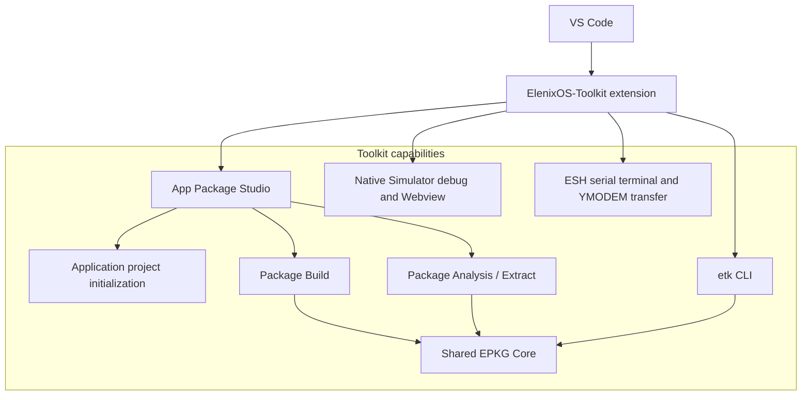
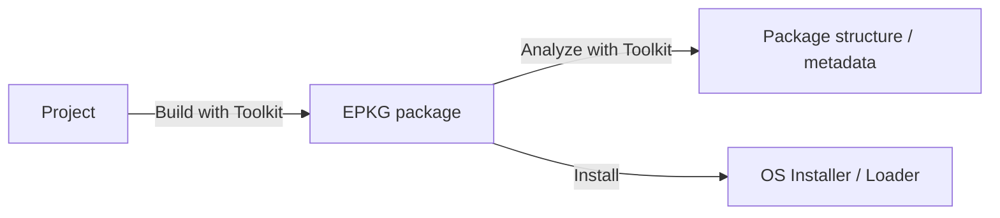

# ElenixOS-Toolkit

**ElenixOS-Toolkit 是面向 ElenixOS 开发流程的 VS Code 插件。** 它通过编辑器工作区提供项目初始化、安装包构建与分析、模拟器调试和设备串口功能。EPKG 是 ElenixOS 的系统级 Package Contract；Toolkit Builder 和 Analyzer 按该契约生成与读取安装包，格式语义由系统契约定义。



EPKG Package Contract 独立定义 OS 接受的格式，约束 Builder 的输出，并指导 Analyzer 与 OS Installer / Loader 如何读取同一种 `.epk` 文件。Package Build 与 Package Analysis 共享 Toolkit 的 EPKG TypeScript Core。包头、FPMA、manifest、File Table、数据区域、校验与签名预留的正式语义见 [EPKG v1 安装包格式](../architecture/package_format)。

## 获取与安装

- **插件名称：** ElenixOS-Toolkit
- **编辑器：** Visual Studio Code；扩展声明的 VS Code Engine 要求为 `^1.136.0`。
- **Marketplace 标识：** `ElenixOS.elenixos-toolkit`。在 VS Code Extensions 中搜索该名称或标识，选择 **Install**；也可通过 VS Code 命令行安装：

  ```bash
  code --install-extension ElenixOS.elenixos-toolkit
  ```

- **Marketplace 页面：** [ElenixOS-Toolkit](https://marketplace.visualstudio.com/items?itemName=ElenixOS.elenixos-toolkit)
- **源码仓库：** [ElenixOS/ElenixOS-Toolkit](https://github.com/ElenixOS/ElenixOS-Toolkit)

扩展的 `publisher` 和 `name` 分别为 `ElenixOS` 与 `elenixos-toolkit`；项目发布工作流将匹配版本的 VSIX 发布到 Visual Studio Marketplace。当前项目没有 Open VSX 发布配置，GitHub Releases 页面也没有独立 VSIX 下载项，因此 Marketplace 是已配置的正式安装渠道。

### 可选：安装 `etk` CLI

Marketplace 扩展提供 VS Code 工作区，不会把 `etk` 命令加入主机 shell 的 `PATH`。若要在终端、脚本或 CI 中使用 CLI，主机需要 Node.js 和 npm；从 Toolkit 仓库根目录构建并注册命令：

```bash
git clone https://github.com/ElenixOS/ElenixOS-Toolkit.git
cd ElenixOS-Toolkit
npm install
npm run package
npm link
etk --help
```

`npm run package` 会生成 `dist/cli.js`；仓库的 `bin` 声明将 `etk` 映射到这个文件。成功后，`etk --help` 应列出 package build、inspect、validate、extract 和 install 子命令。若 shell 找不到命令，确认 npm 的全局可执行目录已在 `PATH` 中。

## Application 与 Watch Face 项目

在 VS Code 命令面板运行 **ElenixOS: Open App Tools** 打开 App Package Studio。**Create** 工作区目前提供 Application 项目初始化：根据项目名称、App ID、版本、作者和描述生成项目目录，其中包含 `manifest.json` 与 `main.js`；API level 初始值为 `0`，可在项目中修改。创建完成后可直接进入 Build 工作区。

当前 App Package Studio 尚未提供 Watchface 项目初始化或 Watchface 模板。它可以将已有 Watchface 项目构建成表盘包：在 Build 工作区选择包含根目录 `manifest.json` 的项目目录，并把 Package type 设为 **Watch face**。项目仍需符合运行时的入口和 manifest 要求。

包项目以根目录 `manifest.json` 作为身份和 metadata 来源。该 manifest 后续由 Builder、Analyzer 和系统安装流程共同解释。Application 的完整项目、构建、部署教程见 [Application 开发](../getting_started/application_development)；手动建立 Watch Face 项目并安装运行见 [Watch Face 开发](../getting_started/watchface_development)。这两个教程分别面向不同的开发目标。

模拟器调试使用 Simulator 仓库提供的 VS Code workspace / debug 配置：Native debug 启动时插件自动打开模拟器 Webview。模拟器不在当前 workspace 时，可通过 `elenixosToolkit.simulatorPath` 指定可执行文件路径。

## 安装包构建（Package Build）

App Package Studio 的 Build 工作区从项目目录读取 manifest 和文件，显示预览信息后执行项目校验，再构建 `.epk` 包。项目类型可选 Application 或 Watch Face；压缩选项为 `auto`、`none`、`lz4`。构建后可直接转入 Analyze 查看输出包。Toolkit 负责把项目转换成契约允许的 EPKG v1 布局，不改变安装包的身份、metadata 或区域定义。

Toolkit 项目还声明 `etk` CLI 入口，使用相同的 Shared EPKG Core，可用于终端、脚本和自动化工作流。在已构建并将 CLI 命令加入 `PATH` 的环境中，可使用：

```bash
etk package build ./my-app --output ./build/my-app.epk --type app --compression auto
etk package build ./my-watchface --output ./build/my-watchface.epk --type watchface
```

`etk` 还提供 `inspect`、`validate`、`extract` 和 `install` 命令。CLI 构建输入格式与 VS Code Build 工作区遵循同一 Package Contract。

## 安装包分析（Package Analysis）

Analyze 工作区或 `etk inspect` 打开现有 EPKG，读取 Header、FPMA、manifest、图标 metadata 与 File Table。工作区显示包类型、身份、API 范围、图标、文件路径、条目类型、codec、存储 / 原始长度，以及 Header CRC 和 manifest CRC；`etk inspect --json` 还会返回解析出的 Header / FPMA / File Table 字段，包括各文件项 CRC 与 offset。分析器按 Package Contract 读取包；格式定义见[EPKG v1 安装包格式](../architecture/package_format)。

预览式 inspect 读取结构和快速预览内容，不会逐项解码普通 payload；因此 damaged payload 仍可能通过预览阶段。`validate` 会完整处理 `NONE` 与 `LZ4_BLOCK` 文件项，核对解码长度和文件 CRC。`extract` 在写出前先执行完整校验。当前无签名 EPKG v1 的签名 offset / size 必须为零；Toolkit 尚不生成签名，也不验证签名区域。



Builder 和 Analyzer 是对称的契约使用方：Builder 产生合法包，Analyzer 按同一契约解析包。Analyzer 显示了什么不能反向缩小契约中已经定义的区域；签名区域即使已在格式层预留，也不因此成为当前分析器支持的能力。

## 其他 ElenixOS 开发工作流

- **Native Simulator 与 F5 调试：** Toolkit 与 ElenixOS Native Simulator 配合，以 headless（无本地窗口）模拟器进程驱动 VS Code Webview 中的 LVGL 画面，并转发触控和硬件按键输入。使用 Simulator 仓库提供的工作区和调试配置时，按 F5 会自动连接 Webview；普通非调试会话也可运行 **ElenixOS: Open Simulator**。当前模拟器工作流支持 macOS、Linux 和 Windows。
- **ESH 串口终端：** **ElenixOS: Open ESH Terminal** 在 VS Code Terminal 中连接设备 ESH。首次连接会从主机检测到的串口中选择端口；Toolkit 不设通用默认端口路径。默认串口格式为 8 data bits、no parity、1 stop bit（8N1），关闭 RTS/CTS 硬件流控。`elenixosToolkit.uartBaudRate` 默认 `921600`，只设置 Toolkit 主机端速率，设备端 UART 必须匹配。`elenixosToolkit.uartMemoryMode` 默认 `window`，所选端口与速率保留到当前 VS Code 窗口/扩展宿主结束；改为 `persistent` 后跨重启和工作区保存。设置均可在 VS Code Settings 的 **ElenixOS Toolkit** 分组修改。
- **YMODEM 文件传输：** **ElenixOS: Send File or Folder with YMODEM (UART)** 可经设备 UART 传送文件或目录，并与 ESH 终端共用一条串口会话。Toolkit YMODEM 默认每次响应等待 30 秒，最多重试 10 次；传输期间避免让其他串口工具同时读取或写入该端口。设备接收后可由 ESH 的 `pkg validate`、`pkg install` 等命令继续处理安装包。
- **平台串口速率（PSoC-E84 开发工程）：** E84 集成仍处于开发阶段，尚未实现稳定移植；以下数值对应该开发工程，不代表稳定移植的接口承诺。Simulator 的虚拟 ESH 不使用物理串口。E84 工程的 ESH 与 YMODEM 使用 BSP `CYBSP_DEBUG_UART`，设备端波特率为 `921600`，与 Toolkit 默认一致；接收缓冲为 8192 字节，ESH 中的 `uartstats` 可查询 RX overflow 计数。连接物理设备时，主机与设备端 UART 速率需要匹配，并设置 `elenixosToolkit.uartBaudRate`。
- **CLI 设备安装：** `etk install` 将本地包经 YMODEM 传到设备，再请求设备校验、安装并读取包信息确认安装结果。它沿用设备端 Installer，不绕过 Package Contract。

这些功能使 Toolkit 同时覆盖从项目准备到包交付、模拟器调试和设备串口操作的日常流程。各工作流的设备结果仍由 ElenixOS 端返回，单纯构建或预览不等于设备端安装成功。

## 旧版独立打包脚本

`eos_pkg_builder.py` 属于旧版独立打包工具，当前 ElenixOS-Toolkit 已接管新的 Application 与 Watch Face 项目构建及包分析工作流。它仅作为旧工具链的历史实现保留。Application 与 Watch Face 的项目和 Package 工作流从对应教程开始；Toolkit 是这两条开发路径使用的工具之一。
