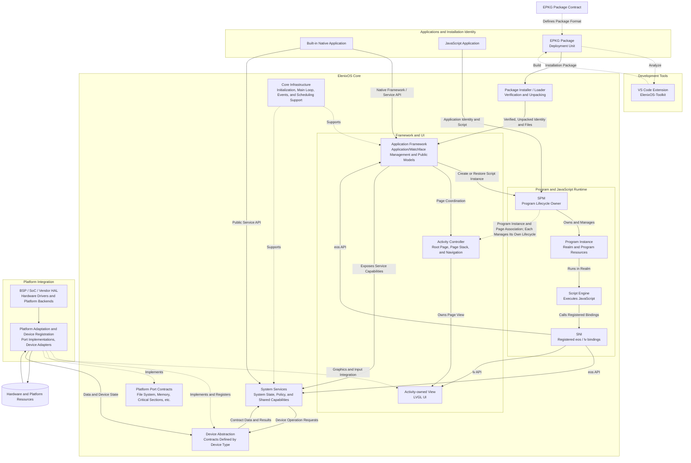

# System Architecture

ElenixOS consists of a portable Core and platform integration. Core defines the application model, program and page management, system services, device contracts, and foundational runtime interfaces; platform integration connects these interfaces to a specific SoC, BSP, Vendor HAL, and hardware. Applications depend on the public models and capabilities provided by Core, not on a particular chip or driver. Platform differences are confined to interface implementations and device capabilities, which are conveyed to Core through the corresponding contracts.

Script Applications and Watch Faces use installation packages as their deployment unit. The EPKG format contract defines installation identity, the packaging of program and resource files, and verification boundaries; the Installer / Loader verifies and unpacks according to the contract, and the runtime consumes the installed application identity and files. EPKG is a Package Contract shared by development tools and the system installer, and is not a private format of the runtime or Platform. For the format definition, see [EPKG v1 Package Format](./package_format); for the application runtime model, see [Application Management Module](./framework/app).

When understanding ElenixOS, it should be viewed as multiple cooperating architectural domains managed by different owners, rather than a single "application calls driver" layer chain. The diagram below shows the main relationships: Program/Runtime, Activity/UI, and system services are different parts of Core; dashed lines indicate that the platform implements interfaces defined by Core; data and state can return in the opposite direction of control requests.

## Core Architecture Principles

- **Separation of Core and platform implementation.** Core targets the ports and device contracts it defines itself; platform projects implement these contracts and integrate with the SoC/BSP. Core and applications do not depend on Vendor types or register interfaces.
- **Isolation of applications from hardware.** Applications use system capabilities through the Framework and public Service APIs. Script applications can only access registered Native APIs through SNI. Applications do not directly call device operation tables or drivers.
- **Separation of policy and mechanism.** Services hold system state, shared policy, and cross-consumer coordination; device contracts define the operation and data semantics between Core and platform implementations; the platform is responsible for actual hardware operations and platform backends.
- **Objects managed by owner.** Programs, Activities/Views, Service state, and platform-registered devices each have their own lifecycle owner. An object being referenced or associated by another layer does not imply a transfer of ownership.
- **Capabilities expressed by contract.** Platform capabilities are not assumed to be identical everywhere. The expression of missing capabilities, failed operations, or invalid data is defined by the corresponding device type and Service contract; upper layers handle them according to public results.
- **Upper layers depend on stable boundaries.** Applications, Service extensions, and platform ports enter the system through Framework/Service APIs, Core extension points, and Device/port contracts respectively, without propagating platform differences into the application model.

## Architectural Domains

| Architectural Domain | Problems Solved and Main Objects | What It Is Not Responsible For |
|---|---|---|
| Application and Installation Identity | Represents the stable identity, manifest, and files of a built-in Native application or an installed script application. EPKG is the delivery/installation unit; after the Installer verifies and unpacks, the Application Framework manages the installed identity and resources. | Not equivalent to a runtime instance, an Activity, or a View tree. For in-package region definitions, see [EPKG v1 Package Format](./package_format). |
| Program and JavaScript Runtime | Creates and manages Program Instances, Realms, and SNI contexts for script applications, and executes JavaScript. SPM manages program lifecycle, Script Engine executes scripts, and SNI provides the controlled JS/Native boundary. | Does not manage the global Activity page stack, nor replace Service system policy. Built-in Native applications typically have no SPM Program. |
| Activity and UI | Represents the system root page, navigation pages, and their entry, pause, resume, and destruction; the Activity Controller manages page relationships, an Activity owns its View, and the View is rooted in the LVGL object tree. | Does not own the JavaScript Realm; an Activity is not an alias for a Program. |
| Application Framework | Provides high-level application-facing models and coordinates application/watchface identity, launch entry points, page navigation, and public system capabilities. It delegates Program management to SPM and page relationships to the Activity Controller. | Does not directly implement chip drivers, nor take over the lifecycle of Services or page objects. |
| System Services | Provides shared capabilities to the system and applications, and holds state, caches, policy, demand arbitration, or scheduling when needed. Native Framework can use public Service APIs, and script applications use the corresponding registered APIs through SNI. | Does not provide the hardware implementation of a particular board; Service policy should not be moved into Vendor drivers. |
| Device Abstraction and Port Interfaces | Device Contracts define the operations, state, and data boundaries between Core and device implementations by device type; port contracts provide platform foundational interfaces such as file system, memory, and critical sections. | Does not define application semantics, nor imply that all devices share a single registration, hot-plug, or shutdown flow. |
| Platform Integration | Combines platform startup, port implementations, device registration, device adapters, and BSP/Vendor backends to connect Core contracts to the target hardware. | Does not decide application permissions, page transitions, Program state, or Service policy. |
| Core Infrastructure | Provides common support such as initialization, main loop, memory, events, and scheduling for Core subsystems. | Does not replace application/page/device owners, nor constitute a unified queue applicable to all asynchronous behavior. |

The Core boundary in the diagram is composed of Framework/UI, Program Runtime, Services, Device Abstraction, port contracts, and infrastructure. Device and port interfaces belong to Core's abstraction surface; the concrete implementations of the interfaces reside in Platform Integration. Whether a given device operation is optional, how its absence is discovered, and how state is reported all depend on that type's own contract and cannot be derived from a generic registration diagram.

## Application, Program, Activity, and View

These concepts describe different stages and different objects:

| Concept | Meaning | Primary Owner |
|---|---|---|
| Package | An EPKG installation container containing installation identity metadata, entry scripts, and bundled files. Installation verifies and expands its contents. | Package / Installer |
| Installed Application | The application identity and files that have been installed and can be discovered, ordered, and launched by a stable ID. Built-in Native Applications may not be installed as script packages. | Application Framework |
| Program Instance | An executable instance of a script application or watchface, associated with a stable application ID, instance ID, Realm, and SNI context. A second unterminated script instance is not created in parallel for the same ID. | SPM |
| Activity | A system or application page and its state in the root page/page stack. An Activity typically owns one page View. | Activity Controller and the owning page flow |
| View | The LVGL page root object of an Activity and its UI subtree. Deleting a parent object can invalidate child objects and reference handles. | Activity / LVGL object tree |
| JS Realm | The isolated context in which a Program executes JavaScript. SNI installs supported Native bindings in this Realm. | Program / SPM in cooperation with Script Engine |

The Program of a script application can be associated with an application Activity and its child pages; when a Program goes through multiple page states, it does not thereby become multiple Programs. Conversely, a system page or built-in Native Activity can exist without a script Program. Application identity is stable across multiple launches, while a Program Instance represents one of those execution lifetimes that has not yet terminated.

Switching the foreground page first changes the Activity/UI state; upper-layer flows such as Recent Apps then decide whether the program and pages are temporarily parked for restoration or fully evicted. Restoration reattaches the original instance and page state, rather than rebuilding the Activity as a Realm. On destruction, the Activity Controller cleans up page objects, SPM cleans up Program/Realm/SNI resources, and associated resources are finalized according to each owner's contract.

## Runtime and Native System Boundary

The JavaScript Runtime resides in Core's script execution domain. Application code is executed by the Script Engine in the Realm owned by the Program; SPM creates, restores, suspends, and stops Programs, and coordinates the runtime resources associated with that instance. SNI is the boundary between the Realm and the Native System: it only installs registered `eos`, `lv`, and other bindings into the script, and brings parameters, return values, handles, and callbacks into the Native implementation according to the binding contract.

Therefore, a JS application cannot directly call a Native C function just because it exists; only capabilities that are explicitly registered and become script APIs are visible to JS. Native resources are still managed by their Native owner, and a JS reference itself does not transfer ownership of Activity, View, Service, or device objects. When page objects and script programs end, they are invalidated and cleaned up along the owner paths of pages and SNI/Program respectively.

## Framework, Service, Device, and Platform

These four exist separately because they answer different questions:

| Part | Question Answered | Architectural Responsibility |
|---|---|---|
| Framework | What system model do applications work with? | Provides the application/watchface model and high-level coordination entry points; coordinates page and program owners without holding ownership on their behalf. |
| Service | Which system component holds shared policy and state? | Implements device-independent service semantics, caching, request coordination, and system/application-facing results. The state actually held by different Services is not entirely the same. |
| Device Abstraction / Contract | How does Core describe a given type of device capability? | Defines typed boundaries, device state, and corresponding operation/data semantics for Services and platform implementations. Different types may adopt different patterns. |
| Platform / Vendor | How are these operations implemented on the target chip? | Implements port/device interfaces, integrates with BSP, HAL, drivers, and concrete resources, and returns data or state according to device contracts. |

Typical capability control is initiated by an Application, enters a Service through the Framework or a public Service API, and then reaches the Platform implementation through a Device Contract; data and state are obtained by the platform and returned to upper layers through the corresponding Device/Service. The Framework's high-level model does not replace Service policy, Services do not need to know Vendor chip details, and Vendors do not own application-level policy.

## Three Mutually Independent Lifecycles

ElenixOS does not merge programs, pages, and devices into a single "application object". Independence means that state and lifecycle owners are different; it does not mean that any combination of states is valid; the Framework, Recent Apps, and each owner are responsible for coordination during cross-domain operations.

| Lifecycle | Owner and Managed Objects | Relationship with Other Lifecycles |
|---|---|---|
| Program lifecycle | SPM manages script Programs, Realms, and SNI contexts, and performs start, resume, suspend, and stop. | Page transitions can occur while a Program is still retained; suspending a Program is not equivalent to destroying the Activity/View. |
| Activity / UI lifecycle | The Activity Controller manages the root Activity, page stack, and page transitions; Activities/Views are paused, resumed, parked, or destroyed according to page rules. | An Activity can belong to a script application or be a Native/system page without a Program; page destruction also need not be equivalent to immediate Realm destruction. |
| Device / Service lifecycle | Platform Integration establishes target platform devices and port implementations; Core Services hold their own state, caches, and consumer demands. | These system-level objects do not follow the launch or exit of a single application; cleanup of application requests or subscriptions is managed separately by the corresponding Service contract. |

This separation allows the system to save resumable script execution state, handle page transitions independently, and continue providing shared device capabilities during application switching. Parking, eviction, and error recovery involving multiple types of objects must be coordinated by the corresponding owners, and the caller cannot arbitrarily choose a destruction order.

## Dependencies, Control, Data, and Ownership

A single function call only indicates a local control relationship and cannot by itself indicate system dependencies, data returns, or resource ownership:

| Relationship | Approximate Direction | Description |
|---|---|---|
| Architectural dependency | Applications call Services through the Framework / public Service APIs; Services use Core contracts to access devices. | Platform Integration implements interfaces defined by Core; upper layers do not depend on a specific Vendor. JS applications use public bindings through SNI. |
| Control request | An Application initiates a request, the Framework / Service executes policy and calls the Device, and the Platform implements the device operation. | The Service decides how to use the device according to its own policy; the direction of the request does not change the owner of the interface. |
| Data and state | The platform implementation provides data, which is processed by the Device / Service and then handed to the Framework / Application. | Data is validated, normalized, cached, or arbitrated according to the specific contract; models such as Push, Pull, and callback are specified by the corresponding subsystem. |
| Lifecycle and ownership | The owner of each object manages it separately | SPM manages script programs, the Activity Controller manages pages, Services manage their own state, and platform integration manages platform implementations and registration. Mutual references do not imply a transfer of ownership. |
| Error propagation | From the boundary where the error occurs toward consumers | Synchronous results, state, invalid data, or asynchronous notifications vary by device/Service; ElenixOS does not assume that all hardware uses the same success confirmation mechanism. |

## System-Level Stable Boundaries

- Applications depend on public Framework/Service capabilities, not on the SoC, Vendor HAL, drivers, or device operation tables.
- JavaScript can only enter the Native System through bindings registered by SNI; Native functions do not automatically become JS APIs.
- Programs, Activities/Views, Service state, and platform-registered devices are managed by different owners; cross-domain coordination cannot merge or bypass these owners.
- Services hold system-level policy and state; Platform/Vendor implements device mechanisms and complies with type contracts, without taking over application semantics.
- Platform capabilities and the manner of their absence are expressed by the corresponding Device/Service contracts; porting cannot assume that a capability present on one development board is common to all platforms.
- Extensions must choose the boundary consistent with capability ownership: application entry points enter the Application Framework, system policy enters Services, hardware capabilities enter Device Contracts and platform implementations, and script APIs enter public SNI bindings.

## Continue Reading by Development Role

- For package format, region semantics, verification, and signature reservation, see [EPKG v1 Package Format](./package_format); for project creation, package building, and analysis, see [ElenixOS-Toolkit](../development/toolkit).
- For application identity, installation, launch, and capabilities that applications can depend on, see [Application and Framework Contract](./application_contract).
- For program state and cross-Runtime lifecycle coordination, see [Runtime](./runtime); for the JS and Native resource boundary, see [SNI Architecture](./script_engine/sni).
- For root Activity, page stack, View, and page transitions, see [Activity Pages](./framework/activity).
- For device type boundaries and common constraints, see [Device Architecture](./device_architecture_design); for specific capabilities, go to subsystem documents such as [Sensor](./services/sensor), [Audio](./services/audio), and [Storage](./services/storage).
- For platform registration and porting responsibilities, see [Platform / Vendor Contract](./platform_contract); for extension boundaries for adding Services, device types, or Native/JS capabilities, see [Core Development Contract](./core_development_contract).