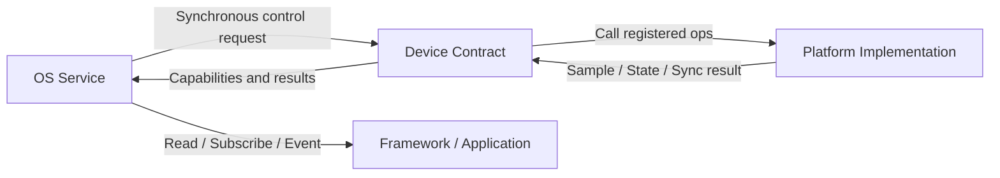

# Device Contract

The Device Layer is the typed boundary between Service/Core and the platform implementation. It provides a registerable implementation entry point, state, and operations specific to that device type; it does not own application semantics, sampling/power policies, page lifecycle, or JS callbacks.

## Two Directions



Control and data flow in different directions. The Service requests operations, and the Device invokes the platform through the registered operation table; for data-type devices, the platform pushes data or provides pull values according to its own protocol; the Service is then responsible for caching, arbitration, normalization, validity, and consumer-facing notification. The device layer does not automatically convert hardware callbacks into main loop tasks, nor does it automatically retry.

## Registration and Availability

The target platform registers the implementation of that type before the dependent Service is initialized. Successful registration only means the operation entry point has been registered; it does not mean the device is currently available, that every optional capability exists, or that future operations will succeed. Device state is used to represent the ready/busy/error defined by that type's contract; operation return codes describe the result of a single request, and the two cannot substitute for each other.

Device types define their own operation tables, required items, optional items, and return semantics. Display, power, audio, vibration, time, battery, and sensors do not have a unified `init/read/notify/deinit` interface. Missing capabilities may only be represented by NULL when that type explicitly allows them to be optional; the Service/caller needs to check for unsupported or device-missing results.

Currently, Sensor Device supports registering multiple instances by name, but Sensor Service binds one default device for each Sensor Type at initialization; registration order determines the default instance, and the Service has no dynamic selection, priority, or failover. Most other Devices are singletons. This model is not a general-purpose multi-provider framework, and the platform cannot assume that devices can be replaced or unregistered online.

## Data, Memory, and Lifecycle

- The Device Operation table is provided by the platform implementation, and Core holds a reference to it; the implementation and operation table must remain alive for the duration of the registration's validity.
- Sensor data is reported by the platform to the Service; the Service copies samples and manages the FIFO/latest itself. Subscription callback pointers are borrowed until the end of the current synchronous callback.
- Battery raw measurements are reported by the platform, and the Service copies them into service state; change Events are dispatched synchronously, and `param` is passed only as borrowed state.
- The Microphone's shared DMA buffer is allocated by the Audio Service and passed to the device; Core may reclaim it only after the device has stopped. The ownership of the Speaker's borrow/enqueue buffer is currently not fully specified by the public operation table and should be treated as an unclosed contract.
- Core currently has no unified device hotplug, registration revocation, or shutdown/deinit flow for all devices. The requests, subscribers, and caches owned by each Service must be managed by the lifecycle of the Service to which they belong.

## Extension Rules

When adding new hardware to an existing Device Type, register it before the initialization of the Service that consumes it, and follow the unit, context, state, and buffer contracts. If new application semantics or state policies are needed, extend/add a Service rather than stuffing business rules into the Device operation table. If what is being added is an entirely new Sensor Type, the public data type, units, coordinate/time semantics, caching, and sampling requirement behavior must also be defined at the same time.

For specific Vendor startup order, data reporting, and ISR boundaries, see [Platform/Vendor Contract](./platform_contract); for how applications consume Services, see [Application Contract](./application_contract).

## Overview

ElenixOS adopts a layered architecture design with the core principle that **the upper layer sends control instructions, and the lower layer only reports status**. This design achieves separation of concerns, maintaining loose coupling between system layers while facilitating porting and extensibility.

```
driver → Status Report
        ↓
device manager updates state
        ↓
service queries state
```

## Architecture Layers

### Layer Hierarchy

```
Application Layer (Application)
    ↓ Control Instructions (OPS)
Service Layer (Service Layer)
    ↓ Query/Control
Device Manager (Device Manager)
    ↓ Status Report
Driver Layer (Driver)
```

### Design Constraints

**Service Layer**
- Provides standard API interfaces upward
- Can only use devices, cannot manage device information
- Obtains device instances through device manager and operates on device OPS
- Forbidden from directly calling driver layer code

**Device Framework**
- Unified device instance management through device manager
- All devices must provide `register` function for registration
- Device state can only be reported from driver to device manager
- Service layer can only obtain device state by querying state machine status

**Driver Layer**
- Implemented by the porter
- Ensures upper layer can operate lower-level hardware through implementing OPS
- Responsible for hardware status collection and reporting

## Service Layer

### Service List

| Service Name | Service File | Description |
|-------------|--------------|-------------|
| Sensor Service | `eos_service_sensor.c/.h` | Sensor sampling and data processing |
| Display Service | `eos_service_display.c/.h` | Screen brightness management and power control |
| Battery Service | `eos_service_battery.c/.h` | Battery status monitoring and power management |
| Power Manager Service | `eos_service_pm.c/.h` | System power state and sleep management |
| Haptic Service | `eos_service_haptic.c/.h` | Haptic feedback control |
| Time Service | `eos_service_time.c/.h` | System time acquisition |
| Storage Service | `eos_service_storage.c/.h` | File system operations and JSON storage |
| Config Service | `eos_service_config.c/.h` | System configuration management |
| State Service | `eos_service_state.c/.h` | Runtime persistent state management |
| Log Service | `eos_log.c/.h` | Logging system |

### Service Naming Conventions

Service file naming: `eos_service_<service_name>.c/.h`

Service initialization API: `eos_service_<service_name>_init()`

Other APIs are unified as: `eos_<service_name>_<function_name>()`

## Device Framework

### Device Manager

The device manager is the **only path** for the upper layer to obtain device instances.

#### Supported Device Types

| Device Type | Device File | Description |
|------------|-------------|-------------|
| Sensor Device | `eos_dev_sensor.c/.h` | Multi-instance support, linked list management |
| Display Device | `eos_dev_display.c/.h` | Single instance |
| Battery Device | `eos_dev_battery.c/.h` | Single instance |
| Power Device | `eos_dev_power.c/.h` | Single instance |
| Time Device | `eos_dev_time.c/.h` | Single instance |
| Vibrator Device | `eos_dev_vibrator.c/.h` | Single instance |

#### Required Device Manager Capabilities

1. **Registration Function** (must be named `register`)
   - Input parameter is OPS pointer
   - Used for registering device instances

2. **Device Lookup Function**
   - Single instance devices provide `get_instance` or `get_default`
   - Multi-instance devices provide `find` and `find_by_type` APIs

3. **Get Device State** (`get_state`)
   - Used for querying current device state

4. **Device State Report** (`report`)
   - Called by driver layer to report device state changes

#### Forbidden Device Manager Implementations

1. PORT is forbidden; provide OPS for device control, weak definitions are forbidden
2. Business interfaces are forbidden (e.g., sampling frequency settings, mode switching, etc.)
3. Unregistration functions are forbidden
4. User data fields are forbidden

#### Basic Device Structure

```c
typedef enum {
    DEV_STATE_NONE = 0,   // Not exist / Unregistered
    DEV_STATE_READY,      // Initialized, available
    DEV_STATE_BUSY,       // In use
    DEV_STATE_ERROR,      // Error occurred
} eos_dev_state_t;

typedef struct {
    const eos_<device_name>_ops_t *ops;
    <private_info>
    eos_dev_state_t _state; // Private field
} eos_<device_name>_dev_t;
```

### Sensor Device

Sensor devices support multi-instance management, organized using linked lists.

#### Sensor Types

```c
typedef enum {
    EOS_SENSOR_TYPE_UNKNOWN = 0,
    EOS_SENSOR_TYPE_ACCE,       // Accelerometer
    EOS_SENSOR_TYPE_GYRO,       // Gyroscope
    EOS_SENSOR_TYPE_HR,         // Heart Rate Sensor
    EOS_SENSOR_TYPE_SPO2,       // SpO2 Sensor
    EOS_SENSOR_TYPE_LIGHT,      // Ambient Light Sensor
    EOS_SENSOR_TYPE_PROXIMITY,  // Proximity Sensor
    EOS_SENSOR_TYPE_ECG,        // ECG Sensor
    EOS_SENSOR_TYPE_TEMP,       // Temperature Sensor
    EOS_SENSOR_TYPE_MAG,        // Magnetometer
    EOS_SENSOR_TYPE_BARO,       // Barometer
    EOS_SENSOR_TYPE_CAP,        // Capacitance Sensor
    EOS_SENSOR_TYPE_STEP,       // Step Counter
    EOS_SENSOR_TYPE_MAX
} eos_sensor_type_t;
```

#### Sensor Data Structure

```c
typedef union {
    eos_sensor_data_acce_t acce;
    eos_sensor_data_gyro_t gyro;
    eos_sensor_data_mag_t mag;
    eos_sensor_data_temp_t temp;
    eos_sensor_data_baro_t baro;
    eos_sensor_data_light_t light;
    eos_sensor_data_proximity_t proximity;
    eos_sensor_data_hr_t hr;
    eos_sensor_data_spo2_t spo2;
    eos_sensor_data_ecg_t ecg;
    eos_sensor_data_cap_t cap;
    eos_sensor_data_step_t step;
    eos_sensor_data_battery_t battery;
} eos_sensor_data_t;

typedef struct {
    eos_sensor_type_t type;
    eos_sensor_data_t data;
    uint32_t timestamp;  // Obtained using eos_tick_get()
} eos_sensor_raw_data_t;
```

#### Sensor Data Structure Design Requirements

- Sensor name (for lookup)
- Sensor type
- Sensor state
- Sensor data cache (FIFO, implemented with ring buffer)
- Sensor event ID (auto-registered)
- Sensor read period (0 means no auto-read, in milliseconds)

## Device Control Interface (OPS)

OPS (Operations) is the portable interface provided downward, defined in `eos_dev_<device_name>.h`.

### OPS Design Principles

- Device layer does not provide read operations; data is pushed to service layer via `eos_sensor_notify()`
- Service layer manages FIFO and broadcasts to subscribers
- OPS return type should be `eos_result_t` or `bool`, simple operations can return `void`

### OPS Example (Sensor)

```c
typedef struct {
    void (*init)(eos_dev_sensor_t *dev);
    void (*deinit)(eos_dev_sensor_t *dev);
    void (*enable)(eos_dev_sensor_t *dev);
    void (*disable)(eos_dev_sensor_t *dev);
    void (*set_sample_rate)(eos_dev_sensor_t *dev, uint32_t hz);
    void (*get_sample_rate)(eos_dev_sensor_t *dev, uint32_t *hz);
} eos_dev_sensor_ops_t;
```

### Device Control Interface Constraints

- Other services are forbidden from directly calling this service's corresponding OPS
- Each device type can only be operated by its corresponding Service, not by other Services
- OPS should not contain report functions (report is provided by device manager)

## Sensor Data Flow

### Pull Mode (Synchronous)

- When calling the interface, data is immediately read from sensor data cache
- If no data available, returns empty or error code
- Does not affect sensor sampling behavior

### Push Mode (Asynchronous)

- Subscribe to sensor data by registering callback function
- Sensor service triggers callback at set frequency
- Each subscriber can independently configure expected data frequency
- Callback executes in non-interrupt context

### Data Report Flow

```
driver → sensor_report(type, data)
              ↓
         Fast Enqueue (interrupt-safe)
              ↓
         Write to Ring Buffer
              ↓
         Service Layer Scheduling
              ↓
         Callback Distribution
```

### Design Constraints

- Device layer is forbidden from directly calling upper layer callback functions
- All sensor data must first enter cache, then be distributed by service layer
- Services are forbidden from directly accessing sensor devices; must use service interface
- Interrupt context only allows data report operations

## Event System

### Event Registration

```c
eos_event_code_t eos_event_register_id(void);
```

Gets user-defined event ID, starting from `EOS_EVENT_LAST`.

### Event Subscribe and Publish

```c
// Subscribe to event
void eos_event_subscribe(eos_event_code_t event_id, eos_event_cb_t cb, void *user_data);

// Publish event
void eos_event_post(eos_event_code_t event_id, void *param, lv_obj_t *obj);
```

### Built-in Event Types

| Event Name | Description |
|-----------|-------------|
| `EOS_EVENT_APP_UNINSTALLED` | Application has been uninstalled |
| `EOS_EVENT_APP_INSTALLED` | Application has been installed |
| `EOS_EVENT_SYSTEM_SLEEP` | System entered sleep |
| `EOS_EVENT_SYSTEM_DISPLAY_ON` | System awakened |
| `EOS_EVENT_SYSTEM_DISPLAY_AOD` | Always-on display mode |
| `EOS_EVENT_SYSTEM_CONFIG_UPDATE` | Configuration has been updated |
| `EOS_EVENT_SCRIPT_STARTED` | Script has started |
| `EOS_EVENT_SCRIPT_EXITED` | Script has exited |
| `EOS_EVENT_ACTIVITY_SCREEN_SWITCHED` | Page transition completed |
| `EOS_EVENT_LANGUAGE_CHANGED` | Language has been changed |

## FIFO Ring Buffer

FIFO is used for sensor data caching with statistics support.

### Key Features

- Write operations overwrite old data (when full)
- Supports statistics: write count, read count, overflow count, peak usage
- Thread-safe (critical section protection)

### Core API

```c
eos_fifo_t *eos_fifo_create(uint16_t capacity);
uint16_t eos_fifo_write(eos_fifo_t *fifo, const void *data, uint16_t size);
uint16_t eos_fifo_read(eos_fifo_t *fifo, void *buf, uint16_t size);
bool eos_fifo_is_empty(eos_fifo_t *fifo);
bool eos_fifo_is_full(eos_fifo_t *fifo);
void eos_fifo_get_stats(eos_fifo_t *fifo, eos_fifo_stats_t *stats);
```

## Logging System

The logging system adopts a listener-based pattern, supporting multiple listeners.

### Log Levels

```c
typedef enum {
    EOS_LOG_LEVEL_DEBUG = 0,
    EOS_LOG_LEVEL_INFO,
    EOS_LOG_LEVEL_WARN,
    EOS_LOG_LEVEL_ERROR
} eos_log_level_t;
```

### Log Macros

```c
#define EOS_LOG_D(fmt, ...)  // Debug
#define EOS_LOG_I(fmt, ...)  // Info
#define EOS_LOG_W(fmt, ...)  // Warning
#define EOS_LOG_E(fmt, ...)  // Error
```

### Listener Registration

```c
eos_log_listener_id_t eos_log_register_listener(
    const char *name,
    eos_log_listener_cb_t cb,
    void *user_data,
    uint8_t flags
);
```

## File Naming Conventions

| Type | Convention |
|-----|------------|
| Service File | `eos_service_<service_name>.c/.h` |
| Device File | `eos_dev_<device_name>.c/.h` |
| Service Initialization | `eos_service_<service_name>_init()` |
| Service Other APIs | `eos_<service_name>_<function_name>()` |
