# Activity Pages

Activity is the sole abstraction for page lifecycle and page switching. It describes how pages relate within the root Activity, the normal page stack, and the parked application sub-stack; it is not a substitute for script programs.

## Activity Model

Current Activity types include normal application pages, input pages, application lists, the current watchface, watchface lists, lock screen, Recent Apps, and Native App Debugger. App Debugger is an independent tool page type, not an alias for the system App List.

The system has a separately managed root Activity, typically the current watchface. Normal Activities are pushed onto the page stack; on return, the Activity controller selects the previous page and handles the exit strategy of the current page. An Activity typically owns one View, which is its LVGL page root object.

## Root Page and Page Stack

The root Activity is not destroyed by normal `back` operations. Watchface switching uses the root replacement flow; the old root and its View/script resources are destroyed with the replacement, and the new root becomes the system's new bottom page. Applications and system pages can be pushed onto the normal stack; an application's sub-pages can also be parked and restored as a whole by Recent Apps.

Page return, opening new pages, and restoring Recent Apps must all be performed through the Activity controller. Callers must not directly alter the Activity stack chain or re-attach a parked View to an arbitrary parent object.

## Lifecycle and Exit Strategy

The Activity lifecycle includes enter, pause, resume, and destroy:

- On enter, the View and content used for the first time by the page are established.
- Pause means the page has left the foreground but may still be resumed; it is not equivalent to destruction.
- Resume means the same Activity becomes the active page again.
- After destruction, the View, page resources, and the Activity itself can no longer be used.

Activity lifecycle hooks correspond to these transitions:

| Hook | Current Trigger Semantics |
|---|---|
| `on_enter` | Called once when the Activity first enters the current page flow; the page View is typically established here. |
| `on_pause` | Called when the current Activity leaves the foreground; when the application sub-stack is suspended, called in order from the top of the stack to AppRoot. It does not itself determine whether the page is kept or destroyed; the exit strategy determines subsequent lifecycle. |
| `on_resume` | Called when an Activity that has already been entered returns to the foreground; when the application sub-stack is restored, called in order from AppRoot to the current page. |
| `on_destroy` | Called when the Activity terminates, before its View is deleted and the Activity storage is released. |

When returning from an Activity, a path that selects `DESTROY` destroys the current page without calling its `on_pause`; the page being returned to executes `on_resume` after the old page's destruction is finalized. These hooks describe the page lifecycle and do not change SPM's independent ownership of the associated script Program.

Page transitions explicitly select `KEEP`, `DESTROY`, or `SUSPEND`. Before the transition completes, the old page may still be referenced by animation snapshots or return animations; cleanup must be performed by the transition finalization path. A parked Activity must not use the normal direct destruction interface; eviction should be completed through the Recent Apps/per-instance cleanup flow.

## Pages, Scripts, and Object Ownership

An Activity owns its page View; deleting an LVGL parent object may cascade-delete child widgets. A script program owns Realm and SNI resources, but must not delete system-managed Views by bypassing the Activity lifecycle. After an Activity or View is destroyed, C pointers, script handles, and callbacks must all be considered invalid.

After a page switch completes, a system event is published synchronously. The View pointer in the event is valid only for the lifetime guaranteed by the publisher; subscribers do not thereby acquire ownership of that View.

## Architecture Constraints

- Activity lifecycle can only be driven by the Activity controller and its owning managers.
- Direct destruction applies only to Activities that are not on the stack, not visible, and not parked; the current page, root page, and recent application pages must use their dedicated flows.
- An Activity's View can only be set during the permitted enter flow; a running page must not arbitrarily replace or delete system-managed Views.
- Page transitions must not rely on destroy/suspend flags left by the caller; exit semantics must belong to the current transition.
- App Debugger must remain an independent Activity type and must not reuse the App List's animations and business routes.
- The root page should be accessed through root Activity semantics; the old watchface getter is retained only for compatibility and is not the recommended boundary for new code.

## Lifecycle Flow

```mermaid
flowchart TB
    subgraph AppStart["Application Startup"]
        AppManager["Application Manager"] --> SPMStart["SPM creates or restores Program"]
        SPMStart --> CreateActivity["Activity creates application page"]
        CreateActivity --> CreateView["Enter page and establish View"]
        CreateView --> UpdateUI["SNI / Application updates UI"]
    end

    subgraph AppBackground["Application Leaves Foreground"]
        ExitPolicy["Activity computes exit strategy"] --> Transition["Complete page transition and detach page stack"]
        Transition --> RecentApps["Recent Apps parks or evicts"]
        RecentApps --> SPMStop["SPM suspends or stops the corresponding Program"]
    end

    subgraph WatchfaceSwitch["Watchface Switch"]
        WatchfaceManager["Watchface Manager"] --> ValidatePackage["Validate target package"]
        ValidatePackage --> ReplaceRoot["Replace root Activity"]
        ReplaceRoot --> StopOld["Stop old watchface program and resources"]
        StopOld --> EnterNew["Enter new root page"]
    end
```

For the application perspective on startup, suspension, and asynchronous resource boundaries, see [Application Contract](../../application_contract); for owner rules across Activity/SPM/SNI, see [Core Development Contract](../../core_development_contract).