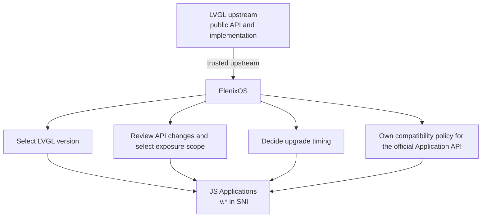
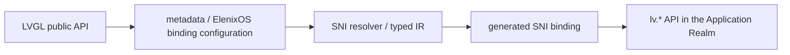

{"translation": "---
sidebar_position: 1
title: SNI Architecture and Lifecycle
---

# SNI Architecture and Lifecycle

## Definition and Boundaries

SNI (Script Native Interface) is the call and type bridging boundary between an ElenixOS script Realm and the Native System. A Realm is a JavaScript global environment private to a script program. SNI mounts the Native capabilities registered to `lv` and `eos` into that Realm, converts and validates parameters when a JS call enters C, converts Native data into JS values when C returns results, and dispatches Native events and asynchronous completion callbacks back to the Realm of the program that registered them.

SPM (Script Program Manager) owns the lifecycle of script programs such as Applications and Watchfaces, and pairs each program with an SNI context. An SNI context is the Native-side state table corresponding to that Realm; the Script Engine Core executes JerryScript and manages Realms; the Framework, services, and LVGL implement the concrete Native capabilities. SNI is responsible for cross-boundary type semantics, Native reference association, and callback ownership, and does not own the Activity stack, device service policies, or the script program itself.

In this document, Native owner refers to the Native component that actually decides when a Native entity is destroyed and performs its destruction. A wrapper only establishes a cross-language access relationship and does not transfer that ownership. Program teardown is the coordination process by which SPM ends a program Realm and, in dependency order, closes callbacks, dissolves JS/Native associations, and cleans up resources; context sweep is the phase within it that traverses SNI context registrations and performs cleanup by type.

The call path is: Application/Watchface JavaScript → program Realm → SNI parameter validation and conversion → Framework, services, or LVGL → Native results converted or dispatched back to the owner Realm via SNI. Asynchronous results from the platform or services first return to a Native context permitted to operate JS/UI, and are then synchronously entered into the owning Realm by SNI; a Realm is never entered concurrently from an ISR or another thread.

A C function or type does not automatically become a JS API merely because it exists in the Native build. API descriptions and hand-written wrappers together determine the call surface visible to JS; SNI type descriptions determine how parameters and results cross the boundary. Call entry points, type mappings, Native object owners, and callback owners are related but distinct relationships.

## Architectural Position of LVGL in the Application API

Within the ElenixOS system boundary, LVGL is a component of the GUI subsystem. ElenixOS selects and integrates LVGL as the GUI framework; LVGL's public API is the design source of the ElenixOS GUI API; LVGL upstream is an upstream that ElenixOS trusts and manages. Applications use the interfaces provided by the ElenixOS-selected version through SNI, cannot choose a different LVGL runtime version on their own, and cannot establish their own LVGL platform contract outside the ElenixOS SNI/API surface.

The `lv.*` interfaces selected by ElenixOS and included in the release surface are part of the official Application API. API ownership belongs to ElenixOS platform policy and does not depend on who writes the binding code: ElenixOS selects the LVGL version and the application-visible API, reviews and schedules upgrades, decides when interface changes enter the Application API, and formulates compatibility policy for interfaces already included in the official API. Therefore, the Application API does not additionally establish a set of `eos.ui.*` facades that basically mirror LVGL one-to-one for the long term; SNI directly carries the controlled `lv.*` interfaces. If ElenixOS defines a high-level UI abstraction with semantics different from LVGL, that abstraction belongs to a separate ElenixOS API.



Directly binding the LVGL API does not mean automatically following upstream upgrades. Each ElenixOS release incorporates the selected LVGL version and its application-visible API surface into its own platform contract. Before adopting a new version, ElenixOS reviews upstream API and behavioral changes and completes a compatibility assessment; whether new APIs enter `lv.*` is decided by ElenixOS. For upstream APIs that have been selected and are compatible with the existing contract, bindings use direct mapping; only when actual incompatible changes need to be handled are corresponding aliases, generated adapters, small compatibility shims, or migrations within ElenixOS's own major API/version introduced. An LVGL upstream major version release does not by itself trigger an ElenixOS upgrade; ElenixOS may continue to adopt the current stable version or may schedule a platform-level migration.

The LVGL binding generator is part of this architectural boundary, responsible for turning the ElenixOS-selected API into the SNI binding mechanism:



The generator reduces the binding maintenance cost of adding newly supported LVGL APIs, but the generated result itself does not determine platform stability. Which bindings belong to the official, stable Application API is still determined by ElenixOS version and release policy. This definition addresses LVGL's architectural role as the complete GUI framework selected by ElenixOS; it does not constitute a general rule for exposing all third-party libraries directly to Applications. Hardware vendor drivers, RTOS internal implementations, and file system implementations do not automatically become Application APIs because of this.

## Type System: Values, Objects, and Handles

The SNI type system separates basic values from objects. The object model has only two kinds of objects: Value Objects and Handle Objects. A Value Object represents data copied across the boundary; a Handle Object represents a Native entity that has Native identity and is protected by a clear lifecycle model. Both may appear as ordinary JS objects in JavaScript, but their semantics, identity, and reclamation differ.

```text
SNI Object
├── Value Object
└── Handle Object
    ├── Object Tree Node
    └── Managed Resource
        ├── Pure Managed Resource
        ├── Tree-Dependent Resource
        └── Hybrid Resource
```

This model describes Native identity that can be persistently exposed to JS. The appearance of `T *` in C is not sufficient to make something a Handle Object; only when SNI can establish identity reuse, invalidation notification, and a destruction/cleanup loop coordinated with the real Native owner is that Native entity suitable for exposure as a persistent handle. Short-lived callback parameters, value structures, and external pointers without lifecycle integration do not constitute additional official handle categories.

| Category | C-side representation | JS-side representation | Identity, copying, and lifecycle |
| --- | --- | --- | --- |
| Basic values (`SNI_T_*`) | Integers, floats, booleans, strings, or explicitly declared raw pointers. | Number, Boolean, String, or the address numeric value used by `SNI_T_PTR`. | Scalars are converted by value. Strings copy their contents across the boundary. Basic values do not represent a lookupable Native object identity. |
| Value Object (`SNI_V_*`) | A C struct or value data whose fields are specified by the type description. | An ordinary JavaScript object whose properties correspond to the fields in the description. | C→JS copies field by field; JS→C copies properties into the caller-provided C target. The JS object has no native object identity and is not associated with an independent Native resource. |
| Handle Object (the current implementation uses `SNI_H_*` type numbers) | A Native entity that satisfies one official lifecycle model. | An ordinary JS wrapper object carrying SNI's Native association metadata. | The wrapper associates the Native entity's identity for the entity's valid period; SNI reuses a valid wrapper on C→JS and invalidates the association when the Native entity becomes invalid. Whether the handle itself owns the Native entity is defined by its official subclass. |
| Raw pointer (`SNI_T_PTR`) | An explicitly passed address. | The current bridge represents the address as a Number. | Only the address numeric value is passed; it carries no SNI handle type validation, identity reuse, liveness notification, or automatic release semantics. |

### Basic Values and Value Objects

Basic values are data interpreted by value. Integers, floats, booleans, and strings do not retain a Native object identity that JS can look up later as a result of crossing the boundary. When a string goes from JS to C, the bridge allocates a Native copy containing the string contents; when it goes from C to JS, the JS string holds a copy of the contents. The C string memory produced by the conversion is released by the binding call path that performed the conversion.

A Value Object is a structured value mapped through a field description. It is suitable for data such as coordinates, regions, color components, and animation parameters: JS needs the field values but does not need to hold the address of the original C struct or manage that struct's resource lifecycle. The Value Object's C struct may be on the stack, inside a caller struct, or in other Native storage; as long as the SNI type mapping declares it a value object, the bridge reads the fields and constructs a JS object.

From C to JS, SNI reads the Native struct according to the field description and sets properties on an ordinary JS object; from JS to C, SNI reads those properties and writes them into the caller-provided target struct. Property conversion does not retain the C struct address, and later modifications to the JS object are not written back to the original C struct. The JS object can be reclaimed normally by the JS engine; the source and target structs are still managed by their respective Native callers, do not enter the SNI Native resource registry, and do not participate in Native resource cleanup.

`SNI_V_LV_COLOR` is a current special mapping: C→JS generates an object from the color fields; JS→C also accepts a Number and constructs an `lv_color_t` via `lv_color_hex`. This is that type's API representation rule and does not change its semantics as value data with no independent Native identity.

"Value" and "Value Object" are not two mutually exclusive ownership models. In this document, "value" is a general term for by-value passing semantics; `SNI_T_*` denotes basic values, and `SNI_V_*` denotes structured values with a field description.

### Object and Handle Object

Value Objects and Handle Objects may both appear as objects at the JavaScript language level. A Value Object carries only copied data fields; a Handle Object is the JS identity entry point for a Native entity, associated with that Native entity's SNI type and lifecycle record. A JS wrapper is not the Native entity, and creating a wrapper does not acquire Native ownership.

A Native object is an entity created and managed by LVGL, the Framework, services, or another Native subsystem. It has an identity and destruction timing determined by the Native owner. Only SNI types declared as object-type handles expose this Native identity to JS. A C pointer declaration by itself cannot indicate whether it points to a Native object, a value struct, a string, a buffer, or temporary borrowed data within a single call.

A Handle Object is a JS wrapper for accessing an entity that has Native identity. It solves the stable association between a JS object and a C Native identity: C→JS can reuse a wrapper by entity and type, and JS→C can validate the wrapper's type and valid state before obtaining the associated address. A handle represents access identity and does not automatically represent Native ownership; its ownership and invalidation rules come from the Object Tree Node or the three Managed Resource definitions.

In the official model, Object Tree Nodes are owned by the LVGL object tree; Managed Resources are divided into Pure Managed, Tree-Dependent, and Hybrid. Context registration is only SNI's lookup and invalidation mechanism; it cannot by itself determine the Native owner, nor can it classify a pointer as a Managed Resource. Values, stack-scoped data, or unintegrated external references currently wrapped under `SNI_H_*` numbers are implementation deviations and do not constitute a fourth kind of Handle Object.

### Pointer and Type Mapping

C's `T*` only indicates that the expression is an address; it does not indicate its cross-boundary semantics. The same pointer shape can represent:

- `SNI_H_*`: the Handle Object type numbers used by the current implementation; a type number represents a legitimate persistent Handle Object only when the corresponding Native entity satisfies an official lifecycle model;
- `SNI_V_*`: a structured value that is only read or filled during conversion;
- `SNI_T_STRING`: a character sequence copied by string contents;
- `SNI_T_PTR`: a raw address numeric value explicitly declared by the binding;
- API-defined buffers, output parameters, or short-lived borrowed references.

Therefore, a C pointer type does not encode the JS representation, object owner, caller ownership, valid period, or destruction operation. In particular, `T *` is a C call form, not an SNI ownership type; a type description also cannot replace lifecycle integration. `SNI_T_PTR` only passes an address numeric value and does not perform Handle Object type, identity, or validity checks. If a Native entity's external owner cannot coordinate destruction/invalidation with SNI, that pointer does not meet the admission conditions for a general persistent handle; the caller may instead return a value or Value Object, or provide a dedicated wrapper with explicit owner integration.

Type conversion occurs at the SNI boundary. On JS→C, the binding first converts parameters according to the declared type and checks type/handle state, then calls the Native implementation; on C→JS, the binding copies values or establishes/reuses a handle wrapper according to the return type. When conversion fails, the binding stops that Native call and returns to JS with the exception or status defined by that API.

The relationship between automatically generated code and the SNI type model is to select conversions by semantics: Value Objects copy data according to the field description; Object Tree Nodes establish a control block with observable deletion according to known LVGL object type semantics; Pure Managed corresponds only to the resource loop established by the SNI create path; Tree-Dependent creation wrappers also establish the parent association, and the relevant early-deletion paths invalidate the handle synchronously; Hybrid relies on explicit SNI/Native owner integration. The generator cannot derive these relationships from a `T *` declaration itself; pointers that do not meet the lifecycle admission conditions are not automatically mapped as general persistent Handles.

## Native Identity, Wrappers, and Lookup Relationships

### LVGL Object Tree Nodes

An Object Tree Node is an `lv_obj_t` instance whose lifecycle is managed by the LVGL object tree, such as `lv.obj` and its subclasses. The Native identity is that `lv_obj_t` object; the Native owner is the LVGL object tree, and the upper owner of the tree root View decides when the entire View tree is deleted. SNI associates the JS wrapper but does not take over node destruction authority.

A node need not be created by SNI. When a Native API returns a still-valid parent, child, or current object, it can become an Object Tree Node Handle as long as SNI can establish a control block on that node and receive LVGL delete notifications. The safety basis of this model is "the LVGL tree owns lifetime, SNI observes deletion," not "SNI owns creation." When the same Native tree node is exposed through multiple APIs, SNI reuses that node's valid wrapper identity.

The current implementation connects one SNI LVGL handle, one LVGL object, and one JS wrapper via a control block:

JS wrapper
  ↕ JerryScript native metadata
SNI control block (`ptr`, type, alive, `js_obj`, owner context, engine generation)
  ↕
LVGL object
  ↕ `eos_wdata`[`EOS_WDATA_SNI_CB`]
SNI control block

The control block is SNI's association and validity record; it is not an LVGL node and does not own that node. It records the Native address, SNI type, liveness state, owning context, engine generation at creation time, JS wrapper reference, and sub-resource records attached to that node. The JS wrapper's JerryScript native metadata points to the control block; the LVGL object finds the control block in reverse through the `EOS_WDATA_SNI_CB` typed key of `eos_wdata`. This uses ElenixOS's object data registry, not exclusive writing of the SNI control block into LVGL's `user_data`.

### Registered Resources and Bidirectional Lookup

Managed Resources that are not Object Tree Nodes use registration nodes grouped by SNI type in `sni_context`, rather than tree node control blocks. A registration node can record the Native address, JS wrapper, type, liveness state, and the parent control block relationship for Tree-Dependent Resources. Registration answers "how SNI finds the wrapper / invalidates the association"; it does not answer "who owns the Native entity."

Program Realm
  → SNI context
      → resource linked lists grouped by type
          → registration node (`ptr`, type, `js_obj`, alive)
              ↔ JS wrapper's JerryScript native metadata
              → optional `parent_cb` relationship
                  → parent LVGL node control block
                      → `eos_wdata`[`EOS_WDATA_SNI_CB`]

The two kinds of handles use different lookup directions:

| Lookup direction | LVGL tree node | Context-registered resource |
| --- | --- | --- |
| JS→C | Obtain the control block from the JS wrapper's JerryScript native metadata, then validate the SNI type and `is_alive` to obtain the Native address. | Obtain the registration node from the JS wrapper's native metadata, then check the registration node, type, and `is_alive` flag, and subsequently read the address within it; this is not a general liveness query against the Native owner. |
| C→JS | Find the control block from the LVGL node's `eos_wdata`[`EOS_WDATA_SNI_CB`] and reuse its wrapper. | Look up by Native address in the resource linked list of the corresponding type in the current program context, and reuse that node's wrapper. |
| Lookup cost | JS→C and tree node→JS access directly through the existing association record; tree nodes are not in the context resource linked lists. | JS→C takes the registration node directly from the wrapper; C→JS finds the record after a linear scan of the current type's linked list. Resource lookup is not a global O(1) index. |

When the same active association is converted C→JS multiple times, SNI returns the existing JS wrapper in the record rather than creating a new object for each conversion. This keeps JS strict equality comparisons, Map/Set keys, and event targets at the same identity within that association's scope. The reuse boundary is determined by the Native address, SNI type, and the runtime context in which the association resides; it is not a promise that "any identical address, any type, any Realm share one JS object." For example, an Activity's `eos.view` wrapper and the same View's `lv.obj` wrapper belong to different SNI types, and JS strict equality cannot be inferred from the fact that they reference the same Native address.

When LVGL emits a node deletion event, SNI marks the control block invalid, clears the Native address, and releases the JS reference held by SNI. Sub-resources associated with the parent node are also marked invalid, clearing the Native association and releasing their JS references. An old JS wrapper still held by the program can continue to exist as a JS value, but it can no longer be converted by SNI into a valid Native address afterward. The deletion event is triggered by the Native owner; discarding a wrapper by a JS variable does not delete the LVGL node.

### Control Block and Generation

The control block provides the Native-side association state for tree node wrappers: the address answers "which node is accessed," the type is used for handle conversion validation, the liveness bit prevents a deleted node from continuing to be used, `js_obj` is used for C→JS to find the wrapper again, `owner_ctx` identifies the program context that registered the node, `engine_gen` distinguishes runtime generations before and after a JerryScript engine reset, and `sub_resource_head` links registered resources attached to that node.

Native deletion notification is responsible for immediate invalidation of a node; generation solves the isolation problem when old control blocks or callback records remain in Native storage after an engine reset. The current generation field exists in tree node control blocks and asynchronous callback contexts; ordinary managed-resource registration nodes themselves have no generation field. The binding of a program context to its Realm and the destruction of the old Realm together constrain the validity period of such resource handles, so generation is not a universal field stored repeatedly for every kind of handle.

Within a normal engine generation, when the object tree Native owner deletes a node first, the SNI deletion event invalidates the wrapper. A fatal reset makes the old JerryScript heap no longer accessible; SPM's recovery path cleans up the Native associations that can be safely cleaned up and lets the new engine use a new generation and a new Realm. Old JS values, old Realms, and old callbacks are not migrated to the new generation runtime environment.

## Resource Model and Ownership

Native ownership, SNI registration, and SNI resource category are three distinct concepts:

| Concept | Meaning |
| --- | --- |
| Native owner | The component that actually decides when a Native entity is destroyed and performs its destruction. |
| SNI registration | The address, type, wrapper, and optional parent relationship stored by the context, used to find the wrapper by Native identity, synchronize invalidation, and clean up bridge records during teardown. |
| SNI resource category | The classification describing lifecycle relationships in the official object model; registration itself does not turn an entity into Pure Managed, Tree-Dependent, or Hybrid. |

The official resource model contains only the following three kinds of Managed Resource:

| Category | Creation and Native owner | JS GC | Native owner early destruction | Context teardown |
| --- | --- | --- | --- | --- |
| Pure Managed Resource | The resource is created via the SNI constructor/create path; SNI is its lifecycle authority, and the resource does not depend on the LVGL object tree. | Discarding the wrapper does not replace explicit destroy; the resource is still tracked by SNI. | Normal explicit deletion goes through SNI-controlled destruction and synchronously unregisters the handle. | Resources not explicitly deleted undergo final Native cleanup by SNI, then registration is released. |
| Tree-Dependent Resource | A Native sub-resource created and owned by LVGL within an Object Tree Node; SNI holds only an independent JS identity and parent association. | GC does not delete the Native child or change parent ownership. | When the parent node is deleted or the sub-resource is explicitly removed, SNI synchronously invalidates the corresponding handle; the Native owner performs child destruction. | Cleans up associations and wrapper records; does not re-destroy the Native child. |
| Hybrid Resource | Managed by another ElenixOS subsystem/owner and establishing an explicit bidirectional lifecycle protocol with SNI; the two sides manage the Native entity and JS identity respectively. | GC does not replace the Native owner's destruction protocol. | The Native owner's deletion/unregistration path notifies or synchronously calls SNI to invalidate the wrapper association. | SNI clears the association per protocol; SNI triggers Native destruction only at the stage explicitly authorized by the protocol, avoiding double destruction. |

### Pure Managed Resource

A Pure Managed Resource is a Native resource whose lifecycle is independent of the LVGL object tree and for which SNI establishes a complete create—track—destroy loop. The resource is created via a constructor/create path exposed by SNI and registered to the corresponding context after creation; if a runtime destroy/delete API is provided, that path is controlled by SNI and unregisters the handle at the same time; when the script does not actively delete it, Realm/context teardown performs final cleanup via SNI. SNI is therefore the authority for that resource's lifecycle, able to prevent the Native owner from releasing the resource first and the sweep then destroying the old address.

"Registration through the SNI context" is the tracking step in the loop, but the registration operation itself does not create a Native resource and cannot prove that the pointer is managed by SNI. A Native C type can correspond both to SNI-created resource instances and to instances created by LVGL/display/other subsystems; only instances that come from the SNI create path and are covered by the same lifecycle loop belong to Pure Managed Resource. `lv_timer_t *` is a C representation: a timer instance created via `new lv.timer()`, registered, and cleanable via SNI timer delete or context sweep fits the Pure Managed model; display refresh timers or `lv_timer_t` created by other subsystems do not automatically fit that model just because the C type is the same.

### Tree-Dependent Resource

A Tree-Dependent Resource is a Native sub-resource created by LVGL within an Object Tree Node and owned by that parent node, but for which JS still needs an independent wrapper/handle. Its typical relationship is `parent lv_obj_t → owned child resource`: the Native owner is the parent tree node; SNI establishes the sub-resource's JS identity, context registration, and parent control block association; when the parent node is destroyed, LVGL destroys the Native child and SNI invalidates the dependent handle. Chart series and cursors are instances of this model. This classification solves the problem of "a Native child object belongs to a tree node, but JS needs an independent identity to access it."

The parent node control block's `sub_resource_head` enables the node deletion callback to locate handles attached to that node; the context's type linked lists are responsible for finding the wrapper by Native address. When the parent node is deleted, SNI first invalidates the association, and the LVGL owner is responsible for Native child destruction; teardown releases the parent relationship and wrapper metadata without destroying the Native child a second time.

Explicit child removal while the parent node is still alive is another Native destruction entry point of the same lifecycle model. When removal completes, the corresponding SNI association is synchronously invalidated. The current `sni_api_lv_chart_remove_series` and `sni_api_lv_chart_remove_cursor` call the LVGL remove API without dissolving the parent association or removing the context registration; the handle may still pass the `is_alive` check afterward and hand the old address to a Native API. The `lv.obj.removeEventDsc` path and paths that remove events by callback/user data also remove the Native descriptor/release the callback context without synchronously removing the corresponding `SNI_H_LV_EVENT_DSC` context resource node. These are all Tree-Dependent invalidation implementation defects and stale-handle/use-after-free risks, not gaps in the official classification.

### Hybrid Resource

A Hybrid Resource is a Native entity managed by another ElenixOS subsystem/Native owner that also requires SNI to maintain a long-term JS identity, and for which an explicit lifecycle cooperation protocol exists between SNI and that owner. The hybrid aspect is that the two sides manage different responsibilities: the external Native owner decides the entity's business lifecycle and performs its normal destruction; SNI manages the JS wrapper identity, context association, and coordination during Realm teardown. When the owner destroys the entity, the protocol synchronously invalidates the SNI association; teardown chooses per protocol whether to request the owner to destroy or merely to clear the SNI association. Hybrid is not any arbitrary external pointer, nor is it a synonym for borrowed pointer.

The current `eos.activity` and `eos.view` fall within the Hybrid type range, but their Native relationships differ:

- The Activity entity is managed by the Activity Framework. A JS-created Activity that has not yet entered the Activity lifecycle remains in the program context; normal teardown performs fallback destruction on Activities that are still alive and have not yet started. An Activity that has entered the page lifecycle is managed by the Activity Controller/page path; context sweep does not destroy an Activity that has already entered the controller lifecycle a second time.
- A View is the LVGL root node held by an Activity. The Activity deletion path deletes its View; what SNI retains for `eos.view` is only the wrapper association registered by type. Context sweep clears that association and does not delete the View additionally.
- When JS explicitly calls Activity destroy or replaces the View, the SNI wrapper path first removes the corresponding resource registration, then enters the Native deletion path. Afterward, that context sweep no longer destroys the already-deleted object a second time.

The current source's Hybrid lifecycle integration does not cover all external destruction paths: `sni_context_invalidate_resource` can null out a registered address, but there is no call site for it in the repository. Context sweep uses a live registry check only for Activity addresses, while ordinary JS→C conversion checks only the registration node, type, and `is_alive`, and does not query the Activity/View owner on every access. Therefore, if an Activity or View is destroyed by an external Controller/Native path while the Realm is still running and the SNI registration has not been removed first, the wrapper may still hand the old address to a Native call. The current implementation does not establish an immediate invalidation guarantee and does not rule out use-after-free risk. The explicit SNI `activity.destroy` / `setView` paths unregister the association first; other destruction paths of the external owner remain implementation defects. This gap does not change the official definition of Hybrid.

### Temporary or Unintegrated References: Current Implementation Deviations

Temporary Native data is not a lifecycle category of Handle Object. If Native data is valid only during a single synchronous call or callback execution, the boundary uses a Value Object/basic value to copy the needed data, or a dedicated callback wrapper limits the access scope; if a Native pointer is managed by an external owner and SNI cannot observe its destruction, that entity does not meet the admission conditions for a general persistent Handle. What is described here is boundary handling and does not add official types such as Borrowed Resource, External Resource, or Scoped Resource.

The current implementation still uses several `SNI_H_*` types for such cases. Type numbers and context registration cannot grant them long-term Native identity, nor can they give a borrowing scope. In particular, `lv_event_t` comes from a short-lived object during event dispatch; draw descriptors, display/layer references, and other stack-scoped structures must also be judged by their respective API owner and validity period. The current generic bridge's check of registration nodes is not a liveness check by the Native owner. If such wrappers allow JS to save the wrapper and continue accessing it beyond the original call/owner lifecycle, the current implementation has a stale pointer risk and should be regarded as implementation debt not yet converged to the official type model.

### Differences Between the Current Handle Mapping and the Official Model

The appearance of a registration node in `sni_context` only proves that the implementation saved a wrapper association; the appearance of a destruction branch in resource sweep only proves that the implementation performs cleanup for that type number. Neither can replace the lifecycle loop of "who created the corresponding instance, who owns it, and how early destruction is notified." The current source registers pointers by `SNI_H_*` type number, so different sources of the same C type may be merged into the same cleanup branch. The following table distinguishes the official classification from the verified implementation state:

| Current Native type / reference | Determination in the official model | Current implementation state |
| --- | --- | --- |
| `lv_obj_t` | Object Tree Node; includes existing valid nodes created by SNI and returned by Native getters. | The control block associates the node via `eos_wdata`, and the LVGL delete notification invalidates the association; its safety comes from the tree owner and deletion observation. |
| `lv_timer_t` | Only instances created by `new lv.timer()` and incorporated into the SNI loop belong to Pure Managed Resource. | The SNI constructor creates the timer, adds it to the context, and binds the wrapper; explicit delete and ordinary sweep clean up the timer and callback state. Timers of the same type created by other subsystems do not automatically belong to Pure Managed because of the type number. |
| SNI Animation wrapper | Only an animation abstraction created and fully controlled by SNI can be a Pure Managed Resource. | The constructor creates and registers `sni_anim_callback_ctx_t`, not a generic `lv_anim_t *`. The current sweep dissolves the callback/user-data association of active animations and releases the SNI context, but does not explicitly delete `active_anim` in that branch; therefore that path alone cannot prove that Realm teardown stops/destroys active Native animations. This type cannot be generalized to arbitrary LVGL animation handles. |
| Chart series / cursor | Tree-Dependent Resource. | `addSeries` / `addCursor` establish the parent association; the parent deletion path invalidates the child handle. The current `removeSeries` / `removeCursor` do not synchronously unregister the SNI association after the Native child is deleted, which is an early-invalidation bug that needs fixing. |
| AnalogDial hand handle | Tree-Dependent Resource. | `eos_ww_analog_dial_get_hand()` returns a hand handle associated with the AnalogDial object; SNI links it to that parent control block, and the dependent handle is invalidated together when the parent is deleted. |
| `lv_event_dsc_t` | A callback descriptor registered by SNI for a specific Object Tree Node is a Tree-Dependent Resource. | The Native callback context records the owner object, and owner deletion/ordinary teardown cleans up the descriptor and callback state; however, the generic `SNI_H_LV_EVENT_DSC` resource node does not establish a parent control block link, and explicit remove does not unregister that handle association either. Therefore, the owner path being able to clean up Native callback state does not mean the JS descriptor wrapper has been immediately invalidated. |
| `lv_draw_buf_t` | Determined by instance source; only instances that satisfy the SNI create, SNI track, SNI-controlled destroy loop can be Pure Managed. | The same `SNI_H_LV_DRAW_BUF` wraps both the existing buffer returned by `canvas.getDrawBuf()` and the buffer created by the SNI canvas special path and handed to the canvas. The former may be managed by the caller/Canvas owner; the latter is saved by the canvas context and destroyed in the `freeBuffer` / object delete paths. The two special destruction paths do not synchronously remove the corresponding context resource node; the subsequent generic type-based sweep still calls `lv_draw_buf_destroy`, and `getDrawBuf()` also does not prove that the returned object is owned by SNI. This type currently has stale handle, double destruction, or erroneous release risks and does not constitute a verified Pure Managed loop. |
| `lv_style_t` | Only style instances created by the SNI create path and fully destroyed by SNI belong to Pure Managed. | What is found in the current binding tree is `SNI_H_LV_STYLE` conversion as a parameter, with no corresponding SNI constructor/C→JS creation loop; the sweep's reset/free branch does not prove the pointer's source. This type is currently not confirmed as Pure Managed. |
| `lv_font_t` | Only instances created by SNI and whose destruction authority covers their specific font kind belong to Pure Managed. | What is found in the current binding tree is font parameter conversion, with no corresponding SNI font creation path; the sweep calls `lv_binfont_destroy`, and the source comments also point out that system/built-in fonts are static objects. If such pointers enter the same registration branch, cleanup by C type cannot distinguish dynamic binfonts from static fonts. Currently not confirmed as Pure Managed. |
| `lv_group_t` | Only group instances for which the SNI constructor/create path establishes a complete loop belong to Pure Managed. | The current type enum and sweep contain that type number/`lv_group_delete` branch, but no corresponding creation and wrapper export path is found in the SNI binding tree; the destruction branch itself does not constitute proof of a loop. |
| `lv_observer_t` | If an observer belongs to a subject or another external owner, it can be an official Handle only when that owner has a clearly defined invalidation protocol with SNI; a type number cannot turn it into Pure Managed. | The current type enum/sweep contains that number and the `lv_observer_remove` cleanup branch, but no corresponding create/export path or owner invalidation integration is found in the SNI binding tree. The current ownership and validity period are not explained by an implementation loop. |
| `lv_subject_t` | A caller-owned subject or one initialized by another subsystem is not Pure Managed; only instances created by SNI and for which it is responsible for deinit/free may fit that class. | The current binding tree uses subject handles as parameters, but no corresponding SNI create/export path is found; the sweep's `lv_subject_deinit` / `eos_free` assumes an unregistration cleanup method but cannot prove that every passed-in address was allocated by SNI. |
| `lv_layer_t` / display references | A Native reference managed by the display owner does not belong to Pure Managed and does not automatically become Hybrid when there is no explicit SNI lifecycle protocol. | `SNI_H_LV_LAYER` is within the existing pure-managed enum range, but the sweep does not perform independent destruction, and the source says it is cleaned up by the display; the layer's source and the synchronous invalidation between display deletion and the SNI wrapper are not expressed by the generic handle relationship. This is an existing classification misplacement. `lv_display_t` is also within the residual handle number range and cannot be regarded as an official Handle on that basis. |
| `SNI_H_LV_EVENT_CB` | Only a callback record with stable Native identity that satisfies an official lifecycle model can be a Handle Object. | In the current source, that number appears in the type enum/name table, but no corresponding creation, bridge, or JS API path is found; the Tree-Dependent interval in which the enum resides cannot itself serve as a lifecycle definition. |
| Value-type/short-term data such as `lv_color_filter_dsc_t`, `lv_event_t`, and draw descriptors | Value Object, basic value, or bounded dedicated callback parameter; when there is no stable Native identity, it is not a Handle Object. | Some are still within the `SNI_H_*` range. Event dispatch converts a stack `lv_event_t *` into a context resource handle, but after the callback returns the registration is not removed and the handle is not invalidated, and the registration node still stores that address; a wrapper retained by JS may continue to dereference after the event stack has ended. The Color Filter sweep comment says it is often stack data, but type-based cleanup will `eos_free` the registered address. The type range, source, and cleanup semantics are not unified, which is technical debt rather than an official resource category. |
| `eos.activity` / `eos.view` | Hybrid Resource requiring a bidirectional lifecycle protocol between the external owner and SNI. | There are currently SNI explicit destroy/setView unregistration and teardown coordination paths, but immediate invalidation upon external Controller destruction is still incomplete, with the aforementioned stale pointer risk. |

Therefore, the current source code's "Pure Managed range" is not a per-instance ownership proof. The Timer constructor is a confirmed example of a Pure Managed loop; the remaining types require item-by-item confirmation of the creation path, explicit destruction, external owner notification, and teardown responsibility. Current behaviors such as Layer, Canvas draw buffer, and stack-scoped event/descriptor must not be used to relax the Pure Managed or Handle Object definitions.

## SNI Context, Realm, and API Registration

An SNI context is the Native-side lifecycle context paired with one script program Realm. SPM creates one context per program and sets its owner program; the Core prepares a JerryScript Realm for that program and mounts the SNI API in it. During an active call or callback dispatch, the current program provides the associated context. The Realm holds that program's JS global object and script environment; the context holds bridge state that must be isolated per program on the Native side. Currently, ordinary programs and Console programs each have their own context.

The context records:

- resource registration linked lists and counts grouped by handle type;
- LVGL event callback contexts;
- Sensor request callback contexts;
- Metric subscription callback contexts;
- the owning program, paused gate, and teardown phase.

During global SNI initialization, value object field tables, LVGL/ElenixOS API descriptions, and bridge behaviors are registered; these types and API descriptions are not resource lists copied separately per context. When the Core creates or prepares a Realm, it calls SNI mount to mount the lv and eos API objects into that Realm. API descriptions include classes, constructors, instance/static methods, properties, and constants; the LVGL type generator outputs API/field descriptions, and the runtime type bridge performs conversions according to these descriptions. Hand-written wrappers also handle types through the same bridge boundary. The generator does not automatically derive identity, ownership, or validity period from C's `T*`.

The context does not own the JerryScript Realm, nor the global API/type descriptor tables; these are managed by the Core/SPM and the SNI initialization layer respectively. Native service objects, the Activity page stack, and LVGL displays also do not transfer to context ownership merely because their wrappers are registered in the context.

The context resource linked lists are an SNI association/tracking structure. The existence of a node does not mean the underlying Native entity is owned by the context or SNI; the Native owner and the permitted destruction actions are still determined by the official semantics of Object Tree Node, Pure Managed, Tree-Dependent, and Hybrid. In the current implementation, the linked lists also hold historical `SNI_H_*` entries that have not yet been incorporated into the official Handle Object model; this part is legacy implementation state.

## Pause, Callback, and Execution Context

A callback context is a deferred call record saved by Native, containing a JS function and possibly a user data reference, and associated with the owner program, SNI context, and engine generation at registration time. Native events, timers, animations, and Metric or Sensor completion notifications all use the owning record to return to the original owner. A callback's owner is the program that registered it, not the program that happens to be in the foreground when the notification occurs.

Before dispatch, it checks whether the callback is still valid, whether the engine generation matches, whether the context is paused, and whether the owner program is `ACTIVE`. After passing the checks, SPM synchronously switches to the owner Realm to execute the JS callback, then restores the previous program state. A JerryScript Realm is never entered concurrently from another LVGL thread or an ISR; results from contexts unsuitable for operating JS/UI are delivered by the corresponding Native path to a context permitted to dispatch.

Pausing only closes the callback gate and pauses registered timers/animations; it retains the Realm, context, callbacks, and resource registrations. Sensor requests or Metric subscriptions are not automatically canceled by pausing. Only full program teardown cancels the requests/subscriptions owned by the SNI context and releases callback references. After a program's state enters `STOPPING` from `ACTIVE`, new callbacks no longer enter JS. When a Timer or Animation callback deletes itself, the runtime first marks it for deletion and performs the actual cleanup only after the callback returns from the JS/Native call stack. When the current program requests termination within its own active callback, SPM returns `BUSY` to avoid releasing the Realm before the call stack has returned.

## Teardown and Lifecycle Order

Teardown is the process by which SPM coordinates Native callbacks, the SNI context, JS references, the program View, and resource owners when ending a program Realm. It is not equivalent to JavaScript GC, nor to a single resource linked-list sweep. Normal teardown has two ordering constraints: references and LVGL event descriptors must be dissolved while the JerryScript heap is still operable; Native objects are destroyed only by their real owners, and SNI sweep then handles the remaining records and independent resources by type.

### Triggers and Non-Triggers

Normal teardown occurs when SPM terminates a program, during cleanup after script startup/execution failure, and for operations such as replacement/reload that go through SPM's termination path. Mere suspend/resume does not teardown; the Realm and context are retained. A runtime JS exception thrown by a callback is also not by itself equivalent to destruction of the program Realm; subsequent error handling is determined by the corresponding dispatch/SPM path. Fatal engine reset is a separate emergency recovery path and does not perform the ordinary full sweep.

### Phases of Ordinary Teardown

SPM currently executes ordinary program termination in the following dependency order. The phase meanings and owner boundaries are the stable interpretation; internal function names and enum numbers are implementation details.

1. **Stop new dispatch.** The program state switches to `STOPPING`, SNI pauses timers/animations and closes the context callback gate.
2. **Detach Native metadata from managed wrappers.** SNI clears the Native pointer on context-registered resource wrappers, preventing subsequent JerryScript GC from modifying the resource linked lists still being traversed via native free callbacks.
3. **Release JS references and cancel asynchronous registrations.** SNI cancels that context's Sensor requests and Metric subscriptions, releases the JS functions of timer/animation callbacks and registered wrapper references, and runs GC while the heap is valid.
4. **Remove LVGL event callbacks.** SNI removes event descriptors from still-valid LVGL objects, releasing callback/user data references and the corresponding Native callback records.
5. **Clean up the program View.** SPM calls the program's View cleanup path. The page/Activity owner deletes the View tree it owns; LVGL deletion notifications invalidate still-associated tree node wrappers.
6. **Release or stop the Realm.** The currently executing program is released via the Core stop path; non-current programs release their own Realm. The old Realm values after the program stops are no longer a JS environment that can continue to be called.
7. **SNI Native sweep.** Context sweep handles still-valid registrations according to official resource relationships: Tree-Dependent dissolves the parent association and releases SNI wrapper records; Hybrid coordinates invalidation/destruction per the external owner protocol; Pure Managed performs the final Native cleanup for which SNI is responsible. Object Tree Nodes and Tree-Dependent Native children whose parent has been reclaimed are destroyed by their real Native owner.
8. **Release the context.** SPM destroys the swept resource tables and callback/list bookkeeping, and discards the program record.

The current implementation also retains an additional residual `SNI_H_*` sweep loop to release historical registration nodes that do not fall within the tree-dependent, hybrid, or pure-managed enum ranges. The existence of that loop does not make the value-type, stack-scoped, or unintegrated external pointers within it official Handle Objects, nor does it prove that they have a safe cross-boundary lifecycle.

The earlier steps have already cleared JS wrapper/native associations and released callback references; the goal of the Native sweep is the remaining Native resources and SNI records. Value Objects do not enter these phases. Tree nodes are deleted by the LVGL tree owner; Tree-dependent Native child objects are deleted by parent node cascade; Hybrid Activity/View follows the Activity owner; Pure Managed types go through their respective cleanup branches.

### Teardown Boundaries and JS GC

JS GC reclaims objects in the JS heap that are no longer reachable and does not execute generic Native resource destructors. The currently valid tree handle control blocks and context resource nodes hold JerryScript references to the corresponding wrappers, so discarding a JS variable by itself does not unregister Native records and does not become the resource release timing. Only after the Native owner deletes the object or an explicit SNI deletion path dissolves the association does SNI release the wrapper reference it holds; at that point, if the program still retains the JS wrapper, it becomes an old object that cannot be converted back into a valid Native handle.

Therefore, Realm termination still requires SPM/SNI teardown: resource linked lists and Native allocations are not JS heap objects, and JS GC will not call LVGL/Framework destructors by type; event descriptors, timers, animations, and service callbacks each also hold Native state; the Native tree owner and the SNI context need to be separated from their bidirectional associations in dependency order. After the Realm/context stops, old wrappers, old handles, and callbacks are not migrated to the next Realm or engine generation.

Ordinary teardown does not:

- delete LVGL displays, the Activity stack, or Native services that do not belong to SNI;
- release a Tree-dependent Native child object that the parent LVGL node has already reclaimed a second time;
- destroy the corresponding Native object merely because JS no longer has a variable reference to a wrapper;
- interpret a Native entity as created, owned, or destructible by SNI merely because a registration node exists in the context.

### Fatal Engine Reset

During a fatal reset, the JerryScript heap may still be structurally intact, but some handles within it are no longer trustworthy. SPM uses a dedicated recovery path to remove event descriptors, neutralize Sensor requests, and null out timer/animation callbacks and user data, then cleans up the program View; afterward it releases the context shell and rebuilds the engine generation. This path does not perform a full managed-resource sweep, nor does it traverse all Realm/JS handles for ordinary reference release, to avoid use-after-free or double free. As a result, some Native resources, resource registration nodes, and callback contexts are intentionally left behind; objects such as timers/animations that were not safely deleted remain in the recovery path in a neutralized state without callbacks. The new engine discards the old JS heap and old handles. Fatal reset is not a resource-completeness guarantee of ordinary teardown. For how the Core catches fatal errors, rebuilds the JerryScript heap, and which Programs are recovered by the manager, see [Script Engine Overview](../../script_engine_overview).

The current fatal reset also has a Metric subscription cleanup gap: `eos.metric.subscribe` creates an LVGL timer for each subscription and saves the subscription record in the SNI context's Metric list. SPM's fatal reset path does not call the Metric cleanup used by ordinary teardown, nor does it neutralize these subscription timers; it then releases the context shell. After the timer is re-enabled, the old dispatcher may still access that subscription record's `owner_ctx`; the current validity check dereferences `owner_ctx` before the generation comparison. The source therefore does not establish a guarantee that "all old Metric callbacks are safely invalidated after fatal reset," and leaves a path with potential stale-context access and unreleased Metric demand.

## Discoverable Normative Definitions

The current SNI core definitions are located on this page:

- SNI's cross-layer responsibilities and call boundaries: **Definition and Boundaries**;
- LVGL's Application API ownership, SNI binding generator responsibilities, and compatibility policy: **Architectural Position of LVGL in the Application API**;
- value / Value Object / JS object / Native object / handle / pointer: **Type System: Values, Objects, and Handles**;
- control block, `eos_wdata`, identity reuse, and bidirectional lookup: **Native Identity, Wrappers, and Lookup Relationships**;
- Pure Managed, Tree-Dependent, Hybrid, and currently unconverged temporary/external references: **Resource Model and Ownership**;
- Realm pairing, Context contents, API/type registration: **SNI Context, Realm, and API Registration**;
- owner, generation, pause, callback: **Pause, Callback, and Execution Context**;
- teardown phases, GC boundaries, and fatal reset: **Teardown and Lifecycle Order**.

For the larger boundaries of script invocation, page/program lifecycle, and Native owners, see [Application / Framework Contract](../../application_contract) and [Script Engine Overview](../../script_engine_overview); for the responsibility boundaries of the Core and Platform, see [Core Development Contract](../../core_development_contract) and [Platform / Vendor Contract](../../platform_contract)."}</｜｜DSML｜｜ parameter>
</｜｜DSML｜｜ invoke>
</｜｜DSML｜｜ calls>