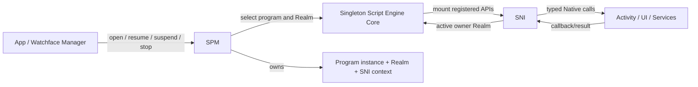

# Script Engine Overview

The script runtime lets Applications and Watchfaces share a single JavaScript execution, Realm, module loading, and Native API boundary. It is coordinated by three different owners: the App/Watchface Manager selects the installed identity and Activity to open; SPM manages script program instances and their lifecycle; Script Engine Core executes JS; SNI safely connects registered capabilities and Native resources to each program Realm. The App/Watchface Manager requests program startup and resumption through SPM, and SPM is the management boundary between the program lifecycle and Script Engine Core.

## Core State and Program Lifecycle

Script Engine Core is a global JavaScript executor responsible for engine initialization, Realm, module resolution, execution, garbage collection, and engine-level error recovery. SPM creates a Program with an independent Realm and SNI context, and stores the installed identity, type, permissions, and the `ACTIVE`, `SUSPENDED`, `STOPPING`, `TERMINATED` lifecycle states. Core's execution state describes the current engine invocation window and is not equal to the lifecycle of a particular Program: after `main.js` finishes executing, Core can return to `IDLE` while the Program remains `ACTIVE`, and its Realm can still be re-entered through timer/event callbacks.

| Layer | State it owns | State it does not own |
|---|---|---|
| App / Watchface Manager | Installed ID, entry selection, startup/switching flow for the corresponding Activity | JerryScript Realm and SNI Native resources |
| SPM | Program instance, Realm association, program state, program-level errors, and callback gate | Activity page stack policy, device service policy |
| Script Engine Core | Global engine state, JS invocation, Realm execution, module resolution, and engine generation | Application navigation, Recent Apps cards, and hardware capabilities |
| SNI | Per-Program JS/Native API mapping, handles, and callback owner | Activity stack, service cache, and Vendor devices |

When an application is retained by Recent Apps, SPM can keep its Program/Realm `SUSPENDED`; resuming restores the same instance and does not re-execute `main.js`. A new application entry runs `main.js` synchronously through SPM; this call occupies the execution context that initiated the launch, and JS does not run in parallel just because a loading Activity is shown first. Different programs cannot execute JavaScript in parallel; scheduling and suspension policy are decided by SPM/the caller.

## Package Identity and Module Loading

Applications and watchfaces use the same EPKG v1 `.epk` container; `package_type` distinguishes Application from Watch Face, the `id` in `manifest.json` is the runtime identity, the API level is used for compatibility checks, and permission declarations are used for the authorization flow before launch. Package format, integrity verification, and installation belong to the Package/App boundary; the Script Engine receives an already-prepared program package and is not responsible for transport, installation, or uninstall UI. For the installation package structure, see [EPKG v1 Installation Package Format](./package_format); for the project and build tools, see [ElenixOS-Toolkit](../development/toolkit).

`main.js` is the program entry point. Module resolution is based on the program package path, normalizes module identifiers, and caches resolution results to maintain module instance semantics within the same program; the corresponding module state is cleaned up when the program/engine is released. Scripts can import files through the current package's module resolution mechanism, but this does not mean that a general-purpose Storage API automatically forms an application sandbox; the file access boundary is defined by the corresponding public API, see [Storage Contract](./services/storage).

## API and Native Extension Boundary

Each Realm mounts the registered `lv` and `eos` APIs at creation time. SNI descriptions/bindings determine what scripts can call, how Native values are converted, who owns objects, and which Realm a callback returns to. An arbitrary C function or Vendor driver does not automatically become a script capability just because it is linked into the system; new script capabilities are selected from stable Framework/Service interfaces and explicitly registered through SNI.

Handle allocation, invalidation, explicit deletion, and fallback cleanup on program stop are part of the SNI contract. The types, return semantics, and lifecycle of public APIs constitute the script interface; internal handle numbering, Realm switching methods, resource linked lists, generator artifacts, and Native address mapping are implementation details. For specific ownership, suspension, and asynchronous callback rules, see [SNI Architecture and Lifecycle](./script_engine/sni).

## Exceptions, Engine Rebuild, and Program Recovery

Syntax/module errors, catchable JavaScript exceptions, and JerryScript fatal errors are different failure paths. A normal program stop ends a Program/Realm; a fatal reset rebuilds the JerryScript heap and the SNI global registration state within the current process. It does not restart the operating system process.

### Normal stop and Core Cleanup

When SPM normally terminates a Program, it first closes that program's callback gate, cleans up SNI references and page resources, and then calls Core stop/release Realm. Core releases the current Realm, module references, and execution state and returns to `IDLE`; the JerryScript global heap remains available for subsequent Programs. The full Core clean-up path separately calls `jerry_cleanup` and enters `UNINITIALIZED`, which is not at the same level as the normal stop of each Program.

### Fatal reset capture and rebuild

JerryScript's fatal port returns to the recovery point via `setjmp`/`longjmp` within the fatal scope established by Core. During a Program's first run, the scope is established by `script_engine_run`; when subsequently entering JerryScript from a callback, the scope is established by the callback invocation path. Core saves the identity and error information of the crashed Program, then rebuilds the engine in the following order:

1. Clean up the module queue, module references, Realm switching state, and current script package state held by Core.
2. SPM marks all Programs as `STOPPING`, suspends LVGL timer dispatch, cleans up event descriptors and Sensor requests, invalidates timer/animation callbacks, cleans up Program Views, and destroys all SPM Programs and Recent Apps records.
3. The fatal heap may still contain JerryScript handles that cannot be safely inspected or freed. The recovery path does not perform a normal SNI resource sweep; to avoid using records that are corrupted or still on the C call stack, some SNI/Native bookkeeping and resources are retained. The old SNI context shells and Program records are invalidated.
4. Core calls `jerry_init` to reinitialize the JerryScript heap, calls `sni_init` to rebuild the SNI type and API registration state, increments the engine generation, then reopens LVGL timers and sets the Core state to `IDLE`.
5. New Programs create new Realms, SNI contexts, and wrappers through the regular SPM startup path. Old Realms, JS values, handles, callbacks, and Programs are not restored or migrated.

This recovery only holds within a valid fatal scope. If a JerryScript fatal occurs at a location with no active scope, or is triggered again during fatal recovery itself, the current port aborts the process and cannot transition into the rebuild flow described above.

### How applications are handled after a rebuild

Core automatically rebuilding JerryScript does not mean that every crashed Program is automatically restarted. Program-level recovery is determined by the triggering path and the application type:

| Scenario | Handling after engine rebuild |
| --- | --- |
| Fatal during the first launch of main.js | After `script_engine_run` completes the heap rebuild, it returns the execution error to the launcher; the launcher displays the error and handles the failure, and no separate delayed fatal event is published. |
| Fatal in a runtime callback of an Application | Core publishes `EOS_EVENT_SCRIPT_FATAL` with a delay; the App manager displays a Restart/Exit error panel. After choosing Restart, a new Activity and a new SPM Program restart the application; the default path does not automatically restart that application. |
| Fatal in a runtime callback of a JavaScript Watchface | The Watchface manager displays a Restart/Switch panel; after the user chooses, a new Activity and Program are rebuilt through the regular watchface switching path. |
| Console fatal | The delayed fatal event is handled by the App manager: clean up the old Activity sub-stack and recreate the Watchface; if the foreground before the crash was a script Application, restore that application with a new Activity and a new Program. Native/System Applications are not restarted as script Programs. |

Fatal notifications during callback execution are published with a delay via `Dispatcher`, so that Core completes the heap rebuild and timer recovery before entering the App/Watchface handling path. SNI loses all old contexts in a global reset; for the local boundaries of handle and resource cleanup, see [SNI Architecture and Lifecycle](./script_engine/sni).

Ordinary `SUSPENDED`, engine `IDLE`, or catchable script exceptions are different states from a fatal reset; whether Realms, Activities, and service requirements are retained depends on the lifecycle contract of the corresponding owner.

## Execution Time and Thread Boundary

Script Engine Core does not provide parallel JS threads. `main.js`, ordinary synchronous SNI APIs, and callbacks in `spm_call` all run on the current call stack; a timer, LVGL event, or Native async request only determines when JS is entered again, and does not turn a callback into a background thread. Native callbacks are delivered into the registered owner's Realm by a runtime context suitable for operating on JerryScript.

By default, Core limits a single synchronous JS execution to 3000 ms. JerryScript periodically calls the stop callback during VM execution, and Core checks the elapsed time based on the monotonic tick since startup; a timeout ends the current JS execution and returns to the calling path with `EOS_ERR_TIMEOUT`. Native Core can set the threshold to `0` to disable this check.

The stop callback only checks time while JerryScript is executing, and does not preempt a Native C function that has already been entered and is blocking. If file I/O, decoding, a Native API, or a synchronous callback occupies the current call stack for a long time, it will still delay the UI/Core main loop; whether there is a Dispatcher or a device-specific queue depends on the corresponding service contract. Therefore, execution timeout only covers the JS execution intervals that the VM can check.

## Continue Reading by Lifecycle Topic

- [Application / Framework Contract](./application_contract): installation identity, launch, suspension, resumption, and program stop.
- [Runtime](./runtime): system-level relationships among Activity, View, events, thread contexts, and platform initialization.
- [SNI Architecture and Lifecycle](./script_engine/sni): JS handles, callbacks, asynchronous requests, and teardown ordering.
- [Platform / Vendor Contract](./platform_contract): device and service boundaries beneath the script API.