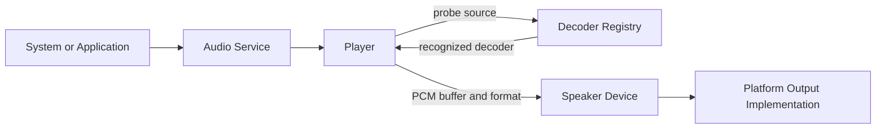
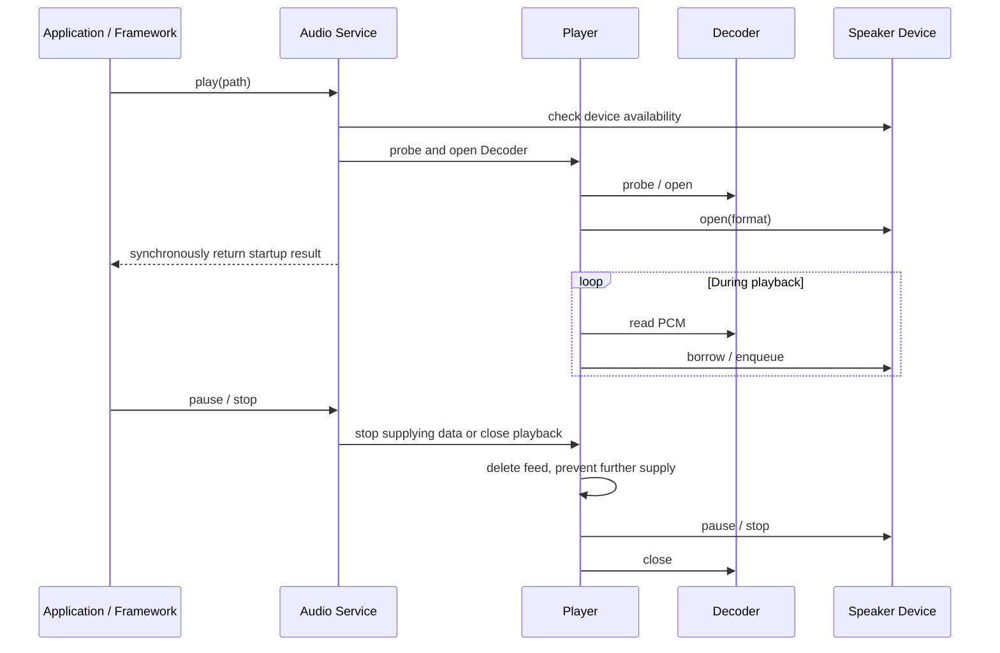

# Audio Service

The Audio Service coordinates playback control, format decoding, speaker output, and microphone recording. Applications express playback or recording intent through the service; the service manages player state and device access, and does not let applications directly control the Codec or platform audio ports.

## Playback Chain and Replaceable Decoders

A Decoder parses an input source into PCM frames consumable by the player. Registry entries provide the player with source probing, open, read, close, and optional seek capabilities; the Player manages generic playback state and submits decoded buffers to the speaker device. This separates Codec file-format logic from pause, resume, seek, and the output queue.

The Decoder registry is the format extension point; the Player's scheduling logic calls probes in registration order and uses the first Decoder that accepts the source. The current WAV Decoder is registered in the Audio Service initialization path, and overlapping probes create a selection-order dependency. An opened playback descriptor borrows the Decoder registry node until the corresponding close completes; Core currently has no active reference counting or safe hot-unload protocol.

After opening the Decoder, playback hands its sample rate, channel count, and bit depth to the speaker device. The Player does not take on Codec-specific processing, and Core has no generic PCM transcoding layer; startup succeeds when the device accepts the format and fails when it does not.

## Feed and Platform Output

Playback does not synchronously read the entire audio in the caller's startup path; the feed clock subsequently drives buffer filling. The current default feed uses an LVGL timer, so callbacks execute in the LVGL main loop. Platforms can replace the feed implementation to hook into RTOS/DMA clocks, and the replacement does not change the data contract between Decoder and Player. The Player's supply callback reads the file, decodes, and submits speaker buffers; implementations using an ISR feed need to defer these operations to a context that can execute them, or provide corresponding interrupt-safe capabilities. The default feed is not a background worker thread.

The speaker device provides capabilities such as opening a format, borrowing/submitting buffers, pause/resume, stop, and playback progress through typed operations. Devices and ports may be missing or may not support a particular operation, and the Audio Service returns the corresponding failure to the caller. The playback instance is held uniformly by the service, and callers do not own the player's internal state.

## Request, Continuous Execution, and Stop

A synchronous success from `play` only means the Decoder and speaker have accepted startup; subsequent file reads, decoding, and PCM consumption continue. The default feed supplies data in the LVGL timer callback, so a single file read or Decoder block occupies the main loop. Failure is returned during startup when no Decoder is found, the device is missing, the format is not accepted, or resources are insufficient; asynchronous port failures after startup have no unified playback error event contract. If the speaker provides a drain query, the Player waits for queued samples to be exhausted before ending naturally; without that capability, Core cannot prove that the last sample has been physically output.

Pause pauses data supply and preserves Decoder/player state; stop deletes the feed, stops the speaker, and closes the Decoder. The service holds a copy of the playback source path for seek/reopen, but the `src` pointer exposed by the Decoder descriptor has no documented borrow period in the public interface. The current WAV implementation establishes its own file handle when opening the file; a new Decoder that needs to continue using source data after `open` returns should copy/hold it itself, and cannot rely on the caller's temporary string remaining valid.

## Recording, Volume, and Configuration

Microphone recording is managed by the Audio Service: the service creates a DMA-shared ring buffer and hands it to the microphone device, periodically reads the device's write cursor, handles buffer wrap-around, and writes new samples to a WAV file. The current format is fixed at 16 kHz, mono, 16-bit PCM. On stop, the service reads the unread interval at the cursor once more, then stops and closes the microphone, backfills the WAV length, and frees the buffer. Speaker and recording input are separate device capabilities; the presence of a speaker does not imply the presence of a microphone.

Volume and mute are saved by the service and applied to the speaker; mute does not overwrite the saved volume value. Playback still reads and decodes source data to advance the playback position and end naturally, and only fills the PCM buffer submitted this time with zeros; after unmuting, the original volume takes effect again. The specific volume control granularity and hardware behavior depend on device capabilities.

## Ownership and Extension Constraints

- Decoder registry entries are established during service initialization and held by the registry; the Decoder descriptor opened for playback and its source resources are closed by the Player on the end path.
- New formats are extended through Decoder registration; format probing and decoding are not implemented in the Audio Service or the speaker device.
- Platform speaker and microphone implementations provide device operations and do not hold application playback policy or page lifecycle.
- The feed implementation can be replaced by the platform; the execution context of the supply callback and buffer ownership determine the callable scope of LVGL, the script runtime, and speaker operations.
- The player instance is held by the Audio Service, and the application-side control entry point is the Audio Service API.
- The public device header does not fully define buffer ownership and reuse timing after Speaker `borrow`/`enqueue`, so these operations have no cross-platform unified guarantee.

For upper-layer start/stop and asynchronous completion semantics, see [Application Contract](../../application_contract); for device registration and Vendor PCM responsibilities, see [Platform/Vendor Contract](../../platform_contract).