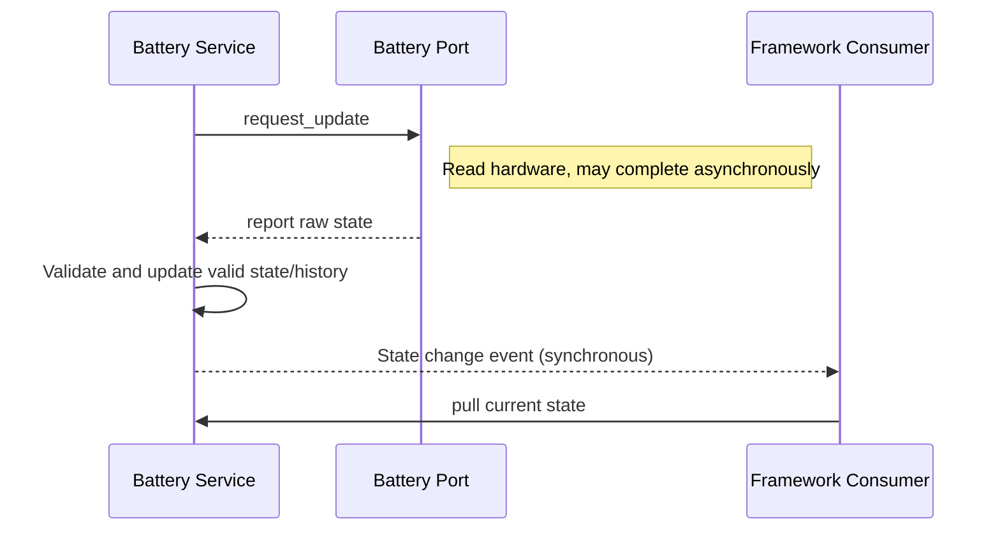

# Battery Service

The battery service is a combination of pull requests and push reports: the Service calls the device's `request_update` according to initialization/timer policy, and the Vendor reports data after obtaining it; the Service validates the percentage, updates the state snapshot/history, and synchronously publishes events on meaningful changes. The percentage reported by the platform device is the primary source of battery level; Core does not derive battery level from voltage on behalf of the Vendor at the application layer or in the Service.

## Sampling Policy

The service automatically selects normal, low power, and charging modes based on the battery level when not charging and the charging status. The default policies are as follows:

| Mode | Entry Condition | Request Interval | Battery Event Threshold |
|---|---|---:|---:|
| Normal | Not charging and battery level above 20% | 60 seconds | 1 percentage point |
| Low Power | Not charging and battery level at or below 20% | 300 seconds | 2 percentage points |
| Charging | Charging | 5 seconds | 1 percentage point |

The Service requests an update immediately upon initialization, after which an LVGL timer requests periodically according to the current mode. The device's `request_update` has no synchronous read return value; the state is only updated after the device reports. Events are triggered according to the thresholds in the table above or on charging status changes, and are not broadcast on every poll. The mode intervals and thresholds are currently fixed in the Battery Service implementation and are not Kconfig options.

## State and Notifications

Consumers can pull the current snapshot or subscribe to battery level/charging changes. Service events are triggered by change thresholds rather than broadcast on every sample. When there is no valid device reading yet, the state remains invalid, and default values do not represent real measurements. The device request entry point does not return sampling results; a successful initialization also does not mean the first valid value has been received.

The service also aggregates capacity, cycle count, and battery level change history; the change history stores up to 128 entries, overwriting the oldest entry when full, and identical consecutive battery level/charging states are not recorded repeatedly. The history count and entries are read via the service API, and consumers should not directly modify the internal records.

Device registration and `request_update` are part of the platform-side contract; after the update report completes, events execute synchronously in the context of the report call. When the platform reports from an ISR, all battery event subscribers also run synchronously in that ISR context, so this path is only suitable when the entire downstream callback chain has been confirmed to be executable in interrupt context; in other cases, the platform defers to an appropriate task/Core context first. For general responsibilities, see [Platform/Vendor Contract](../../platform_contract) and [Application Contract](../../application_contract).