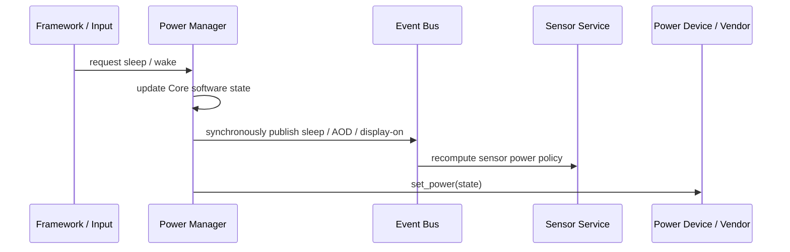

{"translation": "---
sidebar_position: 10
title: Power Management Service
---

# Power Management Service

The Power Manager maintains the display/sleep policy as seen by the Core and hands the required power actions to the power device. It is the owner of the system state, not a feedback sensor for the physical power controller; the software state observed by callers does not necessarily prove that the hardware has completed the transition.

## Requests, States, and Platform Actions

The system states are display-on, AOD, and sleep. A sleep request turns into AOD when AOD mode is enabled, otherwise it enters sleep; a wake turns into display-on. State events are published by the synchronous Event Bus, and then the service performs the platform `set_power` operation.

Currently the return value of `set_power` is not propagated to the caller, and the state is not rolled back on platform errors; when the power device is missing, the Core logs an error, but there is no generic asynchronous "hardware rejected/completed" result. The event indicates that the Core state has changed, not that the hardware has confirmed it. If a product requires reliable confirmation, an explicit confirmation and failure contract must be added for the Power Device/Service.

Sleep pauses the Power Manager's timer; the sensor service observes the synchronous state events, applies an interval floor in low-power/AOD mode, turns off sensors during sleep but retains the demand, and restores them according to the remaining demand after wake.

## Upper-Layer and Lower-Layer Responsibilities

- The Framework, input, and system policy request sleep/wake, always-on mode, or a timeout; applications do not directly rewrite the device power state.
- The Power Manager is responsible for the software state, timeout policy, configuration, and state events; it does not own board-level power rails, display panel sequences, or chip sleep flows.
- The Vendor registers the state transition operations of the power device and implements the states that the target platform can support. Successful device registration does not mean that every state such as AOD or sleep has a hardware implementation.
- When the platform cannot provide a certain state, the integration should explicitly express the capability; the current single `set_power(state)` interface has no generic discovery protocol for independently querying the support status of each state.

Automatic sleep only happens when the service actually creates a timer. The timeout setting only updates the period of an existing timer; if the current build/configuration does not create a timer, an explicit request can still change the software state, but it will not be triggered automatically by the timeout.

The current Core source hardcodes `DEBUG_DISABLE_TIMER` to `1`, so the current build does not create an automatic sleep timer. When the configuration key `sleep_timeout_sec` is missing, the period baseline is 15 seconds, but this value only takes effect in target builds that create a timer; in the current Simulator/this Core version, waiting 15 seconds will not automatically enter AOD or sleep. Explicit sleep/wake requests and input wake state transitions still work along the paths described above.

For platform responsibilities, see [Platform/Vendor Contract](../../platform_contract); for the input wake path, see [UI and Input Architecture](../../ui).
"}
}