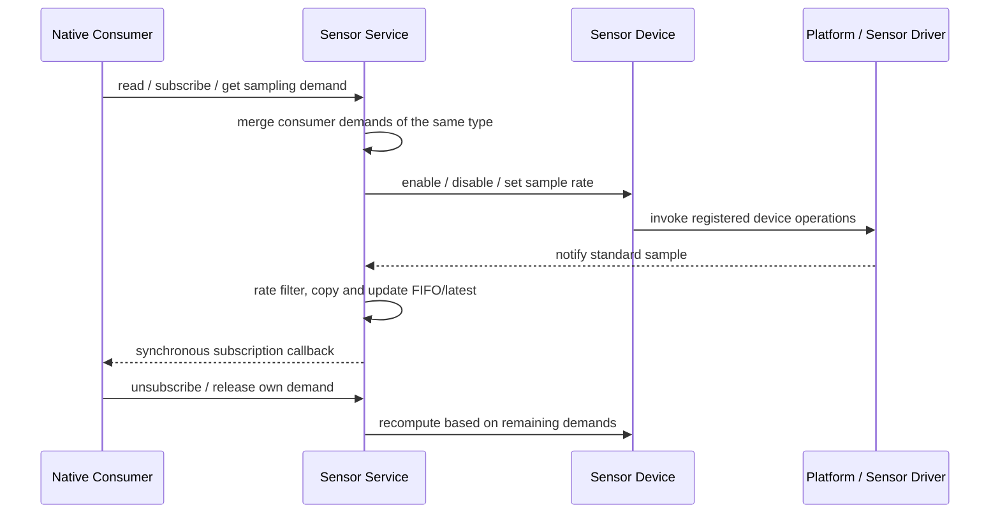

# Sensor Service

Sensor Service is the state and sampling coordinator between sensor devices and Native consumers. Devices provide sampling control and standard samples; the service holds per-type FIFO/latest, Native subscriptions, and sampling demands; applications obtain data by reading, subscribing, or through higher-level Metrics. JS currently does not directly subscribe to raw Sensor samples.

## Protocol from Request to Sample

Vendor's control and data directions are opposite: the service issues enable/rate to the device based on effective demands; Vendor hands back the standard type, data, and acquisition time to the service after obtaining a sample. `eos_sensor_notify` copies the input parameters, maintains the FIFO and latest, and synchronously iterates subscribers outside the critical section. The sample pointer received by the callback is only valid during that callback; it must be copied to be retained.

## How Consumers Read or Subscribe

- Native Pull can take the earliest unconsumed sample from the FIFO, or read a latest snapshot that does not consume the FIFO. Returns not-found/invalid when there is no sample yet; a zero value can be a valid sample, and only the timestamp and validity indicate whether data has ever been received.
- Native Push subscriptions are held by the service. When the subscription's minimum interval is greater than zero, an independent sampling demand is also created; when the interval is zero, only the callback is registered and it is not responsible for starting the sensor. Unsubscribing releases that subscription's own demand, and self-unsubscription within a callback is deferred to a broadcast safe point for cleanup.
- Algorithm requests and explicit demands each also have their own demand ID. The compatibility interface `eos_sensor_set_sample_period` is not a per-consumer isolated handle: the current implementation has only one shared compatibility demand per type, and multiple callers update the same demand. New Native consumers should use an independent demand lifecycle.
- JS `eos.sensor.readLatest` reads the service cache but has no raw subscribe. `eos.metric` can periodically notify semantic data; for sensor sources, it reads the Sensor Service cache and does not guarantee that one callback corresponds to one hardware sample.

## Arbitration, State, and Effective Period

The service takes the shortest interval among all effective demands per type, then applies the current power policy's minimum interval or disable policy. The sampling period is the output cadence required by consumers, not the hardware ODR that Vendor must precisely achieve; whether the device can accept it is reflected through operation capabilities and state. Releasing one consumer must not lower/disable a sensor still needed by other consumers.

Switching from display-on to AOD uses the low-power lower bound; sleep turns off active devices but retains demands, and on wake recomputes based on still-effective demands. Establishing a demand may fail when the service lacks a bound device, the device state is error, or the current policy prohibits enabling; Core should not fabricate valid samples.

### Sample Fields, Units, and Capacity

Native `eos_sensor_data_t` and JS `eos.sensor.readLatest()` use the following standard semantics. Only fields already exported by SNI can be read from JS; among them, `timestamp` exists for all JS results.

| Type | Field | Unit and Conversion |
|---|---|---|
| `ACCE` | `x/y/z` | milli-m/s²; divide by 1000 to get m/s², approximately 9807 represents 1 g. |
| `GYRO` | `x/y/z` | milli-deg/s; divide by 1000 to get deg/s. |
| `MAG` | `x/y/z` | nT; divide by 1000 to get µT. |
| `TEMP` | `temp` | milli-°C; divide by 1000 to get °C. |
| `BARO` | `pressure`, `temperature` | pressure is absolute Pa; temperature is milli-°C, divide by 1000 to get °C. |
| `HUMIDITY` | `humidity` | milli-%RH; for example 50000 represents 50.000 %RH. |
| `LIGHT` | `lux` | lux, no scaling. |
| `PROXIMITY` | `distance_mm` | mm, no scaling. |
| `HR` | `heart_rate` | BPM, no scaling. |
| `SPO2` | `spo2` | percentage, typically 0–100. |
| `STEP` | `steps` | monotonically accumulated step count, not step rate or delta. |
| `ECG` / `CAP` | `ecg` / `cap` | project-defined source counts; there is currently no dependable physical calibration for voltage or capacitance. |
| `PPG` | `red` / `ir` | optical front-end ADC counts; this is the raw optical source value, not a heart rate result. |

The sample timestamp is the platform's monotonic milliseconds since boot at acquisition time, not wall-clock or Unix time. A value of zero can be valid data; when there is no sample yet, the Native latest API returns `EOS_ERR_NOT_FOUND`, while JS's initialized valid types can still return all-zero fields, so JS callers should check `timestamp` and not merely whether the object is `null`.

Three-axis data uses the ElenixOS right-handed device coordinate system. The Core contract fixes the right-handedness of the coordinates, while the physical mounting orientation is specified by each board-level platform; the platform completes chip axis and mounting transformations before reporting, and applications no longer perform axis swaps/flips per board or chip.

Each Sensor Type's FIFO holds 64 samples by default. When there is insufficient write space, the oldest entry is discarded to accept the newest sample; the latest snapshot is updated independently and is not affected by FIFO consumption. The sampling period is an output cadence request and does not guarantee a precise hardware ODR.

## Lifecycle and Context

The Sensor device must be registered before the Sensor Service; the Service fixes the current default device for each type and creates caches during initialization. Registration later than service initialization will not automatically rebind, and there is currently no sensor hot-plug, default device priority, or failover mechanism. Platform integration must also separately initialize the Sensor Service; `eos_init()` currently does not handle this step.

Native subscriber nodes and demands are managed by the consumer owner. Native Activity or program termination does not automatically invalidate arbitrary `user_data` and replace unsubscription; the owner must explicitly unsubscribe in the stop/destroy path. SNI-managed Metric callbacks, however, belong to the script context, are checked by SNI per program/generation, and are released when the context is cleaned up.

`eos_sensor_notify` synchronously executes Native consumer callbacks in the publisher's context. Therefore, if Vendor obtains data from an ISR, it must first defer through a platform task/Dispatcher to a context where Core callbacks are allowed to execute; unless it can be proven that the entire downstream callback chain is ISR-safe. The service does not call consumers while holding a critical section, but it also does not automatically redirect publishing to the LVGL main loop.

## Handoff Boundaries

- [Platform/Vendor Contract](../../platform_contract): registration timing, sample conversion, notify context, and multi-device selection rules.
- [Application Contract](../../application_contract): consumption rules for Pull, Native subscription, Metric, and program lifecycle.
- [Metric Service](../metric): the semantic data boundary for watch faces/scripts.