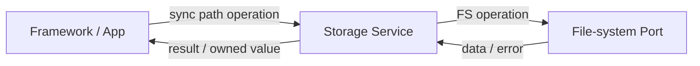

# File System Module

The storage service provides synchronous JSON, file, and directory operations on top of a platform file-system port. Currently, whole-file writes perform file operations directly, with no active batched deferred-write queue. The platform port is responsible for the file-system implementation of the current target; the service API accepts paths and handles and does not imply an application identity or script sandbox.

## JSON and File Data

JSON data supports typed reads and updates. When a key is missing or the type does not match, reads use the caller-provided fallback value. Dynamic strings and parsed JSON trees are freed by the caller according to their allocation source.

JSON and whole-file data writes complete within the current call; recursive deletion affects the entire target directory tree, and the path boundary must be confirmed before calling.

## File and Directory Resources

Files and directories are accessed through explicit handles. A failed open returns an invalid handle; a handle becomes immediately unusable once closed, and subsequent reads and writes are no longer valid. Directory reads write entries one by one into a caller-provided buffer. Space queries and other device capabilities may be unsupported depending on the platform, and callers identify failures through the return result.

File handles and whole-file convenience APIs both access the file system on the current call path; large-file I/O may occupy the calling context. The write of the whole-file API returns the result of the current write operation, but does not indicate that a higher-level application transaction has been atomically committed.

## LVGL File System Adaptation

When the Storage Service initializes, it registers an LVGL file-system driver adapter. LVGL's open, read, write, seek, and directory operations are routed through this adapter to the same storage service handle interface; the read cache is disabled, and when a file/directory is closed the adapter closes the corresponding Storage handle and frees its wrapper record. The driver letter is determined by the build configuration and is kept consistent with LVGL's default file-system drive letter.

## Paths and Isolation

The script interface constructs the package `assets/` and application/watch-face configuration directories based on the current program identity; these path rules belong to the SNI layer. The generic Storage API does not rewrite or restrict paths based on the current script identity, and therefore does not provide an automatically isolated application sandbox. Newly added JS file capabilities define path constraints at their interface boundary before calling the generic storage operations.

The system uses logical paths beginning with `/`. `EOS_SYS_ROOT_DIR` determines the mapping from the logical root to the platform file system: Simulator Native sets it to the repository's `fs/` directory, WASM uses the `/` virtual root, and MCU platforms typically use the root directory `/` of a mounted file system. As a result, application package and system directory names are consistent across platforms, but their actual absolute paths on the host differ.

| Logical Path | Content |
|---|---|
| `/.sys/config/cfg.json` | System configuration file. |
| `/.sys/app/apps/<app-id>/` | Installed Application; the root directory contains `manifest.json` and the runtime entry `main.js`. |
| `/.sys/app/app_data/<app-id>/` | Application persistent data directory, e.g. the application configuration used by `eos.config`. |
| `/.sys/wf/faces/<watchface-id>/` | Installed Watch Face; the root directory contains `manifest.json` and the runtime entry `main.js`. |
| `/.sys/wf/wf_data/<watchface-id>/` | Watch Face persistent data directory. |
| `/.sys/res/font/` | System font resources; the default TTF relative filename is `font.ttf`. |

Under Simulator Native, for example, `/.sys/app/apps/demo/main.js` corresponds to `fs/.sys/app/apps/demo/main.js` in the repository. In many places, Core uses a fixed buffer of `EOS_FS_PATH_MAX` bytes when composing paths; the Simulator project defaults to 256 bytes, and the buffer must also leave room for the trailing NUL. This is not a rejection rule unified across APIs: the return value or truncation handling for overlong paths is determined by the specific API. The buffer size can be adjusted via the File system configuration group in Kconfig. For platform mapping and build defaults, see [Kernel Configuration System](../../../development/kconfig).

The platform port is responsible for mapping logical paths to the target file system and for providing the results of operations such as open/read/write/seek; it does not determine whether a given script is authorized to access that path. Script resource encapsulation, application configuration namespaces, and any path normalization/out-of-bounds rejection logic must be handled by the upper-layer API that calls it.

For application paths and caller responsibilities, see [Application Contract](../../application_contract); file-system registration and the virtual root are defined by the [Platform/Vendor Contract](../../platform_contract).