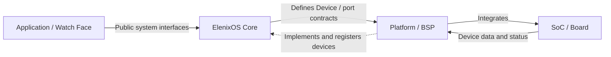

# Quick Start

ElenixOS is an open-source embedded operating system for smartwatches and resource-constrained wearable devices. ElenixOS Core provides the Framework, script runtime, system services, and device abstraction; Platform / BSP projects connect these system capabilities to specific SoCs, Boards, and peripherals. Application packages, board-level firmware, and the Simulator desktop program are distinct deliverables.

Development tools and the Simulator are auxiliary environments chosen per task, not part of the system runtime.

The currently public PSoC Edge E84 integration is still under development and has not yet formed a stable port. The Simulator is suitable for desktop UI and some platform-independent logic iteration, but does not replace board-level driver, power consumption, timing, and flashing verification.

## Choose Your Development Path

| Goal | Where to Start | What This Path Involves |
|---|---|---|
| **Application Development** | [Application Development Tutorial](./application_development) | Application model, project entry point, EPKG build, installation, and running. The official VS Code project and package workflow use [ElenixOS-Toolkit](../development/toolkit); the Toolkit is not a unified prerequisite for system operation. |
| **Watch Face Development** | [Watch Face Development Tutorial](./watchface_development) | Watch face root page, Watch Face type EPKG, installation, and switching. The Toolkit does not currently provide a watch face project template; the tutorial explains the steps to manually prepare the entry file. |
| **Platform / BSP / Vendor Integration** | [Platform and Board Integration](../integration/overview) | Core's device and port contracts, target BSP, board-level firmware, boot, and hardware integration. Choose a specific Board first, then use that project's own toolchain and build process. |
| **Core Development** | [System Architecture](../architecture/arch) and [Core Development Contract](../architecture/core_development_contract) | Core's dependency boundaries are described on the architecture page; the source code is in the [main repository](https://github.com/ElenixOS/ElenixOS/tree/main/src), and the testing and contribution process is described in the [Testing Guide](../development/testing/overview) and [Contributing Guide](../contributing). When you need a runnable target, use the [Simulator path](../simulator/overview) or the corresponding [Platform / Board project](../integration/overview). |
| **Simulator Rapid Iteration** | [Simulator Guide](../simulator/overview) | Environment, build, and run for Native / WASM desktop targets. It is an optional development auxiliary environment, not the default deployment target or board-level firmware builder. |
| **Understand the System First** | [System Architecture](../architecture/arch) | The main relationships among Core, Platform, Application, Runtime, Service, and Device. |

## Three Different Build Artifacts

- **Board-level firmware** is built and flashed by Platform / BSP projects for a specific SoC and Board. The project, toolchain, configuration, and download method are defined by the specific platform project; choose a target from the [Board-level Firmware Build Path](./build).
- **Application / Watch Face installation packages** are generated as `.epk` by the development workflow, then installed onto a system already running ElenixOS; they are not firmware images.
- **The Simulator** is built by the host toolchain as a desktop program or WASM page for auxiliary development; it does not generate Board firmware.

The public entry point ends here. The complete commands, code, configuration, deployment, and expected results for each role are located in the corresponding task tutorials; for interface queries, see the [JavaScript API Reference](../architecture/script_engine/elenix_os).